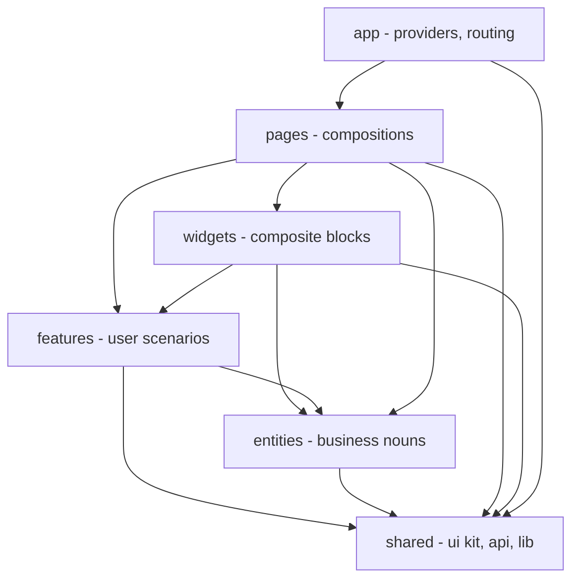

# Feature-Sliced Design (FSD)

## One-line Definition

Feature-Sliced Design is a **frontend architectural methodology** that organizes UI code into layers (`app`, `processes`/`pages`, `widgets`, `features`, `entities`, `shared`) with strict import rules: higher layers may use lower layers, never the reverse.

## Problem It Solves

Large React and Next.js apps rot into `components/`, `hooks/`, and `utils/` dumps where any file imports any other. FSD makes feature ownership and dependency direction explicit so teams can scale the UI without accidental coupling.

## When to Use It

- Medium to large frontend teams (often 3+ frontend engineers)
- Product with many entities and user scenarios (dashboards, marketplaces, SaaS consoles)
- Long-lived codebase where import discipline matters more than short-term speed
- Expected scale: dozens of screens and shared entity models
- Maintenance: multiple people touching UI weekly without stepping on each other

## When Not to Use It

- Tiny MVP / marketing site with few screens — layer ceremony outweighs benefit
- Team unfamiliar with FSD who will invent custom “layers” inconsistently
- Backend-only services — FSD is not a Hono architecture
- When you only need feature folders (vertical slices) without the full layer taxonomy

## Best Fit by Application Type

| Application type | Fit | Why |
|---|---:|---|
| Small React SPA | Poor | Too much structure for few features |
| Large React dashboard | Good | Entities + features + widgets map well |
| Next.js App Router app | Good | `app/` = App Router; features/entities below |
| Hono API | Poor | Backend should use modules/slices, not FSD layers |
| Background worker | Poor | Not a UI organization model |
| Mobile app API | Poor | API side; mobile UI can use FSD separately |
| Marketplace / booking system | Good | Rich entities (listing, booking, payment) |
| Internal admin panel | Medium | Good if large; overkill if few CRUD screens |

## Frontend, Backend, or Both?

**Frontend organization** (cross-cutting UI structure).

In React + Next.js + Hono:

- Apply FSD in `apps/web` (React SPA or Next.js)
- Keep Hono in modular / vertical-slice / hexagonal style
- Share only primitives (`packages/shared`) — not FSD layers — with the API
- Next.js `app/` directory is the FSD **app** (and pages) layer entry

## Core Rules

Standard FSD import direction (high → low only):

```text
app → pages → widgets → features → entities → shared
```

- Lower layers **must not** import higher layers
- `features` must not import other `features` (compose in `widgets`/`pages`)
- `entities` must not import `features` or `widgets`
- `shared` has zero business feature knowledge
- Public API per slice: import from `entities/booking` index, not deep internals
- UI may call Hono via `shared/api` or feature-level API modules — never import server domain packages into client bundles carelessly
- Business rules that must be authoritative stay on the server; client entities hold view models and light invariants only

## Dependency Diagram



## Recommended Folder Structure

### 1. React frontend

```text
apps/web/src/
  app/
    App.tsx
    providers.tsx
  pages/
    booking-checkout/
      ui/BookingCheckoutPage.tsx
      index.ts
  widgets/
    booking-summary/
      ui/BookingSummary.tsx
      index.ts
  features/
    create-booking/
      ui/CreateBookingForm.tsx
      model/useCreateBooking.ts
      api/createBooking.ts
      index.ts
    apply-promo-code/
      ui/PromoCodeField.tsx
      model/usePromoCode.ts
      index.ts
  entities/
    booking/
      model/types.ts
      model/status.ts
      ui/BookingStatusBadge.tsx
      index.ts
    listing/
      model/types.ts
      ui/ListingCard.tsx
      index.ts
  shared/
    api/http.ts
    ui/Button.tsx
    lib/money.ts
```

### 2. Next.js App Router frontend

```text
apps/web/
  app/                                 # FSD app + pages entry
    (marketing)/page.tsx
    (app)/bookings/
      page.tsx                         # imports pages/booking-list
      new/page.tsx
    layout.tsx
    providers.tsx
  src/
    pages-ui/                          # avoid clash with Next "pages" router
      booking-list/ui/BookingListPage.tsx
    widgets/
      header/ui/Header.tsx
    features/
      create-booking/...
    entities/
      booking/...
    shared/
      api/client.ts
      ui/...
```

> Note: Next.js owns `app/`. Keep FSD `pages` compositions under `src/pages-ui` or `src/views` to avoid confusion with the old Pages Router.

### 3. Hono backend

FSD does **not** apply. Use modules + slices:

```text
apps/api/src/modules/bookings/...
```

### 4. Monorepo

```text
apps/web/                 # FSD inside the web app
apps/api/                 # modular backend
packages/shared/          # zod schemas / money — maps to FSD shared, not entities
```

## Implementation Example

```ts
// entities/booking/model/status.ts
export type BookingStatus = "pending" | "confirmed" | "cancelled";

export function canCancel(status: BookingStatus): boolean {
  return status === "pending" || status === "confirmed";
}
```

```ts
// features/create-booking/api/createBooking.ts
import { http } from "@/shared/api/http";
import type { Booking } from "@/entities/booking";

export function createBooking(body: {
  listingId: string;
  checkIn: string;
  checkOut: string;
}): Promise<Booking> {
  return http.post("/bookings", body);
}
```

```ts
// features/create-booking/model/useCreateBooking.ts
import { useMutation, useQueryClient } from "@tanstack/react-query";
import { createBooking } from "../api/createBooking";

export function useCreateBooking() {
  const qc = useQueryClient();
  return useMutation({
    mutationFn: createBooking,
    onSuccess: () => qc.invalidateQueries({ queryKey: ["bookings"] }),
  });
}
```

```tsx
// pages/booking-checkout/ui/BookingCheckoutPage.tsx
import { CreateBookingForm } from "@/features/create-booking";
import { BookingSummary } from "@/widgets/booking-summary";
import { ListingCard } from "@/entities/listing";

export function BookingCheckoutPage({ listing }: { listing: Listing }) {
  return (
    <main>
      <ListingCard listing={listing} />
      <BookingSummary listingId={listing.id} />
      <CreateBookingForm listingId={listing.id} />
    </main>
  );
}
```

## Testing Strategy

- **Unit:** entity pure functions (`canCancel`), feature model hooks with Query client wrapper
- **Integration:** feature UI + MSW/mock API for Hono endpoints
- **Contract:** shared Zod types between `shared/api` and Hono routes
- **E2E:** page-level flows (checkout) across features
- **Mocking:** mock `shared/api` or network; do not mock entities that are pure

## Common Mistakes

- `features/a` importing `features/b` — create a widget/page composer instead
- Dumping everything into `shared` — shared becomes the new god folder
- Putting API DTOs only in features and duplicating entity types inconsistently
- Using FSD folders without public `index.ts` APIs — deep imports break the model
- Applying FSD layer names on the backend — confuses the team

## Migration Path

1. Introduce `shared/` and stop adding to root `utils/`
2. Extract one `entities/x` from the messiest domain noun
3. Move one user scenario into `features/y`
4. Enforce lint boundaries (`eslint-plugin-boundaries` or steiger)
5. Compose pages/widgets last; leave untouched screens until edited

## Related Architectures

| Other architecture | Relationship | Why |
|---|---|---|
| Vertical Slice | Natural combination | Features ≈ slices; FSD adds entity/shared layers |
| Modular frontend | Natural combination | FSD is a concrete modular frontend methodology |
| Next.js App Router | Natural combination | `app/` hosts routing; FSD owns composition below |
| Modular monolith (backend) | Natural combination | Different categories — UI vs deployable |
| Microservices | Possible but requires discipline | One web app can still be FSD while APIs are services |
| Layered frontend (`components/hooks/services`) | Mutually exclusive at the same boundary | Pick one folder taxonomy |
| Hexagonal (backend) | Natural combination | Orthogonal concerns |
