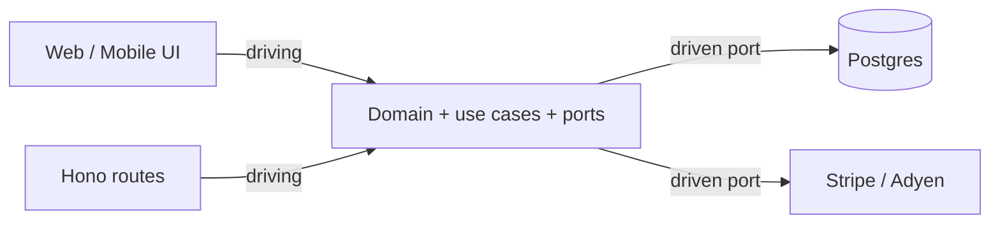
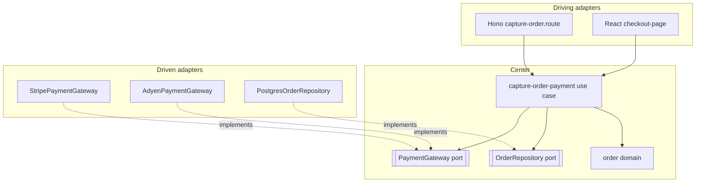

# Hexagonal architecture (ports & adapters)

## One-line definition

The **domain/application sits in the center**. **Ports** are interfaces the center owns. **Adapters** at the edges talk HTTP, UI, databases, and vendors. Nothing outside calls past the center into another edge.

## Problem it solves

When Stripe types, SQL, and React leak into business rules, you cannot swap a DB, test without Docker, or add mobile without rewriting the core. Hexagonal makes the center depend on **abstractions it defines**, and pushes details outward.

---

## 1. Dummy — 30-second picture

A hexagon (the app). Arrows come **in** from UI/HTTP (driving). Arrows go **out** to DB/payments (driven). Both sides plug into ports.



**Why it exists:** so “charge money” stays stable when the payment vendor changes.

---

## 2. When to use / when not

### When to use

- Multiple adapters: web, mobile, CLI, several DBs, multiple payment vendors
- Heavy unit testing of business rules without infrastructure
- Interview / teaching **dependency direction** (DIP in the large)

### When not to use

- CRUD with one DB and no domain logic — ceremony without payoff
- Inventing a port for every function “to look hexagonal”

### Fit by application type

| Application type | Fit | Why |
|------------------|-----|-----|
| Small React SPA | Optional | One `fetch` client is often enough |
| Next.js + Hono marketplace | **Excellent** | Multi-client + multi-DB teaching goal of this repo |
| Worker / cron | Good | Same use case, different driving adapter |
| Admin CRUD | Weak | Prefer thin layered / slice |

### Frontend, backend, or both?

**Both.** Hono routes and React pages are **driving** adapters. Postgres, Stripe, and `fetch` clients are **driven** adapters. The same use case can be driven by HTTP today and a CLI tomorrow.

---

## 3. Working — folders and a thin example

### Core rules

1. Ports live next to application/domain — **not** in infrastructure.
2. Adapters implement ports; adapters do not call other adapters for business flow.
3. Composition root (`main.ts` / `main.tsx`) is the only place that picks concrete adapters.
4. Port types must not leak `Request`, `Response`, SQL rows, or vendor SDK types.
5. Tests replace driven adapters with in-memory fakes.

### Dependency diagram



### Folder structure — Hono

```text
apps/api/src/
  core/
    domain/
      order.ts
    ports/
      payment-gateway.ts      # charge → captured | declined
      order-repository.ts
    use-cases/
      capture-order-payment.ts
  adapters/
    driving/
      hono/capture-order.route.ts
    driven/
      stripe/stripe-payment-gateway.ts
      adyen/adyen-payment-gateway.ts
      postgres/postgres-order-repository.ts
  main.ts                     # config picks Stripe vs Adyen
```

### Folder structure — React (same idea)

```text
apps/web/src/
  core/
    model/checkout-draft.ts
    ports/checkout-api.ts
    ports/payment-form.ts
    workflow/place-order.ts
  adapters/
    driving/react/checkout-page.tsx
    driven/http/http-checkout-api.ts
    driven/stripe/stripe-payment-form.tsx
    driven/adyen/adyen-payment-form.tsx
  main.tsx
```

### TypeScript — port + use case

```ts
// ports/payment-gateway.ts — owned by the center
export type ChargeResult = { status: "captured" } | { status: "declined"; reason: string };

export interface PaymentGateway {
  charge(input: { orderId: string; amountCents: number; token: string }): Promise<ChargeResult>;
}

// use-cases/capture-order-payment.ts
export function createCaptureOrderPayment(deps: {
  payments: PaymentGateway;
  orders: OrderRepository;
}) {
  return async function captureOrderPayment(orderId: string, token: string) {
    const order = await deps.orders.get(orderId);
    if (!order) throw new NotFoundError("ORDER");
    const result = await deps.payments.charge({
      orderId,
      amountCents: order.totalCents,
      token,
    });
    if (result.status === "declined") return { ok: false as const, reason: result.reason };
    await deps.orders.markPaid(orderId);
    return { ok: true as const };
  };
}
```

### Worst vs best

```ts
// ❌ Route imports Stripe and marks paid even when charge fails
await stripe.charges.create(...);
await db.execute("UPDATE orders SET paid = 1 ...");

// ✅ Route → use case → ports; decline does not mark paid
```

---

## 4. Rich — seams, failures, tests

### In-memory adapter (the hallmark)

```ts
class FakePayments implements PaymentGateway {
  constructor(private readonly outcome: ChargeResult) {}
  async charge() { return this.outcome; }
}

test("declined does not mark paid", async () => {
  const orders = new InMemoryOrders([{ id: "o1", totalCents: 1000, paid: false }]);
  const capture = createCaptureOrderPayment({
    payments: new FakePayments({ status: "declined", reason: "card" }),
    orders,
  });
  await capture("o1", "tok_x");
  expect(orders.get("o1")!.paid).toBe(false);
});
```

### Failure modes

| Failure | Ownership |
|---------|-----------|
| Declined card | Use case policy + HTTP `402` at driving adapter |
| Stripe timeout | Driven adapter maps to retryable error; use case decides idempotency |
| Double capture | Idempotency key on port / adapter |
| Port leaks `Stripe.Charge` | Boundary bug — fix the port |

### Anti-patterns

- Adapter-to-adapter calls (route → Stripe → Postgres) skipping the use case
- “Port” that is just the Prisma client renamed
- One mega-port `UnitOfWorkEverything`

---

## 5. Professional / CTO

### Cost

| Dimension | Hexagonal cost |
|-----------|----------------|
| Team | More types and onboarding; clearer ownership of edges |
| Delivery | Faster vendor swaps; slower “hello world” |
| Ops | Same deploy count as before unless you also split services |
| Risk | Low if ports stay thin; high if every widget gets a port |

### Evolution in this repo

`packages/application` owns ports · `packages/db` adapters implement them · `apps/api` and `apps/web` are driving edges — see ADRs on database adapters.

### ADR triggers

Second payment vendor · second DB engine · need to test checkout without Stripe sandbox.

### Automate

- ESLint: `core/**` cannot import `stripe` / `pg` / `hono`
- Architecture tests: use case modules only import from `ports` and `domain`

---

## Common mistakes

1. Hexagonal folders with a route that still imports Stripe.
2. Ports owned by the infrastructure package.
3. Driving adapter that contains the business workflow.

## Migration

- **From layered:** introduce interfaces where application depends on concrete repos; move SQL classes under `adapters/driven`.
- **Toward microservices:** keep the same ports; replace in-process adapters with HTTP/message adapters **after** module boundaries are clean ([modular monolith](modular-monolith.md)).

## Related concepts

[DIP](../solid/05-D.md) · [Adapter](../design-patterns/adapter.md) · [Clean](clean.md) · [Repository](../design-patterns/repository.md) · [DDD](domain-driven-design.md)

## Where in this repo

Primary style for API ↔ DB and auth strategies. See [`../../tech-space/database-abstraction.md`](../../tech-space/database-abstraction.md) and walkthrough DB adapter steps.
