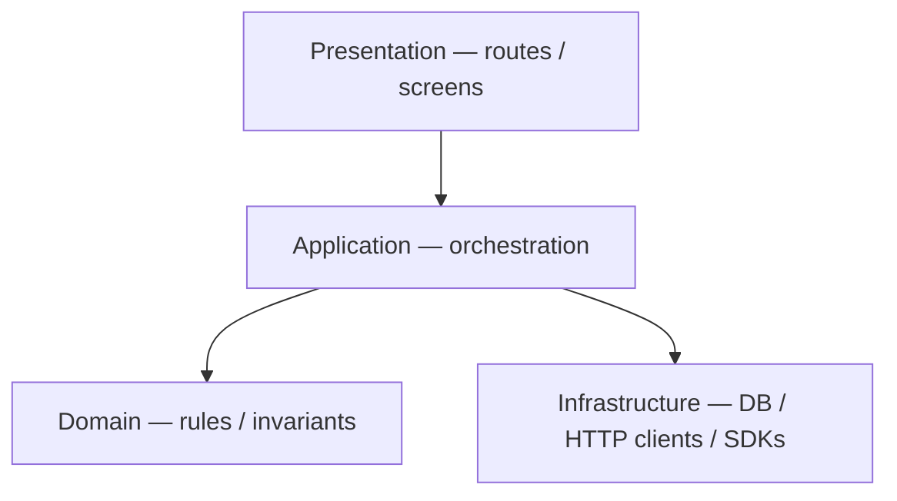
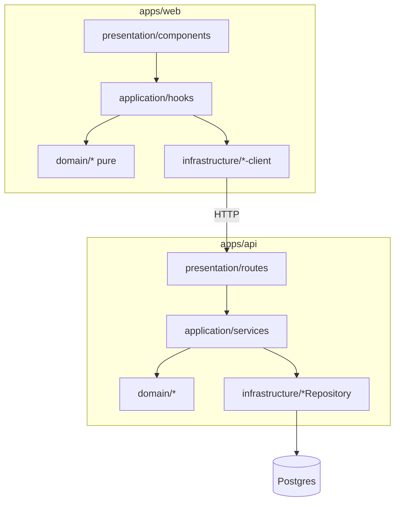

# Layered architecture

## One-line definition

Organize code into **technical layers** (presentation → application → domain → infrastructure). Dependencies call **downward** (or inward toward domain). Folders answer “what *kind* of work is this?” — not “which product feature is this?”

## Problem it solves

Without layers, HTTP handlers contain SQL, UI components contain business rules, and every change risks breaking unrelated concerns. Layering gives a first, teachable separation of concerns.

---

## 1. Dummy — 30-second picture

Four boxes stacked. The top talks HTTP/UI. The bottom talks SQL/files. Rules live in the middle. Arrows only go down.



**Why it exists:** so “change the status code” and “change the title rule” are not the same edit.

---

## 2. When to use / when not

### When to use

- Small/medium apps and teaching first separation of concerns
- Team already thinks in controllers / services / repositories
- One primary entry point (one API, one UI) and moderate domain depth

### When not to use

- Layers become dumping grounds (`*Service` does everything)
- Many entry points (web, mobile, CLI, workers) need the same core → prefer [hexagonal](hexagonal.md)
- Product changes are feature-shaped and reviews hurt across four folders → prefer [vertical slice](vertical-slice.md) inside modules

### Fit by application type

| Application type | Fit | Why |
|------------------|-----|-----|
| Small React SPA | Good | Clear component / hook / client split |
| Next.js App Router | OK | Easy to over-layer RSC + hooks + services |
| Hono API | Good | Route → service → domain → repo is familiar |
| Background worker | OK | Often one “application” entry + infra |
| Marketplace | OK early | Outgrows flat layers as modules appear |
| Admin CRUD | Good | Thin domain; layers stay honest |

### Frontend, backend, or both?

**Both.** Same four *jobs* on API and UI; names differ (route vs screen, repository vs `fetch` client).

---

## 3. Working — folders and a thin example

### Core rules

1. Presentation may call application; never SQL or vendor SDKs.
2. Application orchestrates; it may depend on domain and on **repository interfaces** (or concrete repos in a first lesson — upgrade to ports later).
3. Domain has **no** Hono, React, Next, Drizzle, or `fetch`.
4. Infrastructure implements storage and outbound I/O; it may be constructed only in a composition root (`main.ts` / providers).
5. A feature change that only touches presentation should not require domain edits.

### Dependency diagram (this monorepo)



### Folder structure — Hono

```text
apps/api/src/
  presentation/
    pages.route.ts          # PATCH /pages/:id — Zod, status codes
    comments.route.ts
  application/
    page.service.ts         # renamePage orchestrates rule + save
    comment.service.ts
  domain/
    page.ts                 # assertTitle
    comment.ts
  infrastructure/
    postgres-page.repository.ts
    postgres-comment.repository.ts
  main.ts                   # wire repo → service → routes
```

### Folder structure — React

```text
apps/web/src/
  presentation/
    page-editor.tsx
    comment-list.tsx
  application/
    use-rename-page.ts
    use-comments.ts
  domain/
    page-title.ts           # same assertTitle idea as API
  infrastructure/
    page-client.ts
    comment-client.ts
```

### TypeScript — worst vs best (API)

```ts
// ❌ Worst: route owns HTTP + rule + SQL
app.patch("/pages/:id", async (c) => {
  const title = (await c.req.json()).title?.trim();
  if (!title) return c.json({ error: "empty" }, 400);
  await db.execute("UPDATE pages SET title = ? WHERE id = ?", [title, c.req.param("id")]);
  return c.json({ ok: true });
});

// ✅ Better: layers own different reasons to change
// domain/page.ts
export function assertTitle(raw: string): string {
  const title = raw.trim();
  if (!title) throw new DomainError("TITLE_EMPTY");
  return title;
}

// application/page.service.ts
export function createPageService(pages: PageRepository) {
  return {
    async rename(id: string, rawTitle: string) {
      const title = assertTitle(rawTitle);
      await pages.saveTitle(id, title);
      return { id, title };
    },
  };
}

// presentation/pages.route.ts — parse, call service, map DomainError → 400
```

### TypeScript — React edge

```tsx
// ❌ Component fetches + validates + renders
async function onSave() {
  if (!title.trim()) { setError("empty"); return; }
  await fetch(`/api/pages/${id}`, { method: "PATCH", body: JSON.stringify({ title }) });
}

// ✅ Screen → hook → domain + client
function PageEditor() {
  const { title, setTitle, error, save, pending } = useRenamePage(id);
  return (/* inputs bound to hook only */);
}
```

---

## 4. Rich — seams, failures, tests

### Seams worth testing without infra

| Seam | Test without |
|------|----------------|
| `assertTitle` | No Hono, no DB |
| `page.service.rename` with in-memory repo | No Postgres |
| Route mapping `TITLE_EMPTY` → 400 | Mock service |

### Failure modes

| Failure | Who owns it |
|---------|-------------|
| Empty title | Domain → `DomainError` |
| Unknown page id | Repository / application → 404 mapping in presentation |
| DB down | Infrastructure → 503 mapping; do not catch inside domain |
| Network error on web | Hook → user-visible retry; do not reimplement tax/rules |

### Anti-patterns

- Anemic `page.service` that only forwards to the repo with zero rules
- Domain importing `drizzle-orm` “just this once”
- Presentation importing infrastructure clients on the server *and* embedding SQL
- Copy-paste of the four folders for every tiny DTO with no rule

### Upgrade path inside this style

When a second DB or Stripe appears, extract **ports** at the application boundary and move to [hexagonal](hexagonal.md) without renaming the whole product.

---

## 5. Professional / CTO

### Cost

| Dimension | Layered cost |
|-----------|----------------|
| Team | Easy onboarding; risk of god-services |
| Delivery | Feature PRs touch many folders (horizontal slices) |
| Ops | One deployable still fine |
| Evolution | Cheap early; expensive when modules blur |

### Evolution

1. Start layered for teaching / MVP.
2. Introduce **vertical slices** inside the API when services bloat.
3. Introduce **module public APIs** ([modular monolith](modular-monolith.md)).
4. Harden edges with ports ([hexagonal](hexagonal.md) / [clean](clean.md)).

### ADR triggers

Open an ADR when you: add a second persistence engine; split a god-service into modules; or forbid cross-layer imports via ESLint boundaries.

### Automate

- ESLint `no-restricted-imports`: `domain/**` cannot import `hono` / `react` / ORM
- CI path filters that fail if `presentation` imports `infrastructure` SQL modules

---

## Common mistakes

1. Naming folders `services/` and putting SQL there.
2. “Business logic” that is only DTO mapping — still anemic.
3. Sharing one `AppService` across the whole product.

## Migration

- **From ball-of-mud:** extract domain functions first, then repositories, then thin routes.
- **To vertical slice:** keep domain pure; move route+handler+repo of one feature into one folder.
- **To hexagonal:** replace concrete repo types in application with ports; move SQL to adapters.

## Related concepts

[Clean](clean.md) · [Hexagonal](hexagonal.md) · [Vertical slice](vertical-slice.md) · [SRP](../solid/01-S.md) · [Repository](../design-patterns/repository.md)

## Where in this repo

Mental model for early walkthrough steps before ports language. See [`../../tech-space/backend-architecture.md`](../../tech-space/backend-architecture.md) and walkthrough domain/application steps.
