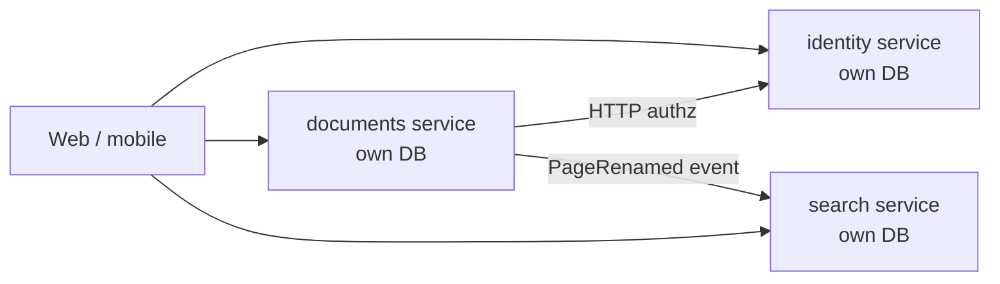
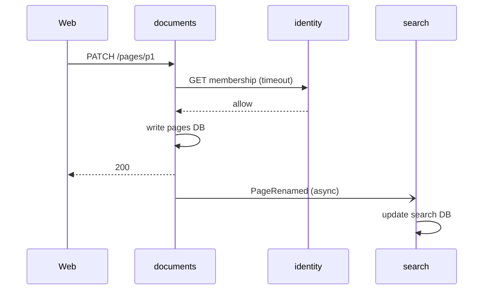

# Microservices

## One-line definition

Independently **deployable** services with separate **data** and **network** boundaries. Same business modules as a [modular monolith](modular-monolith.md), but each module is its own process, pipeline, and usually its own database.

## Problem it solves

One deployable cannot independently scale, release, or fail in isolation when organizational and load boundaries demand it. Microservices buy autonomy — at the price of distributed systems complexity.

---

## 1. Dummy — 30-second picture

Three separate houses (services). Each has its own door and fridge (DB). They talk by phone (HTTP) or mail (events), not by walking into each other’s kitchen.



**Why it exists:** independent scale, release, and ownership — not because folders look cooler.

---

## 2. When to use / when not

### When to use

- Independent scale/release cadence is a **measured** requirement
- Clear bounded contexts and platform maturity (tracing, CI/CD, on-call)
- Organizational ownership aligns with services

### When not to use

- Early-stage learning repo or small team (**this repo’s early phases**)
- Resume-driven splits
- Cannot operate distributed tracing, auth between services, and partial failure

### Fit by application type

| Application type | Fit | Why |
|------------------|-----|-----|
| Marketplace at scale | Conditional | billing/search may earn a split later |
| Tiny SaaS | Poor | Ops tax dominates |
| Multi-team platform | Good | Aligns with team boundaries |
| Teaching repo | Contrast only | Document, do not default |

### Frontend, backend, or both?

**Backend/deploy topology first.** The SPA may remain one shell with per-service clients and partial-failure UX. Independent UI deploys need a further split (microfrontends) — optional and costly.

---

## 3. Working — folders and a thin example

### Core rules

1. **No shared mutable DB** across services (read replicas / projected read models are deliberate).
2. Contracts live in a shared package or schema registry — versioned.
3. Sync calls for queries that must be fresh; events for eventual side effects.
4. Timeouts, retries, idempotency on every outbound call.
5. Extract from a modular monolith **one module at a time** ([strangler fig](strangler-fig.md)).

### Dependency diagram



### Folder structure

```text
contracts/
  identity.ts
  documents.ts
  search.ts
services/
  identity/src/...     # own PORT, DATABASE_URL
  documents/src/...
  search/src/...
apps/web/src/features/
  identity/ | documents/ | search/   # one client + failure UX each
```

### Worst vs best

```ts
// ❌ Shared DB + three deploys = distributed monolith
documentsDb.query("SELECT * FROM search_entries ...");

// ✅ Own data + contract
await identityClient.assertCanEdit(userId, pageId);
await pagesRepo.save(page);
await bus.publish(pageRenamed(page));
```

---

## 4. Rich — seams, failures, tests

### Failure modes

| Failure | Design |
|---------|--------|
| Identity timeout | Fail closed on writes; cached allow-list only with explicit risk ADR |
| Search down | Documents still saves; UI shows search degraded |
| Duplicate events | Idempotent consumers |
| Chatty nanoservices | Merge back — wrong cut |

### Testing

- Contract tests on `packages/contracts`
- Service tests with testcontainers per DB
- Consumer-driven contracts for events
- Chaos: kill search while renaming pages

### Anti-patterns

- Nanoservices per entity
- Shared database with independent deploys
- Distributed transactions as the default (prefer saga / outbox)

---

## 5. Professional / CTO

### Cost snapshot

| Cost | Typical impact |
|------|----------------|
| Platforms | Gateway, mesh/auth, tracing, log correlation |
| Latency | Extra hops on user journeys |
| Consistency | Eventual between services |
| Headcount | On-call and ownership per service |

**CTO bar:** do not split until a modular monolith module has a clear scale, compliance, or team-cadence reason — and a rollback plan.

### ADR triggers

First service extraction · shared DB exception · sync vs async for a cross-service rule · multi-region data.

### Automate

- Per-service CI pipelines · contract CI · SLO dashboards · idempotency keys in golden paths

---

## Common mistakes

1. Splitting before `public.ts` boundaries exist.
2. One “god” API gateway that reimplements all business rules.
3. Assuming microservices fix a bad domain model.

## Migration

Start at [modular monolith](modular-monolith.md) → prove ownership → [strangler fig](strangler-fig.md) extract → keep contracts stable.

## Related concepts

[Modular monolith](modular-monolith.md) · [SOA](soa.md) · [API Gateway](api-gateway.md) · [Event-driven](event-driven.md) · [Strangler fig](strangler-fig.md)

## Where in this repo

Documented for **contrast**; not the default implementation target for early phases. See combination guide and stack recommendations.
