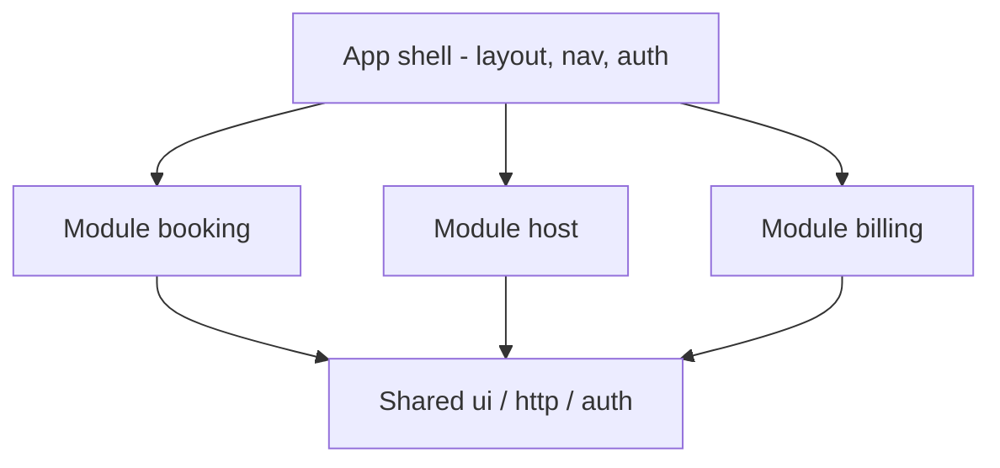

# Modular Frontend Architecture

## One-line Definition

Modular frontend architecture structures the UI into **owned modules/packages** with public APIs, isolated state, and explicit composition — so large React/Next.js apps do not become a single interdependent component graph.

## Problem It Solves

Frontend codebases grow into entangled `components/` trees where any screen imports any store, API client, or style helper. Modular frontend design restores team ownership, lazy loading boundaries, and safer refactors.

## When to Use It

- Large React dashboards or multi-area SaaS consoles
- Multiple frontend engineers / teams
- Need for lazy-loaded areas (admin, host portal, guest checkout)
- Long-lived product with frequent UI changes
- Desire for clearer ownership without necessarily adopting microfrontends

## When Not to Use It

- Small SPA / marketing site
- Over-splitting into microfrontends for a single team
- Modules that still share one giant global store freely
- Inventing module boundaries that don’t match user areas or domains

## Best Fit by Application Type

| Application type | Fit | Why |
|---|---:|---|
| Small React SPA | Poor | Extra boundaries |
| Large React dashboard | Good | Area modules match navigation |
| Next.js App Router app | Good | Route groups + feature modules |
| Hono API | Poor | Backend concern |
| Background worker | Poor | N/A |
| Mobile app API | Poor | API side; mobile UI can still be modular |
| Marketplace / booking system | Good | Guest / host / admin shells |
| Internal admin panel | Good | Section modules (users, billing, audits) |

## Frontend, Backend, or Both?

**Frontend organization**. Backend stays modular monolith / slices / hexagonal separately.

In React + Next.js + Hono:

- Organize `apps/web` by business area modules with public exports
- Use FSD or vertical slices **inside** modules if helpful
- Talk to Hono through module-owned API clients or a shared HTTP kit
- Do not import Hono server modules into client bundles

## Core Rules

- Each frontend module exposes a public API (`index.ts`) — screens import that, not internals
- Cross-module UI composition happens in the app shell / routes, not via deep imports
- Shared kit (`ui`, `http`, `auth`) has no feature business rules
- State is local to a module by default; global state is explicitly justified
- Prefer route-based code splitting at module boundaries
- Modules may share types from `@repo/contracts`, not from each other’s private models
- Client modules must not import server-only Next.js code unless marked server boundaries clearly

## Dependency Diagram



## Recommended Folder Structure

### 1. React frontend

```text
apps/web/src/
  app/App.tsx
  modules/
    booking/
      public.tsx                     # routes + exported pages
      features/create-booking/...
      entities/booking/...
      api/client.ts
      index.ts
    host/
      public.tsx
      features/list-listing/...
      index.ts
    billing/
      index.ts
  shared/
    ui/
    http/
    auth/
```

### 2. Next.js App Router frontend

```text
apps/web/
  app/
    (guest)/
      bookings/page.tsx              # imports from modules/booking
    (host)/
      listings/page.tsx
    (admin)/...
  modules/
    booking/
      index.ts
      CreateBookingForm.tsx
      booking.queries.ts
    host/
      index.ts
    billing/
      index.ts
  shared/
    ui/
    http/server.ts                   # server-only
    http/client.ts
```

### 3. Hono backend

Not applicable as a frontend module tree — mirror capability names only:

```text
apps/api/src/modules/{booking,host,billing}/
```

### 4. Monorepo (optional package-per-module)

```text
apps/web/
packages/
  fe-booking/                        # if multiple apps consume it
  fe-host/
  ui/
  contracts/
```

## Implementation Example

```ts
// modules/booking/index.ts — public API
export { CreateBookingForm } from "./features/create-booking/CreateBookingForm";
export { useBookingDetail } from "./features/booking-detail/useBookingDetail";
export type { BookingListItem } from "./entities/booking/types";
```

```tsx
// app/(guest)/bookings/new/page.tsx — composition root
import { CreateBookingForm } from "@/modules/booking";

export default function NewBookingPage({
  searchParams,
}: {
  searchParams: { listingId: string };
}) {
  return <CreateBookingForm listingId={searchParams.listingId} />;
}
```

```ts
// modules/booking/api/client.ts
import { http } from "@/shared/http/client";
import { createBookingInput, type CreateBookingInput } from "@repo/contracts";

export async function postBooking(input: CreateBookingInput) {
  const body = createBookingInput.parse(input);
  return http.post("/bookings", body);
}
```

## Testing Strategy

- **Unit:** module features and pure helpers
- **Integration:** module page + MSW for Hono
- **Contract:** `@repo/contracts` alignment
- **E2E:** cross-module journeys from the shell
- **Mocking:** mock `shared/http`; do not reach into another module’s internals in tests

## Common Mistakes

- Modules importing each other’s private folders
- One Redux store with all modules’ state forever
- “Shared” module that contains booking and billing logic
- Microfrontends without module boundaries first
- Duplicating the entire design system per module without a kit

## Migration Path

1. Identify top navigation areas as candidate modules
2. Move one area into `modules/x` with an `index.ts` public API
3. Ban deep imports via ESLint boundaries
4. Introduce route-based lazy loading
5. Adopt FSD/slices inside modules once boundaries stabilize

## Related Architectures

| Other architecture | Relationship | Why |
|---|---|---|
| Feature-Sliced Design | Natural combination | FSD is a detailed modular frontend method |
| Vertical Slice | Natural combination | Slices inside modules |
| Microfrontends | Possible but requires discipline | Deployable modules; higher cost |
| Next.js App Router | Natural combination | Route groups as composition roots |
| Modular monolith backend | Natural combination | Mirror module names across stack |
| Layered `components/hooks/services` | Mutually exclusive at the same boundary | Competing taxonomies |
| SCS | Possible but requires discipline | Stronger autonomy including separate apps |
