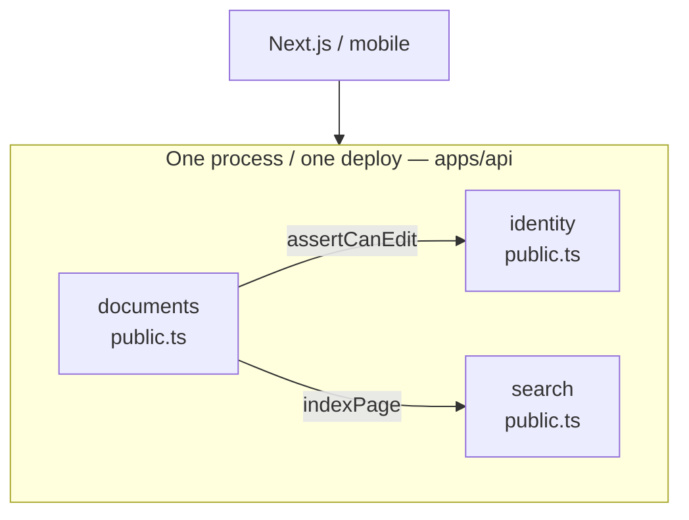
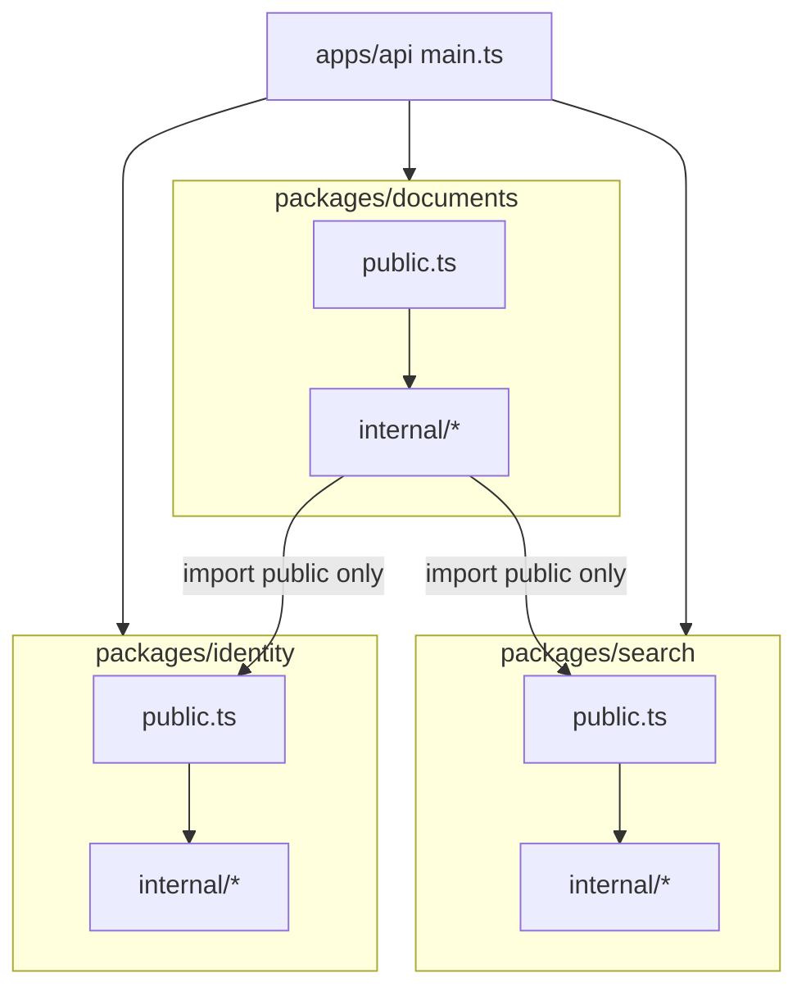

# Modular monolith

## One-line definition

**One deployable** with **hard module boundaries** (business capabilities) and explicit public APIs between modules — **in-process** calls, not network hops. Same mental modules you might later deploy as services.

## Problem it solves

A layered blob becomes a distributed mess if you “split microservices” without ownership. A modular monolith teaches **bounded modules, table ownership, and public APIs** while keeping one process, one trace, and simple ops.

---

## 1. Dummy — 30-second picture

One box (the deployable). Inside it, three rooms (modules). Doors are labeled `public.ts`. Nobody walks through the walls.



**Why it exists:** microservice *boundaries* without microservice *bills*.

---

## 2. When to use / when not

### When to use

- Product still exploring bounded contexts
- Team wants service-like ownership without ops cost
- Teaching modularity before distributed systems (**this repo’s default**)

### When not to use

- Hard requirement for independent deploy/scale/failure isolation per domain
- Modules secretly share tangled tables with no ownership
- One developer MVP with three empty `public.ts` files and no real boundaries

### Fit by application type

| Application type | Fit | Why |
|------------------|-----|-----|
| Marketplace | **Excellent** | listing, order, billing, identity |
| Notion-style workspace | Excellent | identity, documents, search |
| Tiny CRUD | Overkill | One module is enough |
| Multi-tenant SaaS | Excellent | Clear ownership before scale |

### Frontend, backend, or both?

**Primarily backend/package boundaries**, mirrored on the frontend as feature/modules with public entry points ([modular frontend](modular-frontend.md), [FSD](feature-sliced-design.md)). One Next app can still call one Hono deployable.

---

## 3. Working — folders and a thin example

### Core rules

1. Each module owns its tables/schemas — no casual cross-module joins.
2. Cross-module access **only** via `public.ts` (or equivalent).
3. Prefer sync in-process calls; use events for async side effects ([event-driven](event-driven.md)).
4. Vertical slices live **inside** a module — they are not a license to bypass `public.ts`.
5. Composition root mounts module routers; it may know modules, modules must not know `apps/*` internals.

### Dependency diagram



### Folder structure — Hono monorepo

```text
apps/api/src/main.ts                 # mounts module routers
packages/
  identity/
    public.ts                        # assertCanEdit(userId, pageId)
    http/membership.route.ts
    internal/session-store.ts
  documents/
    public.ts                        # renamePage(...)
    http/pages.route.ts
    internal/page-repository.ts
  search/
    public.ts                        # indexPage / searchPages
    http/search.route.ts
    internal/indexer.ts
```

### TypeScript — public API

```ts
// packages/identity/public.ts
export async function assertCanEdit(userId: string, pageId: string): Promise<void> {
  // ownership + role checks; throws ForbiddenError
}

// packages/documents/internal — OK
import { assertCanEdit } from "@repo/identity/public";

// ❌ documents importing identity internal session store
import { sessionStore } from "@repo/identity/internal/session-store";
```

### React mirror (optional)

```text
apps/web/src/modules/
  documents/                           # screens + hooks for pages
  search/
  shell/                               # composes modules
```

Modules import each other’s **public** UI kits only when necessary; prefer API calls to Hono module routes.

---

## 4. Rich — seams, failures, tests

### Table ownership

| Module | Owns | Must not |
|--------|------|----------|
| identity | users, memberships | read `documents.pages` freely |
| documents | pages, blocks | update search index tables directly |
| search | index documents | rewrite page bodies |

If documents need a permission, call `identity.public`. If search must refresh, documents calls `search.public.indexPage` or publishes `PageRenamed`.

### Failure modes

| Failure | Approach |
|---------|----------|
| Module cycle A↔B | Introduce a third policy module or domain event |
| “Just one join” across modules | Forbidden — use public API or a read model owned by one module |
| Shared `utils` god package | Split by module or a tiny `packages/contracts` |

### Testing

- Unit-test module public functions with fakes for other modules’ public APIs
- Integration-test one module’s DB schema in isolation
- Contract-test `public.ts` as you would an HTTP API

### Anti-patterns

- Modules that are just layer folders renamed (`modules/services`)
- Distributed monolith later: network + shared DB + no public API discipline

---

## 5. Professional / CTO

### Cost vs microservices

| Dimension | Modular monolith | Microservices |
|-----------|------------------|---------------|
| Deploy | One | Many |
| Failure isolation | Process-wide | Per service |
| Latency | Function call | Network + serialization |
| Consistency | Single DB transaction possible **within** module; cross-module still careful | Distributed transactions / sagas |
| Team scale | Good until org boundaries force split | Good when teams own deploy cadence |

**Default CTO call for this blueprint:** stay modular monolith until a module has independent scale, compliance, or team cadence that pays for the network.

### Evolution

1. Modules + public APIs + owned tables.
2. Async events for side effects.
3. Logical CQRS read models inside the monolith.
4. Extract a service with [strangler fig](strangler-fig.md) only after the module boundary is already real.

### ADR triggers

New business module · allowing a cross-module join exception · extracting a module to a service · shared database user across modules.

### Automate

- ESLint boundaries: `packages/documents/internal/**` cannot be imported from outside
- CI: fail on imports that skip `public.ts`
- Optional: dependency-cruiser / Nx/Turborepo tags

---

## Common mistakes

1. `public.ts` that re-exports the entire internal tree.
2. One shared schema “for convenience.”
3. Splitting services before modules are clean.

## Migration

- **From layered blob:** identify business capabilities; move tables and routes together; add `public.ts`; ban deep imports.
- **To microservices:** replace in-process `public` calls with HTTP/events **one module at a time**; keep the same names.

## Related concepts

[Microservices](microservices.md) · [Vertical slice](vertical-slice.md) · [DDD](domain-driven-design.md) · [Monorepo](monorepo.md) · [Architecture rules](architecture-rules.md)

## Where in this repo

**Default teaching stance.** See [`../../tech-space/project-blueprint.md`](../../tech-space/project-blueprint.md) and [`architecture-rules.md`](architecture-rules.md) module boundary section.
