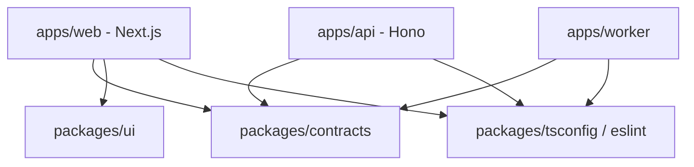

# Monorepo Architecture

## One-line Definition

A monorepo keeps **multiple applications and packages in one repository**, with shared tooling, atomic cross-project changes, and explicit package boundaries — it is a repository organization strategy, not a runtime architecture.

## Problem It Solves

Polyrepos make coordinated changes (API contract + web client + shared Zod schema) slow and inconsistent. A monorepo enables atomic PRs, unified CI, and shared libraries while still allowing multiple deployables.

## When to Use It

- Multiple apps share contracts, UI kit, or domain packages (Next.js + Hono + worker)
- Team wants one CI pipeline and consistent TypeScript/ESLint versions
- Product is a modular monolith or a small set of services owned by related teams
- Expected scale: several packages, not hundreds of unrelated products (unless invested in tooling)
- Maintenance benefits from atomic refactors across API and UI

## When Not to Use It

- Completely independent products with different release/security needs
- No investment in tooling (Turborepo/Nx/pnpm) — monorepo becomes a junk drawer
- Organizational politics require hard repo isolation
- Using monorepo as an excuse for zero package boundaries

## Best Fit by Application Type

| Application type | Fit | Why |
|---|---:|---|
| Small React SPA | Medium | Optional; single app repo is fine |
| Large React dashboard | Good | Shares UI kit and contracts with API |
| Next.js App Router app | Good | Pairs with `apps/api` and `packages/*` |
| Hono API | Good | Same repo as web + worker + contracts |
| Background worker | Good | Shares events/domain packages |
| Mobile app API | Good | Mobile + API contracts colocated |
| Marketplace / booking system | Good | Many modules/packages, one product |
| Internal admin panel | Good | Admin + API + shared types |

## Frontend, Backend, or Both?

**Repository organization** spanning frontend, backend, workers, and shared packages.

In React + Next.js + Hono:

- `apps/web` (Next.js), `apps/api` (Hono), `apps/worker`
- `packages/contracts`, `packages/ui`, `packages/eslint-config`
- Deployables remain independent; the repo does not force microservices or a monolith

## Core Rules

- Apps may depend on packages; packages must not depend on apps
- Business modules should not become a free-for-all via `@repo/everything`
- Public package exports only — no deep imports into another package’s `src/internal`
- Shared packages hold generic code or versioned contracts — not “all domain logic”
- CI should run affected tests (Turborepo/Nx) not always the entire universe blindly without caching strategy
- One package ≈ one ownership boundary
- Do not put secrets in the repo; `.env` examples only

## Dependency Diagram



## Recommended Folder Structure

### 1–3. React / Next / Hono together

```text
apps/
  web/                               # Next.js App Router
    app/
    src/features/
    package.json
  api/                               # Hono
    src/modules/
    package.json
  worker/
    src/consumers/
    package.json
packages/
  contracts/
    src/booking/create-booking.ts    # zod schemas
    package.json
  ui/
    src/Button.tsx
    package.json
  tsconfig/
  eslint-config/
pnpm-workspace.yaml
turbo.json
```

### 4. Monorepo tooling example

```yaml
# pnpm-workspace.yaml
packages:
  - "apps/*"
  - "packages/*"
```

```json
// turbo.json (excerpt)
{
  "tasks": {
    "build": { "dependsOn": ["^build"], "outputs": ["dist/**", ".next/**"] },
    "test": { "dependsOn": ["^build"] },
    "lint": {}
  }
}
```

## Implementation Example

```ts
// packages/contracts/src/booking/create-booking.ts
import { z } from "zod";

export const createBookingInput = z.object({
  listingId: z.string().uuid(),
  checkIn: z.string().date(),
  checkOut: z.string().date(),
  guests: z.number().int().positive(),
});

export type CreateBookingInput = z.infer<typeof createBookingInput>;
```

```ts
// apps/api — use the same contract
import { createBookingInput } from "@repo/contracts/booking/create-booking";

route.post("/bookings", async (c) => {
  const input = createBookingInput.parse(await c.req.json());
  // ...
});
```

```ts
// apps/web — same contract for client validation
import { createBookingInput } from "@repo/contracts/booking/create-booking";

const parsed = createBookingInput.safeParse(formValues);
```

## Testing Strategy

- **Unit:** per package with local test runner
- **Integration:** api + DB in `apps/api`
- **Contract:** packages/contracts consumed by web and api tests
- **E2E:** `apps/web` against a running api from the monorepo compose setup
- **Mocking:** prefer shared contract fixtures over duplicating shapes
- CI: affected-project detection to keep feedback fast

## Common Mistakes

- `packages/common` that imports everything and is imported by everything
- No boundary linting — monorepo becomes a single tangled graph
- Publishing nothing and also not versioning internal contracts mentally
- Forcing unrelated company products into one repo without tooling
- Assuming monorepo equals modular monolith (deploy still matters)

## Migration Path

1. Move web and api into `apps/` with a workspace tool
2. Extract Zod contracts first
3. Extract UI kit second
4. Add Turborepo/Nx pipelines and boundary lint rules
5. Split deploy pipelines per app while keeping one repo

## Related Architectures

| Other architecture | Relationship | Why |
|---|---|---|
| Modular monolith | Natural combination | Classic pairing |
| Microservices | Natural combination | Multi-service code in one repo |
| SCS | Natural combination | Multiple systems, one repo optional |
| Vertical Slice / FSD | Natural combination | Inside apps |
| Polyrepo | Mutually exclusive at the same boundary | Repo strategy alternatives |
| Serverless | Natural combination | Many function apps in one repo |
| DDD | Natural combination | Packages can mirror contexts |
