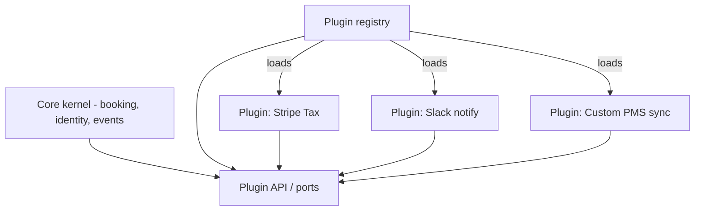

# Plugin / Microkernel Architecture

## One-line Definition

A microkernel (plugin) architecture keeps a stable **core** that provides extension points; features ship as **plugins** that register capabilities without modifying the core’s internals.

## Problem It Solves

Products that need optional integrations, automations, or customer-specific features accumulate `if (tenant.hasX)` branches in the core. Plugins isolate extensibility so the core stays small and third parties (or internal teams) can add behavior safely.

## When to Use It

- Platform products with integrations (Slack, HubSpot, custom webhooks)
- Automations/workflows that vary by customer
- Marketplace of extensions or partner apps
- Multi-team contribution where not everyone should edit core modules
- Clear stable contracts can be defined for registration and lifecycle

## When Not to Use It

- Single-product SaaS with a fixed feature set
- “Plugin” folders that still hard-import core internals freely
- No versioning/security model for third-party code
- Early MVP inventing a plugin SDK before product-market fit

## Best Fit by Application Type

| Application type | Fit | Why |
|---|---:|---|
| Small React SPA | Poor | No extension need |
| Large React dashboard | Medium | UI slots/widgets as plugins |
| Next.js App Router app | Medium | Route/slot registration possible |
| Hono API | Good | Middleware/route/provider registration |
| Background worker | Good | Job handlers registered by plugins |
| Mobile app API | Medium | Integration hooks |
| Marketplace / booking system | Good | Channel integrations, tax, PMS plugins |
| Internal admin panel | Medium | Optional tools/modules |

## Frontend, Backend, or Both?

**Extensibility** pattern — works on backend (most common), frontend (widget slots), or both with separate registries.

In React + Next.js + Hono:

- **Hono core** exposes ports: `registerRoute`, `registerWebhook`, `registerJob`
- **Plugins** implement adapters (e.g. “Export bookings to Salesforce”)
- **React** may load plugin widgets via a registry/slot component
- Core domain remains authoritative; plugins react to events or call public APIs

## Core Rules

- Plugins depend on core **public contracts** only — never on core internal modules
- Core must not import a specific plugin (composition root loads them)
- Registration is explicit (manifest / `register(plugin)`)
- Plugin failures must be isolated (errors do not crash the kernel)
- Permissions and tenancy checks enforced by core for plugin actions
- Shared state goes through core APIs/events, not plugin-to-plugin internals
- Version the plugin API; breaking changes require migration guides

## Dependency Diagram



## Recommended Folder Structure

### 1. React frontend

```text
apps/web/src/
  core/
    slots/BookingSidebarSlot.tsx
    plugin-registry.ts
  plugins/
    slack-notify-widget/
      register.tsx
      SlackPanel.tsx
  features/booking-detail/BookingDetailPage.tsx  # renders slots only
```

### 2. Next.js App Router frontend

```text
apps/web/
  src/core/slots/...
  src/plugins/*/register.ts
  app/bookings/[id]/page.tsx
```

### 3. Hono backend

```text
apps/api/src/
  kernel/
    app.ts
    plugin-api.ts                    # registerRoute, onEvent, addJob
    registry.ts
  modules/booking/                   # core bounded context
  plugins/
    slack-notify/
      manifest.ts
      register.ts
      slack.adapter.ts
    salesforce-sync/
      manifest.ts
      register.ts
  main.ts                            # load manifests → registry → listen
```

### 4. Monorepo

```text
apps/api/
packages/plugin-api/                 # stable contract package
packages/plugin-slack/
packages/plugin-salesforce/
```

## Implementation Example

```ts
// packages/plugin-api/src/index.ts
export type BookingConfirmed = {
  type: "booking.confirmed";
  bookingId: string;
  guestEmail: string;
};

export type PluginContext = {
  onEvent: (type: "booking.confirmed", handler: (e: BookingConfirmed) => Promise<void>) => void;
  registerRoute: (method: "GET" | "POST", path: string, handler: (req: Request) => Promise<Response>) => void;
};

export type Plugin = {
  name: string;
  register: (ctx: PluginContext) => void | Promise<void>;
};
```

```ts
// plugins/slack-notify/register.ts
import type { Plugin } from "@repo/plugin-api";
import { postSlackMessage } from "./slack.adapter";

export const slackNotifyPlugin: Plugin = {
  name: "slack-notify",
  register(ctx) {
    ctx.onEvent("booking.confirmed", async (e) => {
      await postSlackMessage(`Booking ${e.bookingId} confirmed for ${e.guestEmail}`);
    });
  },
};
```

```ts
// kernel/main.ts
import { createPluginContext } from "./plugin-api";
import { slackNotifyPlugin } from "../plugins/slack-notify/register";

const ctx = createPluginContext(app);
await slackNotifyPlugin.register(ctx);
```

## Testing Strategy

- **Unit:** plugin handlers against fake `PluginContext`
- **Integration:** kernel boots with plugin registered; event fires side effect
- **Contract:** plugin-api package version tests; fixture events
- **E2E:** enable plugin for a tenant and complete a booking
- **Mocking:** mock external SaaS in plugin adapters; core tests run with null plugins

## Common Mistakes

- Core importing plugins directly in domain code
- Plugins writing to core database tables bypassing APIs
- No sandbox/timeout around plugin handlers
- Unversioned plugin API → every upgrade breaks extensions
- Building a plugin system for features that should be ordinary modules

## Migration Path

1. Identify true variation points (integrations), not ordinary product features
2. Extract a small `plugin-api` and move one integration behind it
3. Load plugins from a registry in `main.ts`
4. Publish events from core instead of calling integration code inline
5. Only later support third-party packaging if needed

## Related Architectures

| Other architecture | Relationship | Why |
|---|---|---|
| Modular monolith | Natural combination | Core modules + plugin packages in one deploy |
| Event-Driven | Natural combination | Plugins subscribe to events |
| Hexagonal | Natural combination | Plugins are adapters behind ports |
| Microservices | Possible but requires discipline | Plugins as sidecars/services with stable API |
| Serverless | Possible but requires discipline | Plugin handlers as functions |
| DDD | Natural combination | Core bounded contexts remain clean |
| Vertical Slice for core features | Possible but requires discipline | Don’t turn every slice into a plugin |
| Random feature flags everywhere | Usually avoid | Flags ≠ microkernel contracts |
