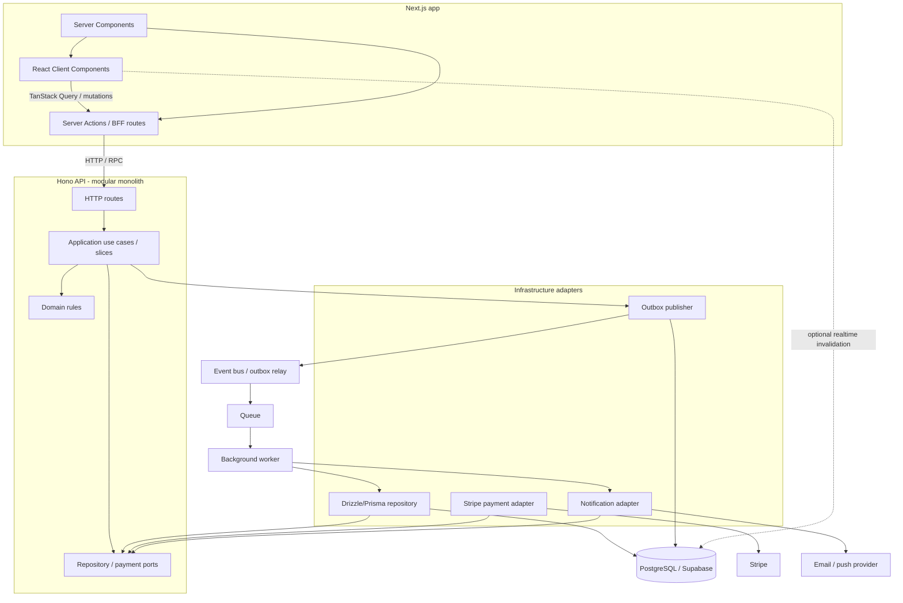

# React + Next.js + Hono Architecture Recommendations

Opinionated guidance for this stack:

- React
- Next.js App Router
- Hono
- TypeScript
- PostgreSQL or Supabase
- Drizzle or Prisma
- Zod
- TanStack Query
- Background workers / queues
- Stripe (or similar payment providers)

---

## Opinionated Default for a Serious Product

- Start as a **modular monolith**
- Organize modules by **business capability**
- Use **vertical slices** or feature-first organization
- Use **Hexagonal-lite** or **Clean-lite** boundaries inside backend modules
- Use **DDD** only in genuinely complex business areas
- Use **synchronous calls** for immediate flows
- Use **events and queues** for asynchronous side effects
- Use **logical CQRS** before physical CQRS
- Avoid **Event Sourcing** unless audit/history/replay requirements justify it
- Avoid **microservices** until independent deployment, scaling, team ownership, or reliability boundaries require them

### Default system diagram



---

## Recommendations by Project Size

### 1. Small MVP

| Concern | Recommendation |
|---|---|
| Deployment style | Single Next.js app **or** Next.js + one Hono service; one DB |
| Backend architecture | Vertical slices or thin layered; skip full hexagonal |
| Frontend architecture | Feature folders; not full FSD |
| Domain modeling | Zod + a few pure functions; no aggregates |
| CQRS | No |
| Event Sourcing | No |
| Events / queues | Optional; call email provider inline or one simple queue |
| Monorepo | Optional; useful if web+api split |
| Microservices | No |

**Suggested folders**

```text
apps/web/                 # Next.js
  app/
  src/features/
apps/api/                 # Hono (or Next route handlers only for tiny MVP)
  src/
    bookings/
      create.ts
      cancel.ts
    db.ts
packages/contracts/       # optional
```

**Enforce**

- Zod at the boundary
- No business rules in Client Components

**Avoid**

- Microservices, Event Sourcing, plugin frameworks, multi-BFF

---

### 2. Growing SaaS

| Concern | Recommendation |
|---|---|
| Deployment style | Modular monolith: `web` + `api` + `worker` |
| Backend architecture | Modules by capability + vertical slices; ports for Stripe/DB |
| Frontend architecture | Modular frontend or light FSD |
| Domain modeling | DDD-lite in billing/entitlements; slices elsewhere |
| CQRS | Logical CQRS for heavy dashboards |
| Event Sourcing | No |
| Events / queues | Yes for email, webhooks follow-up, indexing |
| Monorepo | Yes |
| Microservices | No |

**Suggested folders**

```text
apps/web/
apps/api/src/modules/{identity,billing,project}/
apps/worker/src/consumers/
packages/{contracts,ui,eslint-config}/
```

**Enforce**

- Module `public.ts` boundaries
- Outbox for published events
- Server-only secrets

**Avoid**

- Shared god package
- Physical read replicas “for architecture”

---

### 3. Marketplace / booking platform

| Concern | Recommendation |
|---|---|
| Deployment style | Modular monolith first; extract search/payments only if needed |
| Backend architecture | Modules: listings, booking, payments, reviews; Hexagonal at payment/booking edges |
| Frontend architecture | Modular frontend (guest/host/admin) + FSD inside large areas |
| Domain modeling | DDD for booking/payments; simpler models for content |
| CQRS | Yes logically — calendar/availability queries vs booking commands |
| Event Sourcing | Only for disputes/ledger if required; not default |
| Events / queues | Yes — confirmations, payouts, search index, notifications |
| Monorepo | Yes |
| Microservices | Maybe later for search or payouts under load/team split |

**Suggested folders**

```text
apps/api/src/modules/
  listing/
  booking/
    commands/
    queries/availability/
    domain/
    infrastructure/
  payments/
apps/web/
  modules/{guest,host,admin}/
apps/worker/
```

**Enforce**

- Booking invariants in domain, not in React
- Stripe webhook idempotency
- Availability query model separate from booking aggregate

**Avoid**

- Browser talking to Stripe + three services directly
- One table used by every module without ownership

---

### 4. Large multi-team product

| Concern | Recommendation |
|---|---|
| Deployment style | Modular monolith **or** SCS / selective microservices per team boundary |
| Backend architecture | Bounded contexts with public APIs; Hexagonal/Clean-lite inside |
| Frontend architecture | Modular frontend; FSD; consider separate Next apps per SCS |
| Domain modeling | DDD per complex context; context map mandatory |
| CQRS | Yes where read/write diverge; projections owned by context |
| Event Sourcing | Selective |
| Events / queues | Yes — primary cross-team integration |
| Monorepo | Yes (or monorepo-of-systems) |
| Microservices | Yes only with clear ownership + independent deploy need |

**Suggested folders**

```text
apps/
  web-portal/
  booking-api/
  billing-api/
  worker-booking/
  worker-billing/
packages/
  contracts-booking/
  contracts-billing/
  plugin-api/
infra/gateway/
```

**Enforce**

- No cross-DB joins between team contexts
- Contract tests between teams
- API gateway + optional per-client BFF

**Avoid**

- Shared mutable libraries of domain entities across services
- Enterprise ESB as a logic dump

---

### 5. Platform with plugins, automations, and integrations

| Concern | Recommendation |
|---|---|
| Deployment style | Modular monolith core + plugin packages (serverless consumers optional) |
| Backend architecture | Microkernel: core modules + plugin API; event-driven hooks |
| Frontend architecture | Slot-based modular UI; plugin widgets registered explicitly |
| Domain modeling | DDD in core; plugins use public contracts only |
| CQRS | Logical for automation dashboards |
| Event Sourcing | Optional for automation audit trails |
| Events / queues | Required — integration backbone |
| Monorepo | Yes — `packages/plugin-*` |
| Microservices | Plugins may deploy separately later; core stays coherent |

**Suggested folders**

```text
apps/api/src/kernel/
apps/api/src/modules/{booking,identity}/
apps/api/src/plugins/                 # or packages/plugin-*
packages/plugin-api/
packages/plugin-slack/
packages/plugin-salesforce/
apps/web/src/core/slots/
apps/worker/
```

**Enforce**

- Plugins depend on `plugin-api` only
- Idempotent automation handlers
- Tenant permissions checked in core

**Avoid**

- `if (integration === 'x')` sprawl in domain
- Plugins with direct core DB access

---

## Cross-Cutting Stack Rules

### Next.js

- Use Server Components for read-heavy pages
- Use server actions / route handlers as a **web BFF**, not as a second domain
- Keep Client Components for interactivity; fetch via TanStack Query against BFF or Hono

### Hono

- One modular API by default
- Routes validate with Zod, call use case/slice, map errors to HTTP
- Composition root wires Drizzle/Prisma + Stripe adapters

### Data

- Prefer Drizzle or Prisma behind repository ports in complex modules
- Supabase is fine as Postgres + auth + realtime; still keep domain out of client
- Use pooler for serverless deployments

### Payments

- Stripe adapter behind a port
- Webhooks in Hono (or dedicated function) with signature verify + idempotency keys
- Never trust client-reported payment success alone

### Async

- Transactional outbox in Postgres
- Worker consumes queue for email, search, third-party sync
- TanStack Query invalidation or realtime for UI freshness

---

## What to Grow Into (and When)

| Signal | Consider |
|---|---|
| Multiple client shapes (web/mobile/admin) | Next BFF + mobile BFF |
| Independent scale for search | Extract search service |
| Partner integrations explode | Plugin/microkernel |
| Team release contention | SCS or microservices per context |
| Dispute/audit/replay requirements | Event Sourcing for that context only |
| Legacy monolith in production | Strangler Fig behind gateway |

---

## Related Docs

- [architecture-combination-guide.md](architecture-combination-guide.md)
- [architecture-rules.md](architecture-rules.md)
- [modular-monolith.md](modular-monolith.md)
- [vertical-slice.md](vertical-slice.md)
- [hexagonal.md](hexagonal.md)
- [domain-driven-design.md](domain-driven-design.md)
- [event-driven.md](event-driven.md)
- [cqrs.md](cqrs.md)
- [bff.md](bff.md)
- [plugin-microkernel.md](plugin-microkernel.md)
