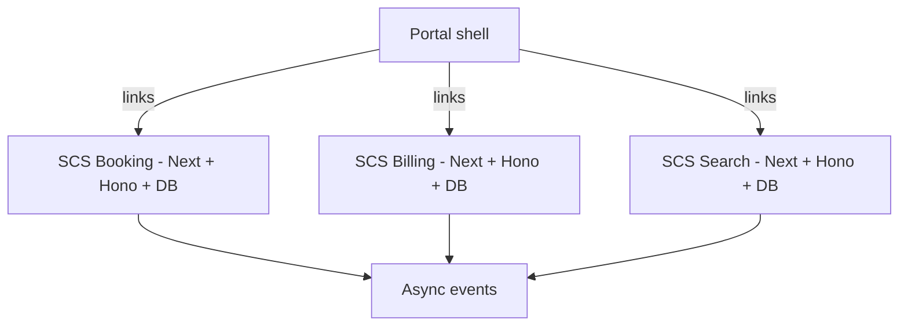

# Self-Contained Systems (SCS)

## One-line Definition

Self-Contained Systems split a large product into **autonomous vertical systems** — each owning its UI, backend logic, and data — that collaborate loosely, prioritizing independence over shared central services.

## Problem It Solves

Large web products become organizational bottlenecks when every feature shares one frontend monolith and one backend monolith. SCS gives each team an end-to-end vertical (UI + API + DB) so they can deliver without coordinating every release.

## When to Use It

- Multiple teams owning distinct business domains end-to-end
- Need independent deploy of UI+API together per domain
- Organization accepts duplicated cross-cutting concerns for autonomy
- Large marketplace/platform where “Booking”, “Search”, “Account” can be separate systems
- High cost of centralized release coordination

## When Not to Use It

- Small team shipping one product
- Strong requirement for one unified SPA with deep shared client state
- Unwillingness to duplicate auth/UI patterns across systems
- Domains too tightly coupled to separate meaningfully

## Best Fit by Application Type

| Application type | Fit | Why |
|---|---:|---|
| Small React SPA | Poor | One system is enough |
| Large React dashboard | Medium | Can be composed of SCS UIs via links/MFE |
| Next.js App Router app | Medium | Each SCS may be its own Next app |
| Hono API | Medium | Each SCS has its own Hono API |
| Background worker | Medium | Per-system workers |
| Mobile app API | Medium | Mobile may call a façade over SCS |
| Marketplace / booking system | Good | Natural verticals (search, book, pay, host) |
| Internal admin panel | Medium | Admin can be its own SCS |

## Frontend, Backend, or Both?

**Deployment topology + team ownership** spanning frontend and backend together.

In React + Next.js + Hono:

- Each SCS is typically `apps/booking-web` (Next) + `apps/booking-api` (Hono) + its DB
- Integration via links, shared auth gateway, and events — not a shared database
- A thin portal shell may deep-link into systems
- Unlike microservices-only, SCS includes the UI in the autonomy boundary

## Core Rules

- Each SCS owns its data store; no shared mutable DB
- Prefer HTML/UI integration (links, redirects, fragments) over chatty shared SPAs
- Synchronous calls to other SCS only when necessary; prefer eventual integration
- Shared libraries limited to truly generic kits; no shared domain models
- Auth can be centralized for SSO, but session/business rules stay local
- A team can deploy its SCS without waiting on others
- Do not build a central “god API” that every SCS must go through for business logic

## Dependency Diagram



## Recommended Folder Structure

### 1–2. React / Next.js per system

```text
apps/booking-web/                    # Next.js UI for booking SCS
  app/...
  src/features/...

apps/search-web/
  app/...
```

### 3. Hono per system

```text
apps/booking-api/
  src/modules/...
  src/main.ts

apps/search-api/
  src/main.ts
```

### 4. Monorepo of systems

```text
apps/
  portal/                            # optional shell
  booking-web/
  booking-api/
  billing-web/
  billing-api/
packages/
  ui-kit/                            # optional visual kit only
  auth-client/                       # SSO helpers
```

## Implementation Example

```ts
// booking-api: owns bookings table exclusively
export async function createBooking(input: CreateBookingInput, db: BookingDb) {
  return db.bookings.insert(input);
}

// After confirm, publish integration event — do not write into billing DB
await outbox.publish({
  type: "booking.confirmed",
  payload: { bookingId, totalCents, customerId },
});
```

```tsx
// portal links into booking SCS instead of importing its pages
export function ListingActions({ listingId }: { listingId: string }) {
  return (
    <a href={`https://booking.example.com/listings/${listingId}/reserve`}>
      Reserve
    </a>
  );
}
```

## Testing Strategy

- **Unit / integration:** inside each SCS as a normal app
- **Contract:** event schemas between SCS
- **E2E:** journey tests across systems in a composed environment
- **Mocking:** stub other SCS via contracts; never share test DBs
- Focus autonomy: a failing billing deploy must not block booking unit tests

## Common Mistakes

- Shared database across “SCS” — autonomy theater
- One giant SPA importing every system’s components
- Central orchestration service reintroducing a monolith
- Excessive sync coupling that recreates a distributed monolith
- Duplicating nothing and therefore coupling everything through shared packages

## Migration Path

1. Identify team-owned verticals in the modular monolith
2. Split UI routes by domain; deploy as separate Next apps behind a portal
3. Split APIs and databases last, after UI ownership is clear
4. Replace cross-module DB joins with APIs/events
5. Measure independence of release trains before splitting further

## Related Architectures

| Other architecture | Relationship | Why |
|---|---|---|
| Microservices | Possible but requires discipline | SCS includes UI; services often API-only |
| Modular monolith | Natural combination | Evolve from modular monolith verticals |
| Event-Driven | Natural combination | Loose integration |
| BFF | Possible but requires discipline | Per-SCS BFF OK; global BFF can centralize too much |
| SOA | Usually avoid | SOA emphasizes shared reusable services; SCS emphasizes autonomy |
| Monorepo | Natural combination | Many SCS codebases in one repo with boundaries |
| FSD | Possible but requires discipline | Apply FSD inside each web SCS |
| Single SPA microservices backend | Usually avoid | Conflicts with SCS UI autonomy |
