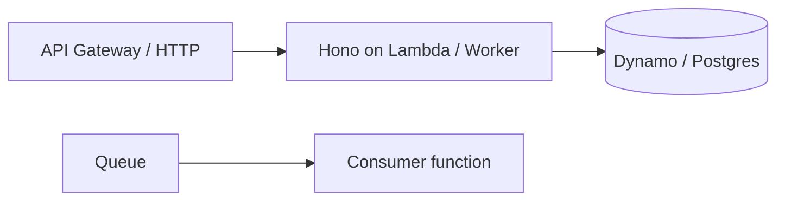
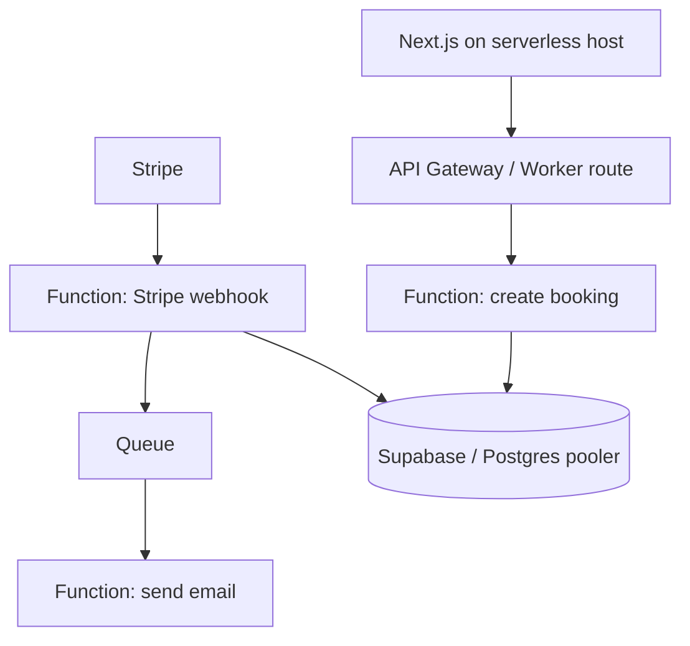

# Serverless / Function-Oriented Architecture

## One-line definition

Serverless architecture structures the backend as **independently deployable functions** (and managed services) that scale per invocation, with the cloud provider owning servers, often wired through HTTP APIs, queues, and events.

## Problem it solves

Always-on servers cost money at low traffic and require ops for scaling. Function-oriented design pushes discrete units of work (HTTP handlers, queue consumers, cron) into isolated deployables that scale to zero and bill per use — at the cost of distributed complexity.

---

## 1. Dummy — 30-second picture

Functions + managed services instead of long-running pods. Events or HTTP trigger short-lived handlers.



**Why it exists:** pay per use and scale to zero when traffic is spiky.

---

## 2. When to use / when not

### When to use

- Spiky or unpredictable traffic
- Many discrete async jobs (webhooks, image processing, notifications)
- Small teams wanting managed ops for parts of the system
- Event-driven integrations with cloud primitives (SQS, EventBridge, Cloudflare Queues)
- Endpoints that fit short execution time limits

### When not

- Long-lived WebSocket-heavy workloads without the right platform support
- Tight transactional workflows across many functions without a monolith boundary
- Cold-start sensitive low-latency APIs on constrained runtimes
- Team without observability for distributed traces and retries
- Rewriting a coherent modular monolith into dozens of functions prematurely

### Fit by application type

| Application type | Fit | Why |
|---|---:|---|
| Small React SPA | Medium | SPA + few serverless API routes can work for MVP |
| Large React dashboard | Medium | API may be serverless; watch cold starts / connection pooling |
| Next.js App Router app | Good | Native fit with Route Handlers / edge / server actions hosting |
| Hono API | Good | Hono runs well on Cloudflare Workers / Lambda / Bun adapters |
| Background worker | Good | Queue-triggered functions are a natural model |
| Mobile app API | Medium | Fine if latency/timeouts acceptable |
| Marketplace / booking system | Medium | Good for webhooks/async; core booking often better as long-lived API |
| Internal admin panel | Medium | Low traffic suits scale-to-zero |

### Frontend, backend, or both?

Primarily a **deployment topology** for backend (and sometimes Next.js hosting). Not a UI folder strategy.

In React + Next.js + Hono:

- Next.js can host UI + some BFF routes serverless
- Hono can deploy as Workers/Lambda for API and webhook functions
- Prefer a modular monolith codebase that **can** deploy as one server *or* as functions — avoid designing business modules as one-file lambdas from day one
- Postgres/Supabase needs serverless-friendly pooling (e.g. PgBouncer / Supabase pooler)

## 3. Working — folders and a thin example

### Core rules

- Each function has a clear trigger (HTTP, queue, cron) and a single job
- Share domain logic via packages — do not copy-paste business rules into each function
- Treat functions as adapters; keep domain framework-independent
- All consumers are idempotent; assume at-least-once invocation
- Bound execution time; move long work to queues
- Secrets and DB connections configured per platform limits
- Avoid chatty function-to-function sync call chains (distributed monolith)

### Dependency diagram (this monorepo)




### Folder structure


### 1. React frontend

```text
apps/web/                 # static SPA → CDN
  src/features/...
```

### 2. Next.js App Router frontend

```text
apps/web/
  app/
    api/webhooks/stripe/route.ts     # thin serverless entry
    (app)/bookings/page.tsx
  src/features/...
```

### 3. Hono backend (function-oriented deploy, modular code)

```text
apps/api/
  src/
    modules/booking/
      application/create-booking.ts
      domain/...
    http/
      create-booking.ts              # hono route module
      stripe-webhook.ts
    workers/
      send-booking-email.ts
    app.ts                           # compose routes
  wrangler.toml / serverless.yml     # deploy topology
```

### 4. Monorepo

```text
apps/web/
apps/api/                            # same codebase, multiple entrypoints
packages/booking-domain/
packages/events/
```

### TypeScript


```ts
// apps/api/src/http/stripe-webhook.ts
import { Hono } from "hono";
import { verifyStripeSignature } from "../infrastructure/stripe";
import { recordPaymentCaptured } from "../modules/billing/application/record-payment-captured";

export const stripeWebhook = new Hono();

stripeWebhook.post("/webhooks/stripe", async (c) => {
  const raw = await c.req.text();
  const event = await verifyStripeSignature(raw, c.req.header("stripe-signature"));

  if (event.type === "payment_intent.succeeded") {
    await recordPaymentCaptured({
      paymentIntentId: event.data.object.id,
      amountCents: event.data.object.amount_received,
    });
  }

  return c.json({ received: true });
});
```

```ts
// entry for Cloudflare Worker / Lambda adapter
import { handle } from "hono/aws-lambda"; // or cloudflare export
import { app } from "./app";
export const handler = handle(app);
```

## 4. Rich — seams, failures, tests

### Seams worth testing


- **Unit:** domain/application with fake ports
- **Integration:** function handler with local queue/DB emulators
- **Contract:** webhook payload fixtures (Stripe)
- **E2E:** deploy preview + real managed queue in staging
- **Mocking:** mock Stripe/SDK at adapter boundary; do not mock the whole handler away from routing tests

### Failure modes

| Failure | Who owns it |
|---------|-------------|
| Cold start SLO miss | Provisioned concurrency / keep-warm |
| VPC DB connection storm | Pooler / connection limits |
| Function timeout on batch | Split job or queue worker |

### Anti-patterns


- One giant Lambda that is a monolith with worse ops
- Sync fan-out across many functions for one user request
- Exhausting DB connections without a pooler
- Embedding secrets in code; missing idempotency on webhooks
- Designing folder structure around vendor triggers instead of business modules


---

## 5. Professional / CTO

### Cost

| Dimension | Serverless cost |
|-----------|-----------------|
| Team | Cold starts, vendor limits, local dev friction |
| Delivery | Fast for event spikes; awkward for long TCP/websockets |
| Ops | Per-invocation billing; IAM complexity |
| Evolution | Extract hot path back to long-running Hono when costs spike |

### ADR triggers

Runtime choice (Workers vs Lambda) · VPC to Postgres · max execution time.

### Automate

- IaC for function + queue wiring
- Load tests on cold-start SLO

## Migration


1. Keep modular Hono monolith on a long-lived server
2. Extract webhook and cron paths to serverless entries first
3. Move async email/indexing consumers next
4. Share packages for domain logic
5. Only split core HTTP API if scaling/cost evidence demands it

## Related concepts

[Event-driven](event-driven.md) · [API gateway](api-gateway.md) · [BFF](bff.md)

## Where in this repo

Contrast with default long-running Hono in [backend-architecture.md](../../tech-space/backend-architecture.md).
