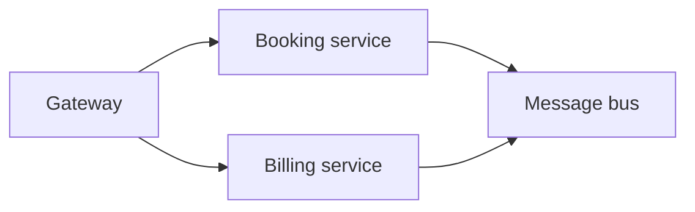
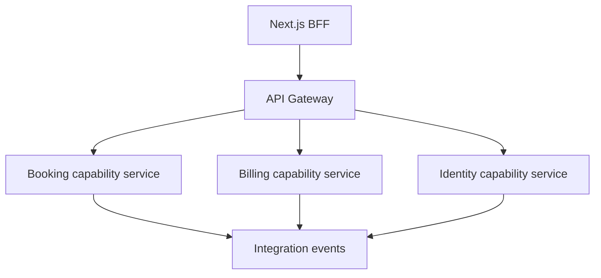

# Service-Oriented Architecture (SOA)

## One-line definition

Service-Oriented Architecture structures a system as a set of **network-accessible services** that expose coarse-grained business capabilities through standardized contracts, often with a shared governance/ESB-style integration layer historically — in modern practice, closer to well-governed service boundaries with shared platforms.

## Problem it solves

Large organizations need reusable business capabilities (billing, identity, inventory) consumed by many channels. SOA aims to expose those capabilities as services with contracts so applications compose capabilities instead of duplicating them.

---

## 1. Dummy — 30-second picture

Coarse **services** with explicit contracts, often an ESB/bus era. Prefer modules/monolith first in this repo.



**Why it exists:** enterprise integration when organizations already own separate systems.

---

## 2. When to use / when not

### When to use

- Enterprise portfolios with many consuming applications
- Strong need for reusable business capabilities across teams
- Existing service catalog / platform governance
- Coarse-grained services (not tiny endpoints) matching business functions
- Organization can fund shared platform, contracts, and ops

### When not

- Startup / single-product modular monolith stage
- Confusing SOA with “many tiny microservices”
- Central ESB that becomes a bottleneck and logic dump
- Small React+Hono app inventing SOAP/ESB ceremony

### Fit by application type

| Application type | Fit | Why |
|---|---:|---|
| Small React SPA | Poor | One backend service is enough |
| Large React dashboard | Medium | Consumes enterprise services |
| Next.js App Router app | Medium | BFF composing SOA services |
| Hono API | Medium | Hono can implement a capability service |
| Background worker | Medium | Orchestration/workers around services |
| Mobile app API | Medium | Often via BFF over SOA backends |
| Marketplace / booking system | Medium | Useful at org scale; overkill for one app |
| Internal admin panel | Medium | Consumer of shared services |

### Frontend, backend, or both?

Primarily **deployment topology + integration** for backends and enterprise composition. Frontends consume services (often through a BFF).

In React + Next.js + Hono:

- Prefer **modular monolith** until multiple products need the same capability
- If SOA is required: Hono apps become capability services (`billing-service`, `booking-service`)
- Next.js BFF composes them for the web UX
- Avoid recreating a heavyweight ESB; use explicit APIs, events, and an API gateway

## 3. Working — folders and a thin example

### Core rules

- Services expose **business capabilities**, not raw tables
- Contracts are versioned (OpenAPI/AsyncAPI); consumers depend on contracts only
- Prefer coarse-grained operations to chatty fine-grained RPC
- Shared libraries must not become a backdoor to couple deployments (share types carefully)
- No hidden shared database between capability services
- Governance for auth, discovery, and observability is part of the architecture
- UI must not orchestrate five enterprise services with business rules in the browser

### Dependency diagram (this monorepo)




### Folder structure


### 1. React frontend

```text
apps/web/src/
  shared/api/bff-client.ts
  features/...
```

### 2. Next.js App Router frontend

```text
apps/web/
  src/bff/compose-checkout.ts        # calls booking + billing services
  app/checkout/page.tsx
```

### 3. Hono backend (one capability service)

```text
apps/booking-service/src/
  api/openapi.routes.ts
  application/
  domain/
  infrastructure/
  main.ts
```

### 4. Monorepo (enterprise-style)

```text
apps/
  booking-service/
  billing-service/
  identity-service/
  web/                               # Next BFF + UI
packages/
  contracts-booking/
  contracts-billing/
```

### TypeScript


```ts
// packages/contracts-booking/src/confirm.ts
import { z } from "zod";

export const confirmBookingRequest = z.object({
  bookingId: z.string().uuid(),
  paymentReference: z.string().min(1),
});

export const confirmBookingResponse = z.object({
  bookingId: z.string().uuid(),
  status: z.literal("confirmed"),
});
```

```ts
// apps/booking-service — capability endpoint
bookingRoutes.post("/capabilities/booking/confirm", async (c) => {
  const input = confirmBookingRequest.parse(await c.req.json());
  const result = await confirmBooking(input, c.get("deps"));
  return c.json(confirmBookingResponse.parse(result));
});
```

```ts
// apps/web BFF composition
export async function composeCheckout(bookingId: string) {
  const booking = await bookingService.get(bookingId);
  const quote = await billingService.quote({ bookingId });
  return { booking, quote };
}
```

## 4. Rich — seams, failures, tests

### Seams worth testing


- **Unit:** per-service domain
- **Integration:** service + its DB
- **Contract:** consumer-driven contracts between BFF and capability services
- **E2E:** cross-service journeys in a staged environment
- **Mocking:** contract stubs for UI/BFF; never skip contract tests

### Failure modes

| Failure | Who owns it |
|---------|-------------|
| ESB becomes god object | Push logic to services; bus carries events only |
| Chatty sync orchestration | Prefer events + sagas |
| Shared canonical model wars | Bounded context ownership |

### Anti-patterns


- Building an ESB that contains all business logic
- Shared database “for convenience” across services
- Fine-grained chatty APIs that recreate distributed objects
- Calling it SOA while shipping an ungoverned microsphere of endpoints
- Putting enterprise orchestration exclusively in React


---

## 5. Professional / CTO

### Cost

| Dimension | SOA cost |
|-----------|----------|
| Team | Integration architects; ESB baggage if over-centralized |
| Delivery | Slow cross-service changes |
| Ops | Many runtimes, distributed tracing required |
| Evolution | This repo teaches [modular monolith](modular-monolith.md) first; SOA when org boundaries demand it |

### ADR triggers

Extracting a SOA service from a module · canonical data model debates · ESB introduction.

### Automate

- Service contract repository (OpenAPI) per boundary
- Consumer-driven contract tests

## Migration


1. Start with modular monolith capability modules + public APIs
2. Publish contracts for the most reused capability
3. Extract that capability to a service when a second product needs independent deploy
4. Put Next.js BFF in front for web composition
5. Add gateway + event integration as consumers grow

## Related concepts

[Microservices](microservices.md) · [Modular monolith](modular-monolith.md) · [Self-contained systems](self-contained-systems.md)

## Where in this repo

Historical contrast; default stance is [modular-monolith.md](modular-monolith.md).
