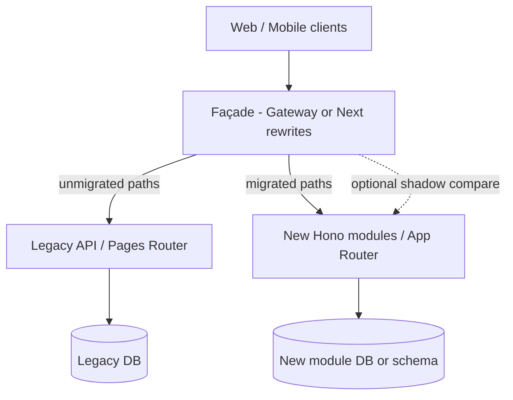

# Strangler Fig Migration Pattern

## One-line Definition

The Strangler Fig pattern migrates a legacy system **incrementally** by routing selected paths to new implementations until the old system is starved of traffic and can be removed — without a big-bang rewrite.

## Problem It Solves

Full rewrites of React/Next.js/Hono (or older Express/Rails) systems fail under parallel feature pressure. Strangler Fig lets you ship a new architecture (modular monolith, BFF, services) piece by piece behind the same product façade.

## When to Use It

- Existing production system that cannot stop for a rewrite
- Clear seams: routes, screens, or bounded contexts to peel off
- Team can invest in routing, dual-run, and parity checks
- Migration target is known (e.g. Express → Hono, Pages Router → App Router, blob → modular monolith)
- Risk reduction matters more than speed of “clean rewrite”

## When Not to Use It

- Greenfield apps — there is nothing to strangle
- No routing/proxy ability to split traffic
- Team keeps building forever on both old and new without a kill plan
- Attempting to strangle with no behavioral parity tests

## Best Fit by Application Type

| Application type | Fit | Why |
|---|---:|---|
| Small React SPA | Medium | Migrate routers/state library incrementally |
| Large React dashboard | Good | Screen-by-screen migration |
| Next.js App Router app | Good | Pages Router → App Router strangling |
| Hono API | Good | Route-by-route cutover from legacy API |
| Background worker | Good | Job-by-job migration |
| Mobile app API | Good | Path-based cutover behind gateway |
| Marketplace / booking system | Good | Context-by-context extraction |
| Internal admin panel | Good | Low-risk incremental UI rewrites |

## Frontend, Backend, or Both?

**Migration / cross-cutting system design** applicable to frontend, backend, and edge routing.

In React + Next.js + Hono:

- Put a gateway or Next.js rewrites in front of legacy + new Hono
- Migrate one bounded context (e.g. bookings) fully before the next
- For UI: route group by group to App Router modules
- Keep contracts stable for mobile clients during cutover

## Core Rules

- Identify a façade (hostname, gateway, Next rewrites) that can choose old vs new
- Migrate by **complete vertical** (UI + API + data ownership) when possible, not only cosmetic UI
- New code must not keep expanding the legacy core
- Dual-write/dual-read only with an explicit end date
- Parity tests or shadow traffic before hard cutover
- Never leave “temporary” branches without owners and deadlines
- Data migration strategy decided per context (sync, batch, expand-contract)

## Dependency Diagram



## Recommended Folder Structure

### 1. React frontend

```text
apps/web/src/
  legacy/                            # old screens still served
  modules/booking/                   # strangled new module
  shell/router.tsx                   # routes old vs new
```

### 2. Next.js App Router frontend

```text
apps/web/
  pages/                             # legacy Pages Router
    account/[...slug].tsx
  app/
    bookings/                        # new App Router area
      page.tsx
  next.config.ts                     # rewrites / redirects during migration
```

```ts
// next.config.ts (illustrative)
const nextConfig = {
  async rewrites() {
    return [
      // Proxy selected API calls to new Hono during migration
      { source: "/api/bookings/:path*", destination: "http://new-api:3001/bookings/:path*" },
    ];
  },
};
```

### 3. Hono backend

```text
apps/api-legacy/                     # old server still running
apps/api/                            # new modular Hono
  src/modules/booking/               # first strangled context
infra/gateway/routes.yaml            # /bookings → new, else → legacy
```

### 4. Monorepo

```text
apps/
  web/
  api/                               # new
  api-legacy/                        # old (temporary)
packages/contracts/
docs/migration/booking-cutover.md
```

## Implementation Example

Gateway path cutover:

```yaml
# infra/gateway/routes.yaml
routes:
  - match: /v1/bookings
    upstream: http://api-new:3001
  - match: /v1/*
    upstream: http://api-legacy:3000
```

Parity check for a command:

```ts
// temporary shadow compare in façade (remove after cutover)
async function createBooking(req: Request) {
  const body = await req.json();
  const [legacyResult, newResult] = await Promise.all([
    legacyClient.createBooking(body),
    newClient.createBooking(body).catch((e) => ({ error: String(e) })),
  ]);
  logParityDiff("createBooking", legacyResult, newResult);
  return legacyResult; // still serving legacy until confidence is high
}
```

Expand-contract data migration sketch:

```ts
// 1) Expand: new column/table written by both systems
// 2) Migrate: backfill
// 3) Cut reads to new
// 4) Contract: remove legacy writes
```

## Testing Strategy

- **Unit:** new module tests as primary safety net
- **Integration:** new API against migrated schema
- **Contract:** keep external client contracts stable; version if needed
- **E2E:** critical journeys on façade after each cutover
- **Parity / shadow:** compare responses for sampled traffic
- **Mocking:** do not mock away the façade routing tests

## Common Mistakes

- Big-bang rewrite labeled “strangler” with no incremental routing
- Migrating only UI while still coupling to legacy APIs forever
- Permanent dual-write without contract removal
- No metrics on % traffic still on legacy
- Strangling by technical layers (all repos first) instead of business capabilities

## Migration Path

1. Establish façade (gateway or Next rewrites) and metrics
2. Choose the smallest valuable bounded context (e.g. Promo codes or Bookings)
3. Build new Hono module + Next routes with parity tests
4. Shadow traffic → percentage cutover → hard cutover
5. Delete legacy code paths; repeat for the next context
6. Decommission legacy app when traffic is zero

## Related Architectures

| Other architecture | Relationship | Why |
|---|---|---|
| Modular monolith | Natural combination | Common migration target |
| Microservices | Natural combination | Extract contexts as services gradually |
| API Gateway | Natural combination | Ideal strangler façade |
| BFF | Natural combination | New BFF can strangle old client aggregation |
| SCS | Natural combination | Peel into self-contained systems |
| Event-Driven | Possible but requires discipline | Sync/async during dual-run needs care |
| Clean/Hexagonal rewrite only | Possible but requires discipline | Apply inside new modules while strangling |
| Big-bang rewrite | Mutually exclusive at the same boundary | Opposite migration strategies |
