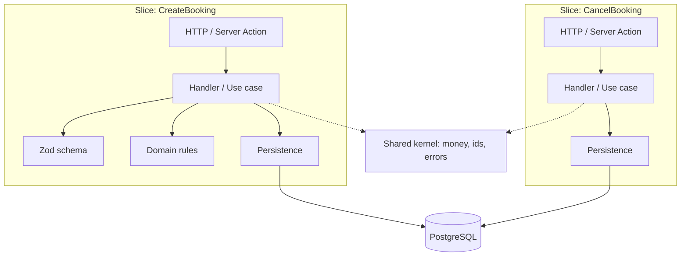
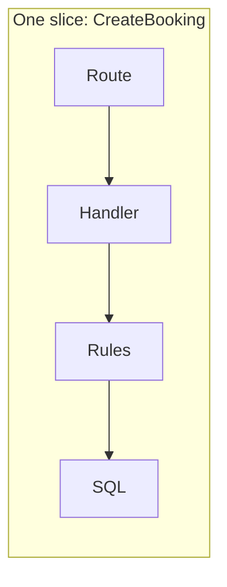

# Vertical Slice Architecture

## One-line Definition

Organize code by **feature use case** (a vertical slice) instead of by technical layer. Each slice owns its request handling, validation, business rules, and data access for that feature, so a change stays inside one folder.

## Problem It Solves

Horizontal layers force every product change to touch presentation, application, domain, and infrastructure folders. Related code scatters; unrelated features share bloated services. Vertical slices keep “create booking” together so reviews, ownership, and deletion stay local.

## When to Use It

- Small to mid-size teams shipping features end-to-end
- Product complexity is feature-shaped (many independent commands/queries)
- Domain rules exist but are not deeply intertwined across the whole system
- You want fast feature delivery with clear ownership per slice
- Maintenance expectation: add slices without rewriting shared layers
- Works well inside a modular monolith module or a Hono API package

## When Not to Use It

- Deep shared domain model with many cross-feature invariants (prefer DDD modules first)
- Extremely thin CRUD with no behavior — slices become empty ceremony
- Team wants strict technical-layer reviews and shared “service” ownership
- Uncontrolled copy-paste of repositories/validators across slices without extracting shared kernels carefully

## Best Fit by Application Type

| Application type | Fit | Why |
|---|---:|---|
| Small React SPA | Good | Feature folders map cleanly to screens and hooks |
| Large React dashboard | Good | Each widget/workflow can own its slice |
| Next.js App Router app | Good | Route segments align with slices (`app/bookings/...`) |
| Hono API | Good | One route + handler + repo per command/query |
| Background worker | Good | Each job is a slice with its own handler |
| Mobile app API | Good | Endpoint-per-feature ownership is easy to reason about |
| Marketplace / booking system | Good | Book, pay, cancel, refund are natural slices |
| Internal admin panel | Good | Admin actions are discrete commands |

## Frontend, Backend, or Both?

**Both** — primarily an **internal organization** pattern for frontend and backend codebases.

In a React + Next.js + Hono stack:

- **Hono:** each command/query is a slice under a module (`bookings/create-booking/`)
- **Next.js:** App Router segment + server actions / route handlers co-located with UI for that feature
- **React SPA:** `features/create-booking/` owns components, hooks, API calls, and local types
- Combine with modular monolith: modules first, slices inside modules

## Core Rules

- A slice may contain presentation, application logic, and persistence for **that feature only**
- Slices **do not** import another slice’s internal files — only shared kernels or a module public API
- Prefer duplication of small helpers over premature shared layers; extract when a third slice needs the same rule
- Domain rules used by one slice live in that slice; cross-slice rules move to a shared domain package inside the module
- Route handlers / page files may validate input and call the slice handler — they must not contain business rules or SQL
- Framework types (Hono `Context`, Next.js `cookies()`) stay at the slice edge, not in pure handlers when you need unit tests
- Shared infrastructure (DB client, logger) is injected or imported as a **tool**, not as a dumping-ground service layer

## Dependency Diagram



## Recommended Folder Structure

### 1. React frontend

```text
apps/web/src/
  features/
    create-booking/
      CreateBookingForm.tsx
      useCreateBooking.ts
      createBooking.api.ts
      createBooking.schema.ts
      bookingAvailability.ts          # client-side rule copy if needed
    cancel-booking/
      CancelBookingButton.tsx
      useCancelBooking.ts
      cancelBooking.api.ts
  shared/
    api/http.ts
    lib/money.ts
```

### 2. Next.js App Router frontend

```text
apps/web/
  app/(app)/bookings/
    page.tsx                         # list — thin
    new/
      page.tsx
      actions.ts                     # server action → createBooking slice
    [id]/
      page.tsx
      cancel-action.ts
  features/
    create-booking/
      create-booking.ts              # use case (framework-light)
      create-booking.schema.ts
      CreateBookingForm.tsx
    cancel-booking/
      cancel-booking.ts
      CancelBookingButton.tsx
  shared/
    db.ts
    money.ts
```

### 3. Hono backend

```text
apps/api/src/
  modules/bookings/
    create-booking/
      create-booking.route.ts        # POST /bookings
      create-booking.handler.ts
      create-booking.schema.ts
      create-booking.sql.ts          # Drizzle queries for this slice
    cancel-booking/
      cancel-booking.route.ts
      cancel-booking.handler.ts
      cancel-booking.sql.ts
    shared/
      booking-errors.ts
      booking-id.ts
    index.ts                         # mounts slice routes
  main.ts
```

### 4. Monorepo (relevant)

```text
apps/api/src/modules/bookings/...    # slices inside business module
apps/web/features/...                # matching feature names
packages/shared/src/money.ts         # cross-app primitives only
```

## Implementation Example

Booking create slice in Hono + TypeScript:

```ts
// modules/bookings/create-booking/create-booking.schema.ts
import { z } from "zod";

export const createBookingInput = z.object({
  listingId: z.string().uuid(),
  guestId: z.string().uuid(),
  checkIn: z.string().date(),
  checkOut: z.string().date(),
  guests: z.number().int().min(1).max(16),
});

export type CreateBookingInput = z.infer<typeof createBookingInput>;
```

```ts
// modules/bookings/create-booking/create-booking.handler.ts
import type { CreateBookingInput } from "./create-booking.schema";
import { assertDateRange, BookingConflictError } from "../shared/booking-errors";
import { insertBookingIfAvailable } from "./create-booking.sql";

export async function createBooking(input: CreateBookingInput, deps: {
  db: Db;
  now: () => Date;
}) {
  assertDateRange(input.checkIn, input.checkOut);

  const row = await insertBookingIfAvailable(deps.db, {
    ...input,
    status: "pending",
    createdAt: deps.now(),
  });

  if (!row) throw new BookingConflictError(input.listingId);
  return { bookingId: row.id, status: row.status };
}
```

```ts
// modules/bookings/create-booking/create-booking.route.ts
import { Hono } from "hono";
import { createBookingInput } from "./create-booking.schema";
import { createBooking } from "./create-booking.handler";

export const createBookingRoute = new Hono();

createBookingRoute.post("/", async (c) => {
  const input = createBookingInput.parse(await c.req.json());
  const result = await createBooking(input, { db: c.get("db"), now: () => new Date() });
  return c.json(result, 201);
});
```

## Testing Strategy

- **Unit:** handler + domain asserts with fake `db` / in-memory insert
- **Integration:** slice SQL against a test Postgres (or transactional test DB)
- **Contract:** Zod schemas shared or duplicated carefully between web and API; OpenAPI/contract tests if clients diverge
- **E2E:** one happy path per critical slice (create → pay → cancel)
- **Mocking:** mock driven deps at the handler boundary; do not mock every internal function inside the slice

## Common Mistakes

- Building a shared `BookingService` that every slice calls — recreates layered dumping grounds
- Cross-importing `create-booking.sql` from `cancel-booking` — hidden coupling
- Putting all Zod schemas in one giant `schemas.ts` — defeats locality
- Empty slices that only forward to a shared layer — ceremony without benefit
- Extracting “base repository” too early — forces horizontal change again

## Migration Path

1. Pick one hot feature (e.g. create booking) and co-locate route, handler, schema, SQL
2. Stop adding methods to the old shared service for that feature
3. Leave unrelated features in layers until touched
4. When a second feature needs the same rule, extract a small `shared/` inside the module
5. Optionally rename App Router folders to match slice names for traceability

## 1. Dummy — 30-second picture



**Why:** a product change should live in **one folder**, not four horizontal layers.

## 4. Rich — failure & seams (extra)

| Failure | Stay inside the slice |
|---------|------------------------|
| Validation | Zod at edge; domain asserts in handler |
| Conflict | Domain/SQL unique path → mapped HTTP status in route |
| Shared rule used thrice | Extract `module/shared`, not a global service layer |

## 5. Professional / CTO

| Signal | Decision |
|--------|----------|
| God `BookingService` returns | Re-slice; ban new methods on the god object |
| Cross-slice SQL imports | Enforce module public API / shared kernel only |
| Team ships features E2E | Prefer slices inside [modular monolith](modular-monolith.md) |

**ADR triggers:** adopting slices repo-wide · extracting a shared kernel · combining slices with hexagonal ports at module edge.

**Automate:** lint against deep imports across slice folders; PR template “files touched stay under one slice?”

## 1. Dummy — 30-second picture


**Why:** a product change should live in **one folder**, not four horizontal layers.

## 4. Rich — failure & seams (extra)

| Failure | Stay inside the slice |
|---------|------------------------|
| Validation | Zod at edge; domain asserts in handler |
| Conflict | Domain/SQL unique path → mapped HTTP status in route |
| Shared rule used thrice | Extract `module/shared`, not a global service layer |

## 5. Professional / CTO

| Signal | Decision |
|--------|----------|
| God `BookingService` returns | Re-slice; ban new methods on the god object |
| Cross-slice SQL imports | Enforce module public API / shared kernel only |
| Team ships features E2E | Prefer slices inside [modular monolith](modular-monolith.md) |

**ADR triggers:** adopting slices repo-wide · extracting a shared kernel · combining slices with hexagonal ports at module edge.

**Automate:** lint against deep imports across slice folders; PR template “files touched stay under one slice?”

## Related Architectures

| Other architecture | Relationship | Why |
|---|---|---|
| Modular monolith | Natural combination | Modules own capabilities; slices organize inside |
| Layered | Possible but requires discipline | Can start layered and migrate feature-by-feature to slices |
| Hexagonal / Clean | Possible but requires discipline | Ports inside a slice, or shared ports at module edge |
| Feature-Sliced Design | Natural combination | FSD is a frontend-specific relative of feature-first slices |
| Microservices | Possible but requires discipline | Each service can be slice-organized; slices ≠ services |
| Classic layered-only org | Usually avoid | Competing folder strategies at the same boundary |
| Event Sourcing | Possible but requires discipline | Event-sourced writes can still be one slice per command |

## Where in this repo

Default **inside-module** organization for walkthroughs and examples (`Docs/examples/vertical-slice-todo`).

## Where in this repo

Default **inside-module** organization for walkthroughs and examples (`Docs/examples/vertical-slice-todo`).
