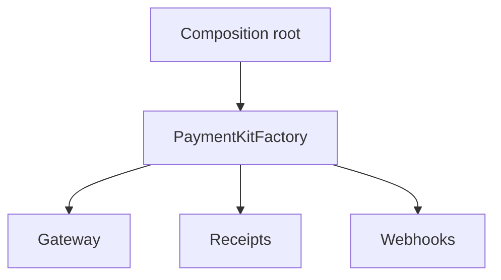

# Abstract Factory pattern

## What it is

Creates **families of related objects** without specifying their concrete classes. Clients depend on abstract product types; a concrete factory produces a matching set.

## توضیح فارسی

**Abstract Factory** یک **خانوادهٔ اشیاء مرتبط** می‌سازد بدون اینکه کلاینت کلاس‌های مشخص را بشناسد. تفاوتش با Factory معمولی: اینجا چند محصول هم‌خانواده با هم ساخته می‌شوند (مثلاً درگاه پرداخت + رسید + وب‌هوک همان فروشنده). اگر Stripe را انتخاب کردید، نباید رسید Adyen با درگاه Stripe قاطی شود.

## 1. Dummy — Mermaid diagram + one sentence why



**Why:** pick one provider once—gateway, receipt formatting, and webhook verification stay in the same family.

## 2. When / when not · Good · Bad

### When to use

- Multiple products must stay consistent (vendor A UI + vendor A API + vendor A webhooks)
- Theme / environment kits (sandbox vs live) that ship together

### When not to use

- Only one product type exists — use a simple factory
- “Family” is imaginary; products never ship together

### Good practice

- Factory interface returns ports, not SDKs
- Composition root picks one concrete factory for the process

### Bad / worst practice

- **Bad:** mixing Stripe charge with Adyen receipt formatter
- **Worst:** abstract factory with a single product forever

**Trade-offs:** Consistency across a family vs more interfaces.

## 3. Working — Hono worst/best + React worst/best TypeScript examples

Real example — Marketplace payment kit (Stripe vs Adyen).

### Backend (Hono) — worst practice

```ts
// ❌ Scatter provider choice — easy to cross-wire
const payments = new StripePaymentGateway(stripe);
const receipts = new AdyenReceiptFormatter(); // wrong family
```

### Backend (Hono) — best practice

```ts
interface PaymentGateway { charge(input: ChargeInput): Promise<ChargeResult> }
interface ReceiptFormatter { lines(order: Order, charge: ChargeResult): string[] }
interface WebhookVerifier { verify(rawBody: string, signature: string): boolean }

interface PaymentKitFactory {
  gateway(): PaymentGateway;
  receipts(): ReceiptFormatter;
  webhooks(): WebhookVerifier;
}

class StripeKitFactory implements PaymentKitFactory {
  gateway() { return new StripePaymentGateway(stripe); }
  receipts() { return new StripeReceiptFormatter(); }
  webhooks() { return new StripeWebhookVerifier(process.env.STRIPE_WEBHOOK_SECRET!); }
}

function createPaymentKit(provider: "stripe" | "adyen"): PaymentKitFactory {
  return provider === "adyen" ? new AdyenKitFactory() : new StripeKitFactory();
}

const kit = createPaymentKit(env.PAYMENTS_PROVIDER);
const app = createApp({ payments: kit.gateway(), receipts: kit.receipts(), webhooks: kit.webhooks() });
```

### Frontend (React) — worst practice

```tsx
// ❌ Mix providers in the page
<StripePayBox />
<AdyenReceipt orderId={orderId} />
```

### Frontend (React) — best practice

```ts
interface CheckoutKit {
  PaymentForm: React.FC<{ clientSecret: string; onToken: (t: string) => void }>;
  ReceiptView: React.FC<{ orderId: string }>;
}

const kit = createCheckoutKit(import.meta.env.VITE_PAYMENTS_PROVIDER);
<CheckoutPage PaymentForm={kit.PaymentForm} ReceiptView={kit.ReceiptView} />;
```

## 4. Rich — edge cases · testing seams

**Edge cases**

- **Sandbox vs live:** two factory implementations; env flag chooses once at boot.
- **Partial rollout:** feature flag per workspace—not per-request factory construction.
- **Webhook route:** must use `kit.webhooks()` matching the charge provider.

**Testing seams**

- `FakePaymentKitFactory` returning in-memory gateway + snapshot receipt lines.
- Contract test: each factory’s three products agree on provider id.

## 5. CTO — overuse signals · monorepo placement

### Overuse signals

- Factory interface with one method for months
- New provider requires editing five apps instead of one kit module

### Alternatives

- [Adapter](adapter.md) when only one port (charge) exists
- [Factory Method](factory-method.md) when one workflow owns creation

### Monorepo placement

| Piece | Location |
|-------|----------|
| `PaymentKitFactory` + Stripe/Adyen kits | `packages/infrastructure/payments` |
| Env selection | `apps/api/src/main.ts`, `apps/web/src/main.tsx` |
| Ports | `packages/application` |

## Related · Where in this repo

**Related:** [Factory](factory.md), [Factory Method](factory-method.md), [Adapter](adapter.md)

**Where:** Pairs with marketplace adapter examples; kit selection belongs in the composition root.