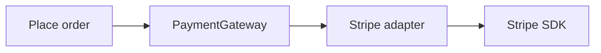

# Adapter pattern

## What it is

Converts one interface into another the client expects. In hexagonal terms: **implements a port** for an external technology.

## توضیح فارسی

**Adapter** رابط یک سیستم بیرونی (مثلاً Stripe یا Adyen) را به قراردادی تبدیل می‌کند که دامنه/use case انتظار دارد. SDK فروشنده داخل فایل adapter می‌ماند؛ هسته فقط «پرداخت موفق با reference» یا «رد شدن با دلیل» را می‌فهمد. در مارکت‌پلیس، هم درگاه پرداخت سمت Hono و هم ویجت پرداخت سمت React معمولاً adapter هستند.

## 1. Dummy — Mermaid diagram + one sentence why



**Why:** the use case speaks one port—vendor SDKs stay behind adapters you can swap or fake.

## 2. When / when not · Good · Bad

### When to use

- Vendor SDKs (pg, mysql, libsql) behind a stable port
- Capacitor plugin wrapped for the app

### When not to use

- Wrapping your own simple function with no mismatch
- Adapter that only renames methods without isolating anything

### Good practice

- Keep vendor types inside the adapter file/package
- Document behavioral differences honestly

### Bad / worst practice

- **Bad:** “adapter” that re-exports the SDK unchanged into domain
- **Worst:** catching all errors and returning null everywhere

**Trade-offs:** Boilerplate vs isolation and replaceability.

## 3. Working — Hono worst/best + React worst/best TypeScript examples

### Real example — Marketplace checkout

A marketplace captures payment when a buyer places an order. Stripe talks in PaymentIntents (`amount`, `payment_method`, `StripeCardError.code`). Adyen talks in `/payments` (`amount.value`, `resultCode`: `Authorised` or `Refused`). The order use case needs neither vocabulary. It needs “captured, here is the provider reference” or “declined, here is a reason the buyer can read.”

The checkout page has the matching problem. Stripe Elements and the Adyen Drop-in mount and submit differently. The Pay button needs one `submit()` that resolves to a payment-method token. The API charges that token. Widget objects stay inside the adapter.

Teaching snippets, not a runnable app. Which fee and tax math apply is a strategy concern: [strategy.md](strategy.md).

### Backend (Hono) — worst practice

```ts
// ❌ Order flow imports Stripe. Adyen means editing this function.
import Stripe from "stripe";

const stripe = new Stripe(process.env.STRIPE_SECRET_KEY!);

export async function captureOrder(order: { id: string; totalCents: number; currency: string }) {
  try {
    const intent = await stripe.paymentIntents.create({
      amount: order.totalCents,
      currency: order.currency,
      confirm: true,
    });
    await db.query("UPDATE orders SET status = 'paid', stripe_id = $1 WHERE id = $2", [
      intent.id,
      order.id,
    ]);
  } catch {
    return null; // declined, network down, and bad keys look the same
  }
}
```

### Backend (Hono) — best practice

```ts
export type Money = { amountCents: number; currency: "usd" | "eur" };

export type ChargeResult =
  | { status: "captured"; providerRef: string }
  | { status: "declined"; reason: "insufficient_funds" | "expired_card" | "refused" };

/** Port the order use case owns. Provider SDKs do not appear here. */
export interface PaymentGateway {
  charge(input: {
    orderId: string;
    money: Money;
    paymentMethodToken: string;
  }): Promise<ChargeResult>;
}

export async function captureOrderPayment(
  order: { id: string; total: Money; paymentMethodToken: string },
  payments: PaymentGateway,
  orders: { markPaid(orderId: string, providerRef: string): Promise<void> },
): Promise<ChargeResult> {
  const result = await payments.charge({
    orderId: order.id,
    money: order.total,
    paymentMethodToken: order.paymentMethodToken,
  });
  if (result.status === "captured") await orders.markPaid(order.id, result.providerRef);
  return result;
}
```

Stripe’s adapter maps card declines onto that union. Anything that is not a card decline still throws, so a timeout is not stored as “refused.”

```ts
import Stripe from "stripe";
import { ChargeResult, PaymentGateway } from "@fsab/application";

function declineReason(
  code: string | undefined,
): "insufficient_funds" | "expired_card" | "refused" {
  if (code === "insufficient_funds") return "insufficient_funds";
  if (code === "expired_card") return "expired_card";
  return "refused";
}

export class StripePaymentGateway implements PaymentGateway {
  constructor(private readonly stripe: Stripe) {}

  async charge(input): Promise<ChargeResult> {
    try {
      const intent = await this.stripe.paymentIntents.create({
        amount: input.money.amountCents,
        currency: input.money.currency,
        payment_method: input.paymentMethodToken,
        confirm: true,
        metadata: { orderId: input.orderId },
      });
      if (intent.status !== "succeeded") return { status: "declined", reason: "refused" };
      return { status: "captured", providerRef: intent.id };
    } catch (error) {
      if (error instanceof Stripe.errors.StripeCardError) {
        return { status: "declined", reason: declineReason(error.code) };
      }
      throw error;
    }
  }
}
```

The Adyen adapter is a separate file. It posts `{ amount: { value: amountCents, currency }, reference: orderId }` and maps `resultCode === "Authorised"` to `captured` and a refusal code to the same `reason` union. `captureOrderPayment` does not change when EU traffic moves to Adyen. The composition root picks the gateway from config. That selection is the factory: [factory.md](factory.md).

The Hono route only parses the order id and the token, calls `captureOrderPayment`, and maps `declined` to `402` and an unexpected throw to `502`. It does not import `stripe` or `@adyen/api-library`.

### Frontend (React) — worst practice

`CheckoutPage` imports `@stripe/react-stripe-js` and `@adyen/adyen-web`. A `provider === "adyen"` branch mounts a Drop-in in the same component that places the order. Stripe’s `PaymentIntent` object gets passed into `fetch` as the JSON body.

### Frontend (React) — best practice

```ts
/** What the Pay button needs. Stripe Elements and Adyen Drop-in both hide behind this. */
export type PaymentHandle = {
  submit(): Promise<{ paymentMethodToken: string }>;
  destroy(): void;
};

export interface PaymentFormAdapter {
  mount(container: HTMLElement, clientSecret: string): Promise<PaymentHandle>;
}
```

```ts
import { Stripe, StripeElements } from "@stripe/stripe-js";

export function createStripePaymentForm(stripe: Stripe): PaymentFormAdapter {
  return {
    async mount(container, clientSecret) {
      const elements: StripeElements = stripe.elements({ clientSecret });
      const payment = elements.create("payment");
      payment.mount(container);

      return {
        async submit() {
          const { error: invalid } = await elements.submit();
          if (invalid) throw new Error(invalid.message ?? "PAYMENT_UI_FAILED");

          const { error, paymentMethod } = await stripe.createPaymentMethod({ elements });
          if (error || !paymentMethod) {
            throw new Error(error?.message ?? "PAYMENT_UI_FAILED");
          }
          return { paymentMethodToken: paymentMethod.id };
        },
        destroy() {
          payment.destroy();
        },
      };
    },
  };
}
```

Adyen’s adapter mounts a Drop-in and resolves `submit()` from Drop-in’s `onSubmit` payload (`state.data.paymentMethod` serialized to the token string). Stripe’s `submit()` is a promise; Adyen’s completion is a callback. That difference stays in the adapter. Document it next to the class so the next provider is mapped the same way.

```tsx
"use client";

import { useEffect, useRef, useState } from "react";

export function CheckoutPayBox({
  form,
  clientSecret,
  onToken,
}: {
  form: PaymentFormAdapter;
  clientSecret: string;
  onToken: (paymentMethodToken: string) => Promise<void>;
}) {
  const containerRef = useRef<HTMLDivElement>(null);
  const handleRef = useRef<PaymentHandle | null>(null);
  const [ready, setReady] = useState(false);
  const [error, setError] = useState<string | null>(null);

  useEffect(() => {
    const container = containerRef.current;
    if (!container) return;
    let cancelled = false;

    void form.mount(container, clientSecret).then((handle) => {
      if (cancelled) {
        handle.destroy();
        return;
      }
      handleRef.current = handle;
      setReady(true);
    });

    return () => {
      cancelled = true;
      handleRef.current?.destroy();
      handleRef.current = null;
    };
  }, [form, clientSecret]);

  async function onPay() {
    const handle = handleRef.current;
    if (!handle) return;
    setError(null);
    try {
      const { paymentMethodToken } = await handle.submit();
      await onToken(paymentMethodToken);
    } catch (caught) {
      setError(caught instanceof Error ? caught.message : "Payment failed");
    }
  }

  return (
    <section>
      <div ref={containerRef} />
      {error && <p>{error}</p>}
      <button type="button" disabled={!ready} onClick={() => void onPay()}>
        Pay
      </button>
    </section>
  );
}
```

`onToken` posts `{ paymentMethodToken }` to the Hono capture route. The React tree never sees a Stripe `PaymentMethod` or an Adyen `PaymentMethodData`.

### Side-by-side

| Change | Without an adapter | With an adapter |
|--------|--------------------|-----------------|
| Take Adyen in the EU | Edit `captureOrder` and `CheckoutPage` | New gateway class and new form adapter; composition root switches |
| Card declined | `catch` returns `null` | `402` with `insufficient_funds` or `expired_card` |
| Stripe.js API change | Pay button and order use case both break | One file, `createStripePaymentForm`, breaks |

## 4. Rich — edge cases · testing seams

**Edge cases**

- **Declined vs error:** adapters map provider codes to domain reasons—never blanket `null`.
- **3DS / async capture:** adapter documents pending states the use case must handle.
- **React widget lifecycle:** mount/unmount inside adapter; page calls `submit()` only.

**Testing seams**

- `FakePaymentGateway` implementing the port for order tests.
- Contract tests per adapter file when SDK responses drift.

## 5. CTO — overuse signals · monorepo placement

### Overuse signals

- Adapter that re-exports entire SDK to `packages/domain`
- One adapter file per method instead of one bounded context port

### Alternatives

- [Facade](facade.md) when orchestrating many calls, not translating one port

### Monorepo placement

| Piece | Location |
|-------|----------|
| Ports | `packages/application` |
| Stripe/Adyen/pg adapters | `packages/infrastructure` |
| Payment form adapters | `apps/web` |

## Related · Where in this repo

**Related:** Hexagonal, LSP, OCP

**Where:** `packages/db` vendor adapters; mobile secure storage (planned). Course A9 — [COURSE.md](../COURSE.md).
