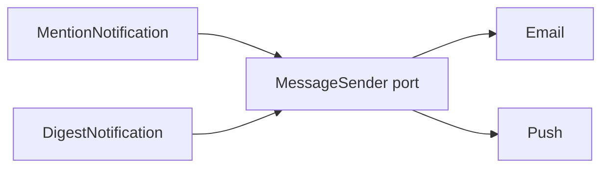

# Bridge pattern

## What it is

Separates an **abstraction** from its **implementation** so both can vary independently. Two orthogonal dimensions stop collapsing into one inheritance explosion.

## توضیح فارسی

**Bridge** انتزاع را از پیاده‌سازی جدا می‌کند تا هر دو مستقل عوض شوند. مثال: نوع اعلان (Mention، Receipt، Digest) یک بعد است؛ کانال ارسال (Email، Push، Slack) بعد دیگر. بدون Bridge معمولاً کلاس‌هایی مثل `EmailMention`، `PushMention`، `EmailReceipt`… زیاد می‌شوند. با Bridge، اعلان به یک `Sender` وصل می‌شود و کانال جدا عوض می‌شود.

## 1. Dummy — Mermaid diagram + one sentence why



**Why:** add Slack without inventing `SlackMentionNotification` and `SlackDigestNotification` subclasses for every pair.

## 2. When / when not · Good · Bad

### When to use

- Two independent axes of change (notification kind × channel, report × renderer)
- You want to avoid a Cartesian product of subclasses

### When not to use

- Only one implementation will ever exist
- [Strategy](strategy.md) alone already covers a single axis of algorithms

### Good practice

- Abstraction holds a reference to the implementor port
- Compose in the composition root

### Bad / worst practice

- **Bad:** bridge that still hard-codes the implementor inside the abstraction
- **Worst:** renaming inheritance as “bridge” with no second axis

**Trade-offs:** Independent extension vs an extra interface layer.

## 3. Working — Hono worst/best + React worst/best TypeScript examples

Real example — Chat notifications × channels.

### Backend (Hono) — worst practice

```ts
// ❌ Cartesian product of classes
class EmailMention { /* SES mention */ }
class PushMention { /* FCM mention */ }
class EmailDigest { /* SES digest */ }
class PushDigest { /* FCM digest */ }
```

### Backend (Hono) — best practice

```ts
interface MessageSender {
  send(toUserId: string, title: string, body: string): Promise<void>;
}

abstract class Notification {
  constructor(protected readonly sender: MessageSender) {}
  abstract deliver(userId: string, payload: Record<string, string>): Promise<void>;
}

class MentionNotification extends Notification {
  async deliver(userId: string, payload: Record<string, string>) {
    await this.sender.send(userId, "You were mentioned", payload.body);
  }
}

const mentionPush = new MentionNotification(new PushSender());
const digestEmail = new DigestNotification(new EmailSender());
```

### Frontend (React) — worst practice

```tsx
function MentionToast() { /* hard-coded toast */ }
function MentionInboxRow() { /* duplicate markup */ }
```

### Frontend (React) — best practice

```tsx
type Renderer = (props: { title: string; body: string }) => React.ReactNode;

function NotificationView({
  title,
  body,
  renderer: Renderer,
}: {
  title: string;
  body: string;
  renderer: Renderer;
}) {
  return <>{Renderer({ title, body })}</>;
}
```

## 4. Rich — edge cases · testing seams

**Edge cases**

- **Per-user channel preference:** select `MessageSender` at runtime, keep notification type.
- **Failure on one channel:** bridge does not imply retry—wrap sender with policy.
- **React renderers:** swapping renderer should not remount unrelated shell.

**Testing seams**

- `FakeMessageSender` recording deliveries; test mention vs digest with same fake.
- Renderer swap test: inbox vs toast component receives same props.

## 5. CTO — overuse signals · monorepo placement

### Overuse signals

- Only one axis ever changes but you maintain abstract class hierarchy
- Bridge interfaces duplicated across API and web with drift

### Alternatives

- Strategy for one-dimensional algorithm swap
- Config table `{ kind, channel } -> handler` for small matrices

### Monorepo placement

| Piece | Location |
|-------|----------|
| `MessageSender` adapters | `packages/infrastructure/notifications` |
| Notification abstractions | `packages/application` |
| `Renderer` bridge in UI | `apps/web/src/notifications` |

## Related · Where in this repo

**Related:** [Strategy](strategy.md), [Abstract Factory](abstract-factory.md), [Adapter](adapter.md)

**Where:** Teaching pattern when product events and delivery channels multiply.