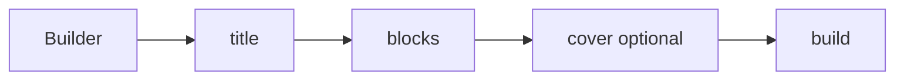

# Builder pattern

## What it is

Constructs a complex object **step by step**. The same construction process can produce different representations.

## توضیح فارسی

**Builder** شیء پیچیده را قدم‌به‌قدم می‌سازد. فرآیند ساخت ثابت می‌ماند؛ خروجی می‌تواند فرق کند (مثلاً همان صفحهٔ Notion یک‌بار PDF و یک‌بار Markdown شود). وقتی سازندهٔ شیء آرگومان‌های زیاد، ترتیب حساس، یا شاخه‌های اختیاری دارد، Builder خوانایی و اعتبارسنجی نهایی را بهتر از یک سازندهٔ غول‌پیکر نگه می‌دارد.

## 1. Dummy — Mermaid diagram + one sentence why



**Why:** fluent steps assemble a valid export only at `build()`—not half-built objects in flight.

## 2. When / when not · Good · Bad

### When to use

- Export / report objects with many optional sections
- Fluent APIs that must validate only at `build()`

### When not to use

- A plain object literal or one constructor is enough
- Every field is required and independent — no assembly story

### Good practice

- `build()` fails fast if required steps were skipped
- Keep the director (orchestration) separate from the concrete builder when formats multiply

### Bad / worst practice

- **Bad:** builder that mutates a shared global document
- **Worst:** `build()` that returns a half-valid object “for convenience”

**Trade-offs:** Clear step API vs more types than a single factory function.

## 3. Working — Hono worst/best + React worst/best TypeScript examples

Real example — Notion page export (Markdown vs PDF job).

### Backend (Hono) — worst practice

```ts
function exportPage(page: Page, format: string) {
  let md = "";
  if (!page.title) return { error: "no title" };
  md += `# ${page.title}\n\n`;
  for (const block of page.blocks) {
    if (block.type === "paragraph") md += block.text + "\n";
    // pdf branch copy-pasted below
  }
  if (format === "pdf") return { pdfJob: { title: page.title, sections: md.split("\n") } };
  return { markdown: md };
}
```

### Backend (Hono) — best practice

```ts
interface PageExportBuilder {
  title(value: string): this;
  block(block: { type: string; text?: string; url?: string }): this;
  cover(url: string): this;
  build(): { markdown: string } | { pdfJob: ExportDoc };
}

class MarkdownExportBuilder implements PageExportBuilder {
  private titleText = "";
  private lines: string[] = [];

  title(value: string) { this.titleText = value.trim(); return this; }
  block(block: { type: string; text?: string }) {
    if (block.type === "paragraph") this.lines.push(block.text ?? "");
    return this;
  }
  cover(url: string) { this.coverUrl = url; return this; }
  build() {
    if (!this.titleText) throw new Error("TITLE_REQUIRED");
    return { markdown: `# ${this.titleText}\n\n${this.lines.join("\n\n")}\n` };
  }
}

function exportPage(page: Page, builder: PageExportBuilder) {
  builder.title(page.title);
  for (const block of page.blocks) builder.block(block);
  return builder.build();
}
```

### Frontend (React) — worst practice

```tsx
function ExportDialog() {
  const [title, setTitle] = useState("");
  const [lines, setLines] = useState<string[]>([]);
  function download() {
    if (!title) alert("title"); // validate at click only, inconsistent
    const md = `# ${title}\n` + lines.join("\n");
    // ...
  }
}
```

### Frontend (React) — best practice

```tsx
function useExportDraft() {
  const [draft, setDraft] = useState<{ title?: string; lines: string[] }>({ lines: [] });

  return {
    setTitle: (title: string) => setDraft((d) => ({ ...d, title })),
    addLine: (line: string) => setDraft((d) => ({ ...d, lines: [...d.lines, line] })),
    buildMarkdown() {
      if (!draft.title?.trim()) throw new Error("TITLE_REQUIRED");
      return `# ${draft.title}\n\n${draft.lines.join("\n\n")}\n`;
    },
  };
}
```

## 4. Rich — edge cases · testing seams

**Edge cases**

- **Idempotent `title()`:** last call wins; document for API consumers.
- **Director pattern:** `exportPage` is director—reused across Markdown/PDF builders.
- **Streaming PDF:** builder may enqueue job id instead of bytes in `build()`.

**Testing seams**

- Builder unit tests: missing title throws on `build()`, not on `block()`.
- Golden test: fixture page + `MarkdownExportBuilder` output string.

## 5. CTO — overuse signals · monorepo placement

### Overuse signals

- Builder with 40 methods for a 3-field DTO
- Shared builder instance across requests (mutable state leak)

### Alternatives

- Zod parse at boundary for simple shapes
- [Factory](factory.md) when there is no stepwise assembly

### Monorepo placement

| Piece | Location |
|-------|----------|
| Export builders | `packages/application/exports` |
| `POST /pages/:id/export` | `apps/api` |
| `useExportDraft` | `apps/web` export dialog |

## Related · Where in this repo

**Related:** [Factory](factory.md), [Abstract Factory](abstract-factory.md)

**Where:** Teaching pattern for export flows; no dedicated example package yet.