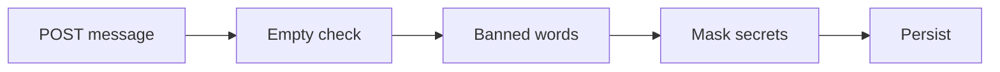

# Chain of Responsibility pattern

## What it is

Passes a request along a **chain of handlers** until one handles it (or each may handle and forward). Decouples the sender from the concrete receiver.

## توضیح فارسی

**Chain of Responsibility** درخواست را در زنجیره‌ای از handlerها جلو می‌برد تا یکی رسیدگی کند (یا هرکدام کاری بکند و رد کند). Middlewareهای Hono و پایپ‌لاین moderation چت همین ایده هستند: احراز هویت → محدودیت نرخ → فیلتر محتوا → ذخیره. فرستنده نمی‌داند کدام حلقه جواب نهایی را می‌دهد.

## 1. Dummy — Mermaid diagram + one sentence why



**Why:** add moderation stages by inserting links—without inflating one validator function.

## 2. When / when not · Good · Bad

### When to use

- Middleware pipelines
- Moderation / validation pipelines with optional stages
- Support ticket routing by rules

### When not to use

- A single definite handler is known
- Order is unclear and bugs become “who ate the request?”

### Good practice

- Explicit order; each handler has one job
- Terminal handler guarantees a response/error

### Bad / worst practice

- **Bad:** handlers that sometimes swallow errors silently
- **Worst:** dynamic chains that reorder per request without logs

**Trade-offs:** Flexible pipelines vs harder debugging of fall-through.

## 3. Working — Hono worst/best + React worst/best TypeScript examples

Real example — Chat message moderation + Hono middleware.

### Backend (Hono) — worst practice

```ts
app.post("/rooms/:roomId/messages", async (c) => {
  const body = (await c.req.json()).body;
  if (!body.trim()) return c.json({ code: "BODY_REQUIRED" }, 400);
  if (/\b(scam)\b/i.test(body)) return c.json({ code: "BLOCKED" }, 400);
  const redacted = body.replace(/sk-[a-zA-Z0-9]+/g, "[redacted]");
  // next check → edit this function again
  return c.json(await postMessage(redacted), 201);
});
```

### Backend (Hono) — best practice

```ts
type Msg = { roomId: string; authorId: string; body: string };
type Result = { ok: true; body: string } | { ok: false; code: string };

type Handler = { handle(msg: Msg): Promise<Result | "next"> };

async function runChain(msg: Msg, chain: Handler[]): Promise<Result> {
  for (const handler of chain) {
    const result = await handler.handle(msg);
    if (result !== "next") return result;
  }
  return { ok: false, code: "UNHANDLED" };
}

const chain = [stripEmpty, blockBannedWords, maskSecrets];
```

### Frontend (React) — worst practice

```tsx
function validate(body: string) {
  if (!body.trim()) return "Message required";
  if (body.length > 4000) return "Too long";
  if (/spam/.test(body)) return "Blocked";
  // all rules in one function
}
```

### Frontend (React) — best practice

```ts
type SubmitHandler = (body: string) => string | null;

const handlers: SubmitHandler[] = [
  (body) => (body.trim() ? null : "Message required"),
  (body) => (body.length > 4000 ? "Too long" : null),
];

function validateMessage(body: string) {
  for (const handler of handlers) {
    const error = handler(body);
    if (error) return error;
  }
  return null;
}
```

## 4. Rich — edge cases · testing seams

**Edge cases**

- **Short-circuit vs transform:** `maskSecrets` returns final body; document which handlers terminate.
- **Async handlers:** moderation ML step—chain must await consistently.
- **Hono middleware:** global vs route chain—order documented in README.

**Testing seams**

- Run `runChain` with fixture message through isolated handlers.
- Insert spy handler in array to assert order.

## 5. CTO — overuse signals · monorepo placement

### Overuse signals

- Chain length >10 with no diagram or integration test
- Handlers share mutable module state

### Alternatives

- [Decorator](decorator.md) for HTTP wrapper composition
- Schema validation (Zod) for static field rules at the edge

### Monorepo placement

| Piece | Location |
|-------|----------|
| Moderation handlers | `packages/application/chat/moderation` |
| `runChain` | `packages/application` or `apps/api` |
| Client validators | `apps/web/src/chat` |

## Related · Where in this repo

**Related:** [Decorator](decorator.md), middleware, [Template Method](template-method.md)

**Where:** Natural language for Hono middleware and moderation pipelines.