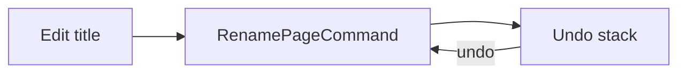

# Command pattern

## What it is

Represents an action as an **object** with `execute` (and often `undo`). Useful for queues, undo/redo stacks, logging, and scheduling.

## توضیح فارسی

**Command** یک عمل را به‌صورت **شیء** مدل می‌کند (`execute` / `undo`). برای صف کارها، undo/redo ادیتور، و لاگ دستورات عالی است. در Notion، هر ویرایش عنوان یا بلاک یک command است که می‌توان به پشتهٔ undo هل داد و بعداً برگرداند؛ در Hono می‌توان همان command را در outbox برای پردازش بعدی ذخیره کرد.

## 1. Dummy — Mermaid diagram + one sentence why



**Why:** treat each editor action as a reversible object—not a one-off mutation lost to history.

## 2. When / when not · Good · Bad

### When to use

- Undo/redo editors
- Job queues / outbox of domain actions
- Macro recording of user operations

### When not to use

- A plain function call is enough
- Every button becomes a class with no undo story

### Good practice

- Commands are immutable intents; apply to a receiver
- Undo must restore the previous memento/state explicitly

### Bad / worst practice

- **Bad:** command that reaches into React components directly
- **Worst:** undo that only works once because state was mutated in place without a snapshot

**Trade-offs:** Powerful history vs more types and memory for the stack.

## 3. Working — Hono worst/best + React worst/best TypeScript examples

Real example — Notion editor undo.

### Backend (Hono) — worst practice

```ts
app.post("/pages/:id/rename", async (c) => {
  const { title } = await c.req.json();
  await pages.saveTitle(c.req.param("id"), title); // no audit trail; no undo contract
  return c.json({ ok: true });
});
```

### Backend (Hono) — best practice

```ts
interface Command {
  type: string;
  execute(): Promise<void>;
  undo(): Promise<void>;
}

class RenamePageCommand implements Command {
  readonly type = "RenamePage";
  private previousTitle = "";

  constructor(
    private readonly pages: PageRepository,
    private readonly pageId: string,
    private readonly nextTitle: string,
  ) {}

  async execute() {
    const page = await this.pages.findById(this.pageId);
    if (!page) throw new Error("NOT_FOUND");
    this.previousTitle = page.title;
    await this.pages.saveTitle(this.pageId, this.nextTitle);
  }

  async undo() {
    await this.pages.saveTitle(this.pageId, this.previousTitle);
  }
}

app.post("/pages/:id/rename", async (c) => {
  const { title } = await c.req.json();
  const command = new RenamePageCommand(pages, c.req.param("id"), title);
  await command.execute();
  await outbox.enqueue({ type: command.type, pageId: c.req.param("id"), title });
  return c.json({ ok: true });
});
```

### Frontend (React) — worst practice

```tsx
function Editor() {
  const [title, setTitle] = useState("Draft");
  return <input value={title} onChange={(e) => setTitle(e.target.value)} />; // no undo
}
```

### Frontend (React) — best practice

```tsx
type EditorCommand = {
  label: string;
  execute: () => void;
  undo: () => void;
};

function useUndoStack() {
  const [undo, setUndo] = useState<EditorCommand[]>([]);

  function run(command: EditorCommand) {
    command.execute();
    setUndo((stack) => [...stack, command]);
  }

  function undoLast() {
    setUndo((stack) => {
      const command = stack[stack.length - 1];
      if (!command) return stack;
      command.undo();
      return stack.slice(0, -1);
    });
  }

  return { run, undoLast, canUndo: undo.length > 0 };
}
```

## 4. Rich — edge cases · testing seams

**Edge cases**

- **Coalescing:** typing bursts—merge keystrokes into one command or stack explodes.
- **Server vs client undo:** optimistic command may need server reconciliation ([memento](memento.md)).
- **Outbox:** command serializes to durable queue; worker replays idempotently.

**Testing seams**

- `RenamePageCommand` with fake repository: execute then undo restores title.
- Hook test: run two commands, undo once, assert state.

## 5. CTO — overuse signals · monorepo placement

### Overuse signals

- Command class per form field with no undo/redo/queue requirement
- Undo stacks unbounded in browser memory on long sessions

### Alternatives

- Event sourcing when audit is the product requirement
- Simple PATCH for stateless CRUD

### Monorepo placement

| Piece | Location |
|-------|----------|
| Command types + execute | `packages/application/editor` |
| Outbox worker | `apps/worker` |
| `useUndoStack` | `apps/web/src/editor` |

## Related · Where in this repo

**Related:** [Memento](memento.md), [Observer](observer.md), queue/outbox

**Where:** Teaching pattern for editor history and durable jobs.