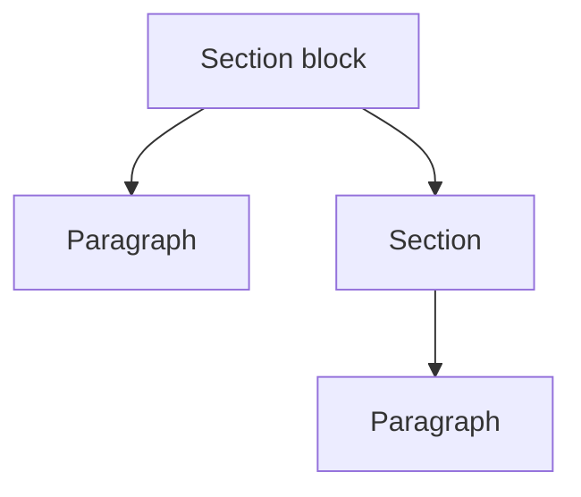

# Composite pattern

## What it is

Lets **individual objects and groups of objects** be treated uniformly through a shared interface. Composites contain children; leaves do not.

## توضیح فارسی

**Composite** به برگ و گروه یک رابط مشترک می‌دهد تا کلاینت نداند با یک آیتم طرف است یا با درخت. در Notion، صفحه و سکشن و پاراگراف همگی «بلاک» هستند: `wordCount()` یا `toMarkdown()` روی کل درخت یکسان صدا زده می‌شود. افزودن سکشن تو در تو نباید API فراخواننده را عوض کند.

## 1. Dummy — Mermaid diagram + one sentence why



**Why:** one `wordCount()` on the root walks leaves and nested sections the same way.

## 2. When / when not · Good · Bad

### When to use

- Tree structures (pages, folders, menus, comment threads)
- Operations that must run the same way on leaf and node

### When not to use

- Flat lists with no nesting
- Forcing a tree where a simple array is enough

### Good practice

- Shared component interface for leaf and composite
- Clear ownership of children; avoid cycles

### Bad / worst practice

- **Bad:** composite that exposes a different API than leaves for every operation
- **Worst:** storing parent pointers and children without a single source of truth

**Trade-offs:** Uniform tree ops vs more complex mutation and rendering.

## 3. Working — Hono worst/best + React worst/best TypeScript examples

Real example — Notion block tree.

### Backend (Hono) — worst practice

```ts
// ❌ Separate code paths per type in the route
app.get("/pages/:id/stats", async (c) => {
  const page = await loadRawPage(c.req.param("id"));
  let words = 0;
  for (const block of page.blocks) {
    if (block.type === "paragraph") words += block.text.split(" ").length;
    if (block.type === "section") {
      for (const child of block.children) {
        if (child.type === "paragraph") words += child.text.split(" ").length;
      }
    }
  }
  return c.json({ words });
});
```

### Backend (Hono) — best practice

```ts
interface BlockNode {
  id: string;
  wordCount(): number;
  toMarkdown(): string;
}

class ParagraphBlock implements BlockNode {
  constructor(public id: string, private text: string) {}
  wordCount() {
    return this.text.trim() ? this.text.trim().split(/\s+/).length : 0;
  }
  toMarkdown() { return this.text; }
}

class SectionBlock implements BlockNode {
  constructor(public id: string, private title: string, private children: BlockNode[] = []) {}
  add(child: BlockNode) { this.children.push(child); }
  wordCount() {
    return this.children.reduce((sum, child) => sum + child.wordCount(), 0);
  }
  toMarkdown() {
    return `## ${this.title}\n\n` + this.children.map((c) => c.toMarkdown()).join("\n\n");
  }
}

app.get("/pages/:id/stats", async (c) => {
  const root = await loadBlockTree(c.req.param("id"));
  return c.json({ words: root.wordCount() });
});
```

### Frontend (React) — worst practice

```tsx
function PageView({ blocks }: { blocks: unknown[] }) {
  return blocks.map((b) => {
    if ((b as any).type === "paragraph") return <p>{(b as any).text}</p>;
    // sections handled elsewhere — drift
    return null;
  });
}
```

### Frontend (React) — best practice

```tsx
type BlockNode =
  | { type: "paragraph"; id: string; text: string }
  | { type: "section"; id: string; title: string; children: BlockNode[] };

function BlockView({ node }: { node: BlockNode }) {
  if (node.type === "paragraph") return <p>{node.text}</p>;
  return (
    <section>
      <h2>{node.title}</h2>
      {node.children.map((child) => (
        <BlockView key={child.id} node={child} />
      ))}
    </section>
  );
}
```

## 4. Rich — edge cases · testing seams

**Edge cases**

- **Cycles:** `add` must reject parent-as-child.
- **Immutable updates:** React state copies path to edited node ([iterator](iterator.md) for walks).
- **Empty section:** `wordCount` is 0; markdown still emits heading.

**Testing seams**

- Build small tree in memory; assert `root.wordCount()` without HTTP.
- Visitor or iterator can walk same tree for export tests.

## 5. CTO — overuse signals · monorepo placement

### Overuse signals

- Every block type is a class with 50 methods—prefer data + functions for simple editors
- Tree stored differently in API vs client with no shared DTO

### Alternatives

- Normalized `blocks` table + adjacency list when persistence dominates
- [Visitor](visitor.md) when many operations cross the tree

### Monorepo placement

| Piece | Location |
|-------|----------|
| `BlockNode` interface + ops | `packages/domain/blocks` |
| `loadBlockTree` | `packages/application` + repository |
| `BlockView` | `apps/web/src/editor` |

## Related · Where in this repo

**Related:** [Visitor](visitor.md), [Iterator](iterator.md), [Factory](factory.md)

**Where:** Pairs with Notion block factory / export examples.