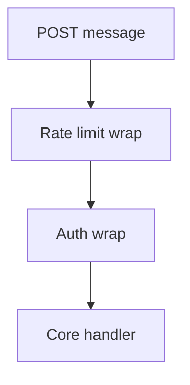

# Decorator pattern

## What it is

Adds behavior to an object by **wrapping** it with another object that exposes the same interface, without changing the original class.

## توضیح فارسی

**Decorator** رفتار را با **پیچیدن** شیء اضافه می‌کند، بدون تغییر کلاس اصلی. چند لایه می‌توانند روی هم بنشینند (لاگ + محدودیت نرخ + احراز هویت). در Hono همان ایده به‌صورت middleware دیده می‌شود؛ در React می‌توان حباب پیام را با badge ویرایش یا منشن بدون تغییر کامپوننت پایه تزئین کرد.

## 1. Dummy — Mermaid diagram + one sentence why



**Why:** stack optional cross-cutting behavior on a stable core without editing the core for every new guard.

## 2. When / when not · Good · Bad

### When to use

- Cross-cutting behavior that must compose (auth, rate limit, caching)
- Optional UI chrome around a stable base component

### When not to use

- The new behavior belongs in the core type permanently
- You need to change the interface, not wrap it (that is [Adapter](adapter.md))

### Good practice

- Keep the same port/interface on the wrapper
- Order wrappers deliberately; document side effects

### Bad / worst practice

- **Bad:** decorator that breaks Liskov expectations of the wrappee
- **Worst:** deeply nested wrappers that hide where work happens

**Trade-offs:** Composable behavior vs harder-to-follow call stacks.

## 3. Working — Hono worst/best + React worst/best TypeScript examples

Real example — Chat API guards + message bubble chrome.

### Backend (Hono) — worst practice

```ts
// ❌ Every new concern edits the handler body
const postMessage: Handler = async (c) => {
  const userId = await sessions.userId(c);
  if (!userId) return c.json({ code: "UNAUTHORIZED" }, 401);
  if (await rateLimit.hit(userId)) return c.json({ code: "RATE_LIMIT" }, 429);
  // ... core ...
};
```

### Backend (Hono) — best practice

```ts
type Handler = (c: Context) => Promise<Response>;

function withAuth(inner: Handler): Handler {
  return async (c) => {
    const userId = await sessions.userId(c);
    if (!userId) return c.json({ code: "UNAUTHORIZED" }, 401);
    c.set("userId", userId);
    return inner(c);
  };
}

function withRateLimit(inner: Handler, key: (c: Context) => string): Handler {
  return async (c) => {
    if (await rateLimit.hit(key(c))) return c.json({ code: "RATE_LIMIT" }, 429);
    return inner(c);
  };
}

const postMessage: Handler = async (c) => { /* call use case */ return c.json(msg, 201); };

app.post(
  "/rooms/:roomId/messages",
  withRateLimit(withAuth(postMessage), (c) => c.get("userId") ?? "anon"),
);
```

### Frontend (React) — worst practice

```tsx
function MessageBubble({ body, edited, mentioned }: { body: string; edited?: boolean; mentioned?: boolean }) {
  return (
    <p>
      {mentioned && <span>@</span>}
      {body}
      {edited && <span>edited</span>}
    </p>
  );
}
```

### Frontend (React) — best practice

```tsx
function MessageBubble({ body }: { body: string }) {
  return <p>{body}</p>;
}

function withEditedBadge<P extends { body: string }>(
  Inner: React.FC<P>,
): React.FC<P & { edited?: boolean }> {
  return function EditedBadge(props) {
    return (
      <div>
        <Inner {...props} />
        {props.edited ? <span>edited</span> : null}
      </div>
    );
  };
}

const ChatBubble = withEditedBadge(MessageBubble);
```

## 4. Rich — edge cases · testing seams

**Edge cases**

- **Wrapper order:** rate limit before auth vs after changes who gets 401 vs 429.
- **Error propagation:** wrappers must not swallow domain errors.
- **React HOCs:** prefer composition (`<EditedBadge><MessageBubble /></EditedBadge>`) when types get painful.

**Testing seams**

- Test core handler with a fake `Context`; test `withAuth` with missing session only.
- Snapshot `ChatBubble` with and without wrapper—base component unchanged.

## 5. CTO — overuse signals · monorepo placement

### Overuse signals

- More than four manual wrapper layers per route with no shared pipeline helper
- Decorators in `packages/domain` (domain should not know HTTP)

### Alternatives

- Hono built-in middleware chain
- [Proxy](proxy.md) when behavior is access control / lazy load, not feature add-ons

### Monorepo placement

| Piece | Location |
|-------|----------|
| `withAuth`, `withRateLimit` | `apps/api/src/middleware` |
| Core handlers | `apps/api/src/routes` |
| UI wrappers / HOCs | `apps/web/src/components/chat` |

## Related · Where in this repo

**Related:** [Proxy](proxy.md), [Chain of Responsibility](chain-of-responsibility.md), OCP

**Where:** Natural fit for Hono middleware and thin UI wrappers.