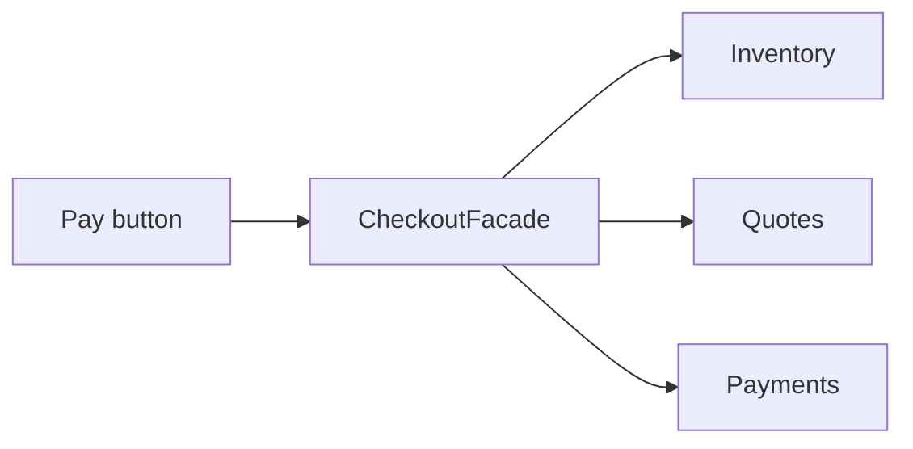

# Facade pattern

## What it is

Provides a **simpler interface** over a complicated subsystem (many services, steps, or SDKs).

## توضیح فارسی

**Facade** یک **رابط ساده‌تر** روی زیرسیستم پیچیده می‌گذارد. کلاینت به‌جای دانستن ترتیب موجودی، قیمت، مالیات، پرداخت و ایمیل، فقط `placeOrder(...)` را صدا می‌زند. Facade پیچیدگی را پنهان می‌کند؛ مسئولیت دامنه را از بین نمی‌برد — فقط نقطهٔ ورود را جمع می‌کند.

## 1. Dummy — Mermaid diagram + one sentence why



**Why:** checkout callers get one call—reserve, quote, charge, and receipt stay inside the facade.

## 2. When / when not · Good · Bad

### When to use

- Multi-step workflows called from thin HTTP/UI edges
- Shielding callers from several collaborating modules

### When not to use

- The facade becomes a god object that owns all business rules
- You only have one underlying call

### Good practice

- Facade orchestrates; domain rules stay in use cases/modules
- Keep return types honest about partial failure

### Bad / worst practice

- **Bad:** facade that also writes raw SQL and formats React
- **Worst:** every new feature only grows the facade forever with no module APIs

**Trade-offs:** Easy entry point vs risk of a dumping-ground service.

## 3. Working — Hono worst/best + React worst/best TypeScript examples

Real example — Marketplace “place order”.

### Backend (Hono) — worst practice

```ts
// ❌ Route orchestrates everything
app.post("/orders", async (c) => {
  const body = await c.req.json();
  await inventory.reserve(body.listingId, c.get("userId"));
  const quote = await quotes.forListing(body.listingId, body.shipTo);
  const charge = await stripe.paymentIntents.create({ amount: quote.buyerPaysCents });
  // ... five more steps in the handler
});
```

### Backend (Hono) — best practice

```ts
class CheckoutFacade {
  constructor(
    private readonly inventory: Inventory,
    private readonly quotes: Quotes,
    private readonly payments: PaymentGateway,
    private readonly orders: Orders,
    private readonly mail: Mailer,
  ) {}

  async placeOrder(input: {
    buyerId: string;
    listingId: string;
    paymentMethodToken: string;
    shipTo: ShipTo;
  }) {
    await this.inventory.reserve(input.listingId, input.buyerId);
    const quote = await this.quotes.forListing(input.listingId, input.shipTo);
    const charge = await this.payments.charge({
      orderId: "pending",
      money: { amountCents: quote.buyerPaysCents, currency: "usd" },
      paymentMethodToken: input.paymentMethodToken,
    });
    if (charge.status !== "captured") {
      await this.inventory.release(input.listingId, input.buyerId);
      return { status: "declined" as const, reason: charge.reason };
    }
    const order = await this.orders.createPaid({ /* ... */ });
    await this.mail.sendReceipt(order.id);
    return { status: "placed" as const, orderId: order.id };
  }
}
```

### Frontend (React) — worst practice

```tsx
async function onPay() {
  await fetch("/inventory/reserve", { method: "POST", body: JSON.stringify(draft) });
  const quote = await fetch("/quotes", { method: "POST", body: JSON.stringify(draft) });
  // ... client-side saga
}
```

### Frontend (React) — best practice

```ts
export async function placeOrder(apiBase: string, draft: CheckoutDraft) {
  const res = await fetch(`${apiBase}/orders`, {
    method: "POST",
    headers: { "Content-Type": "application/json" },
    body: JSON.stringify(draft),
  });
  if (res.status === 402) return { status: "declined" as const, ...(await res.json()) };
  if (!res.ok) throw new Error("PLACE_FAILED");
  return { status: "placed" as const, ...(await res.json()) };
}
```

## 4. Rich — edge cases · testing seams

**Edge cases**

- **Saga / rollback:** declined payment must release inventory—facade owns compensating order.
- **Partial failure after charge:** idempotency keys on `placeOrder` to avoid double capture.
- **402 vs 201:** HTTP mapping stays in route; facade returns discriminated union.

**Testing seams**

- Fake collaborators injected into `CheckoutFacade`; assert release called on decline.
- UI test mocks single `/orders` endpoint.

## 5. CTO — overuse signals · monorepo placement

### Overuse signals

- Facade file exceeds use cases it orchestrates and contains pricing rules
- Frontend facade duplicates backend saga (two sources of truth)

### Alternatives

- Application service / use case module per bounded context
- [Mediator](mediator.md) when many peers talk, not one entry workflow

### Monorepo placement

| Piece | Location |
|-------|----------|
| `CheckoutFacade` | `packages/application/checkout` |
| Route thin mapping | `apps/api/src/routes/orders.ts` |
| `placeOrder` client | `apps/web/src/lib/checkout-api.ts` |

## Related · Where in this repo

**Related:** [Mediator](mediator.md), [Dependency Injection](dependency-injection.md), modular monolith public API

**Where:** Useful teaching name for application-layer orchestration at the HTTP edge.