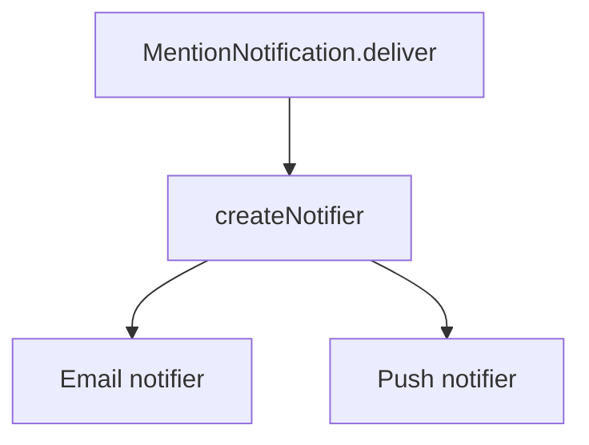

# Factory Method pattern

## What it is

Defines an interface for creating an object, but lets **subclasses or implementations decide** which class to instantiate. Creation is deferred to the method that knows the variant.

## توضیح فارسی

**Factory Method** یک عملیات «بساز» تعریف می‌کند ولی **پیاده‌سازی/زیرکلاس** تصمیم می‌گیرد دقیقاً چه چیزی ساخته شود. برخلاف factory سادهٔ متمرکز، اینجا هر شاخهٔ محصول متد ساخت خودش را دارد. مثال چت: کانال اعلان (email / push / Slack) هرکدام `createNotifier()` خود را می‌آورند تا pipeline ارسال یکسان بماند.

## 1. Dummy — Mermaid diagram + one sentence why



**Why:** shared `deliver()` steps stay fixed—each channel subclass supplies the right notifier.

## 2. When / when not · Good · Bad

### When to use

- A stable workflow must create different products per variant
- Open for new product types without editing a central `switch` (OCP)

### When not to use

- One product type — a function is enough
- You only need config-based selection once at startup (simple factory / abstract factory may fit better)

### Good practice

- Keep the factory method next to the variant that owns the knowledge
- Return a port type, not a concrete SDK class

### Bad / worst practice

- **Bad:** factory method that still contains a giant `switch` on every call
- **Worst:** inheritance tree invented only to host `createX()`

**Trade-offs:** Extension without editing a center vs more types/classes.

## 3. Working — Hono worst/best + React worst/best TypeScript examples

Real example — Chat notification channels after `@sam` mention.

### Backend (Hono) — worst practice

```ts
// ❌ Central switch grows every sprint
export async function deliverMention(userId: string, body: string, channel: string) {
  if (channel === "email") await new EmailNotifier(ses).send({ userId, body });
  else if (channel === "push") await new PushNotifier(fcm).send({ userId, body });
  // slack → edit here
  await deliveries.record(userId, channel);
}
```

### Backend (Hono) — best practice

```ts
interface Notifier {
  send(input: { userId: string; body: string }): Promise<void>;
}

abstract class MentionNotification {
  async deliver(userId: string, body: string) {
    const notifier = this.createNotifier();
    await notifier.send({ userId, body });
    await deliveries.record(userId, this.channel);
  }
  protected abstract createNotifier(): Notifier;
  protected abstract channel: "email" | "push" | "slack";
}

class EmailMentionNotification extends MentionNotification {
  protected channel = "email" as const;
  protected createNotifier() {
    return new EmailNotifier(ses);
  }
}
```

### Frontend (React) — worst practice

```tsx
function NotificationPrefs({ channel }: { channel: Channel }) {
  if (channel === "email") return <EmailTokenEditor />;
  if (channel === "push") return <PushTokenEditor />;
  return null;
}
```

### Frontend (React) — best practice

```tsx
abstract class ChannelSettings {
  abstract createEditor(): React.FC<{ value: unknown; onChange: (v: unknown) => void }>;
}

class PushChannelSettings extends ChannelSettings {
  createEditor() {
    return PushTokenEditor;
  }
}

function NotificationPrefs({ channel }: { channel: Channel }) {
  const Editor = settingsFor(channel).createEditor();
  return <Editor value={value} onChange={setValue} />;
}
```

## 4. Rich — edge cases · testing seams

**Edge cases**

- TypeScript modules can use `createNotifier()` functions instead of classes—same pattern.
- **Async factory methods:** creation may need token refresh—keep inside `createNotifier`.
- Channel disabled per user: factory method returns no-op notifier, not null.

**Testing seams**

- Subclass with `createNotifier() { return fake; }` to test `deliver` without SES/FCM.
- Table-driven test: each channel settings class exposes an editor component.

## 5. CTO — overuse signals · monorepo placement

### Overuse signals

- Abstract base with one subclass
- Factory method called on hot path constructing heavy SDK clients each time

### Alternatives

- [Factory](factory.md) for one-shot creation at startup
- [Strategy](strategy.md) when the whole algorithm varies, not one step

### Monorepo placement

| Piece | Location |
|-------|----------|
| `MentionNotification` hierarchy | `packages/application/notifications` |
| SDK notifiers | `packages/infrastructure` |
| Channel settings UI | `apps/web/src/settings` |

## Related · Where in this repo

**Related:** [Factory](factory.md), [Abstract Factory](abstract-factory.md), [Template Method](template-method.md), OCP

**Where:** Complements [factory.md](factory.md); prefer when variants own creation knowledge.