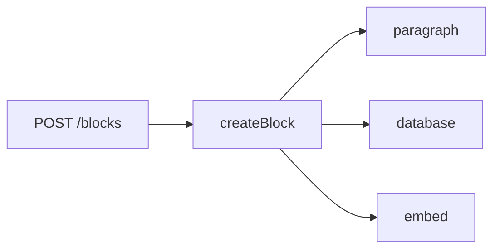

# Factory pattern

## What it is

Centralizes creation logic so callers request a product without knowing the concrete class.

> Related: [factory-method.md](factory-method.md) (subclass decides) and [abstract-factory.md](abstract-factory.md) (families of products).

## توضیح فارسی

**Factory** منطق ساخت را در یک نقطه متمرکز می‌کند تا فراخواننده بدون دانستن کلاس دقیق، محصول بخواهد. مثال: ساخت بلاک Notion (پاراگراف، دیتابیس، embed) با قوانین اعتبارسنجی یکسان برای API و منوی slash. برای انتخاب درایور دیتابیس هم از همین ایده استفاده می‌شود.

## 1. Dummy — Mermaid diagram + one sentence why



**Why:** one front door validates and constructs blocks—callers don’t embed type-specific rules.

## 2. When / when not · Good · Bad

### When to use

- `createDb(config)` returns the correct vendor client/adapter
- Test suites swap in-memory implementations via factory

### When not to use

- `new` is clear and singular
- Abstract factory trees with one product ever

### Good practice

- Factory lives near composition/config, not inside domain entities
- Fail fast on unknown `DATABASE_DRIVER`

### Bad / worst practice

- **Bad:** factory hidden behind service locator globals
- **Worst:** reflection magic to invent classes by string everywhere

**Trade-offs:** Single creation point vs indirection.

## 3. Working — Hono worst/best + React worst/best TypeScript examples

### Real example — Notion blocks

A page is a list of blocks, and each block type is built differently. A paragraph stores rich text. A database block stores a property schema and rejects duplicate property names. An embed stores an `https` URL. The slash menu, the “turn into” action, and `POST /blocks` all need a valid block. If each caller assembles the object, a database block with no schema gets saved and the editor crashes when it opens.

The React side has the matching creation problem: given a block type, mount the editor for that type. The page host should not switch on type and import every editor’s setup.

Teaching snippets, not a runnable app. Loading and saving the page aggregate is the repository: [repository.md](repository.md).

### Backend (Hono) — worst practice

```ts
// ❌ Each route builds a partial block. The embed route forgets to check the protocol.
app.post("/blocks", async (c) => {
  const body = await c.req.json();
  if (body.type === "database") {
    await db.query("INSERT INTO blocks (id, type, schema) VALUES ($1, 'database', $2)", [
      crypto.randomUUID(),
      JSON.stringify(body.schema ?? []),
    ]);
  } else if (body.type === "embed") {
    await db.query("INSERT INTO blocks (id, type, url) VALUES ($1, 'embed', $2)", [
      crypto.randomUUID(),
      body.url,
    ]);
  }
  return c.json({ ok: true }, 201);
});
```

### Backend (Hono) — best practice

Callers pass a draft. `createBlock` is the only place that returns a `Block`. An unknown wire `type` fails in the parser before this function. A known type with illegal contents fails here.

```ts
export type RichText = { text: string };
export type PropertySchema = { name: string; kind: "text" | "number" };

export type Block =
  | { id: string; type: "paragraph"; richText: RichText[] }
  | { id: string; type: "database"; schema: PropertySchema[] }
  | { id: string; type: "embed"; url: string };

export type BlockDraft =
  | { type: "paragraph"; richText: RichText[] }
  | { type: "database"; schema: PropertySchema[] }
  | { type: "embed"; url: string };

export function createBlock(draft: BlockDraft, newId: () => string): Block {
  switch (draft.type) {
    case "paragraph":
      return { id: newId(), type: "paragraph", richText: draft.richText };
    case "database": {
      if (draft.schema.length === 0) throw new Error("SCHEMA_REQUIRED");
      const names = new Set(draft.schema.map((property) => property.name));
      if (names.size !== draft.schema.length) throw new Error("DUPLICATE_PROPERTY");
      return { id: newId(), type: "database", schema: draft.schema };
    }
    case "embed": {
      const url = new URL(draft.url);
      if (url.protocol !== "https:") throw new Error("EMBED_HTTPS_ONLY");
      return { id: newId(), type: "embed", url: url.toString() };
    }
    default: {
      const unknown: never = draft;
      throw new Error(`Unknown block: ${JSON.stringify(unknown)}`);
    }
  }
}
```

```ts
import { z } from "zod";
import { createBlock } from "@fsab/domain";

const BlockDraftBody = z.discriminatedUnion("type", [
  z.object({
    type: z.literal("paragraph"),
    richText: z.array(z.object({ text: z.string() })),
  }),
  z.object({
    type: z.literal("database"),
    schema: z.array(z.object({ name: z.string(), kind: z.enum(["text", "number"]) })),
  }),
  z.object({ type: z.literal("embed"), url: z.string() }),
]);

app.post("/pages/:pageId/blocks", async (c) => {
  const parsed = BlockDraftBody.safeParse(await c.req.json());
  if (!parsed.success) return c.json({ code: "VALIDATION_ERROR" }, 400);

  try {
    const block = createBlock(parsed.data, () => crypto.randomUUID());
    await blocks.add(c.req.param("pageId"), block);
    return c.json(block, 201);
  } catch (error) {
    if (error instanceof Error && error.message === "SCHEMA_REQUIRED") {
      return c.json({ code: "SCHEMA_REQUIRED" }, 400);
    }
    if (error instanceof Error && error.message === "DUPLICATE_PROPERTY") {
      return c.json({ code: "DUPLICATE_PROPERTY" }, 400);
    }
    if (error instanceof Error && error.message === "EMBED_HTTPS_ONLY") {
      return c.json({ code: "EMBED_HTTPS_ONLY" }, 400);
    }
    if (error instanceof TypeError) return c.json({ code: "EMBED_URL" }, 400);
    throw error;
  }
});
```

`new URL` throws `TypeError` on `javascript:alert(1)` and on a bare word. The factory’s protocol check rejects `http://`. The slash-menu command on the server, if you add one later, calls `createBlock` too.

This factory builds domain values. Picking Stripe vs Adyen at process start is the other factory in [adapter.md](adapter.md): one `createPaymentGateway(config)` that fails fast on an unknown provider name. Do not fold that config switch into `createBlock`.

### Frontend (React) — worst practice

`BlockHost` switches on `block.type` and, in the database branch, writes `schema: block.schema ?? []` before passing it down. The slash menu has a second switch that inserts `{ type: "embed" }` with no `url`. The two switches drift.

### Frontend (React) — best practice

`createEmptyDraft` is what the slash menu inserts. `createBlockEditor` is what the host renders. Both fail fast on an unknown type, which surfaces a client/server enum drift in tests instead of a blank row.

```ts
import { Block, BlockDraft } from "@fsab/domain";

export function createEmptyDraft(type: Block["type"]): BlockDraft {
  switch (type) {
    case "paragraph":
      return { type: "paragraph", richText: [{ text: "" }] };
    case "database":
      return { type: "database", schema: [{ name: "Name", kind: "text" }] };
    case "embed":
      return { type: "embed", url: "" };
    default: {
      const unknown: never = type;
      throw new Error(`Unknown block type: ${unknown}`);
    }
  }
}
```

```tsx
"use client";

import { Block, BlockDraft } from "@fsab/domain";

type EditorProps = {
  block: Block;
  onChange: (block: Block) => void;
};

const blockEditors = {
  paragraph: ParagraphEditor,
  database: DatabaseEditor,
  embed: EmbedEditor,
} satisfies Record<Block["type"], React.FC<EditorProps>>;

export function createBlockEditor(type: Block["type"]): React.FC<EditorProps> {
  const Editor = blockEditors[type];
  if (!Editor) throw new Error(`No editor registered for ${type}`);
  return Editor;
}

export function BlockHost({ block, onChange }: EditorProps) {
  const Editor = createBlockEditor(block.type);
  return <Editor block={block} onChange={onChange} />;
}

export function SlashMenu({ onInsert }: { onInsert: (draft: BlockDraft) => void }) {
  return (
    <ul>
      {(["paragraph", "database", "embed"] as const).map((type) => (
        <li key={type}>
          <button type="button" onClick={() => onInsert(createEmptyDraft(type))}>
            {type}
          </button>
        </li>
      ))}
    </ul>
  );
}
```

`ParagraphEditor`, `DatabaseEditor`, and `EmbedEditor` are normal components. A new block type means a new domain branch in `createBlock`, a new editor component, and one entry in `blockEditors`. `BlockHost` and `SlashMenu` do not grow a condition.

Empty paragraph text is legal while someone is typing. The database and embed rules still run when the draft is submitted through `createBlock` on save.

### Side-by-side

| Change | Without a factory | With a factory |
|--------|-------------------|----------------|
| Reject a duplicate database property | Remember to check in every route | `createBlock` throws `DUPLICATE_PROPERTY` |
| Slash menu inserts an embed | `{ type: "embed" }` with no URL field | `createEmptyDraft("embed")` returns `{ url: "" }`; `createBlock` rejects it until the URL is `https` |
| New “bookmark” block | Hunt every `switch (block.type)` | New domain branch, new editor, one map entry |

## 4. Rich — edge cases · testing seams

**Edge cases**

- **Draft vs persisted:** `createEmptyDraft` for UI; `createBlock` for API—same validation rules.
- **Unknown type:** factory throws domain error → 400, not silent default paragraph.
- **DB driver factory:** fails fast on bad `DATABASE_DRIVER` at boot.

**Testing seams**

- Table tests on `createBlock` inputs without HTTP.
- In-memory repo via `createDb({ driver: "memory" })` in tests.

## 5. CTO — overuse signals · monorepo placement

### Overuse signals

- Stringly-typed `createThing(type: string)` without validation
- Factory in domain entity constructors

### Alternatives

- [Factory Method](factory-method.md) when variants own creation
- [Abstract Factory](abstract-factory.md) for vendor families

### Monorepo placement

| Piece | Location |
|-------|----------|
| `createBlock` | `packages/domain/blocks` |
| `createDb` | `packages/infrastructure` |
| Slash menu wiring | `apps/web/src/editor` |

## Related · Where in this repo

**Related:** [Adapter](adapter.md), [DI](dependency-injection.md)

**Where:** DB driver selection; see multi-db notes example.
