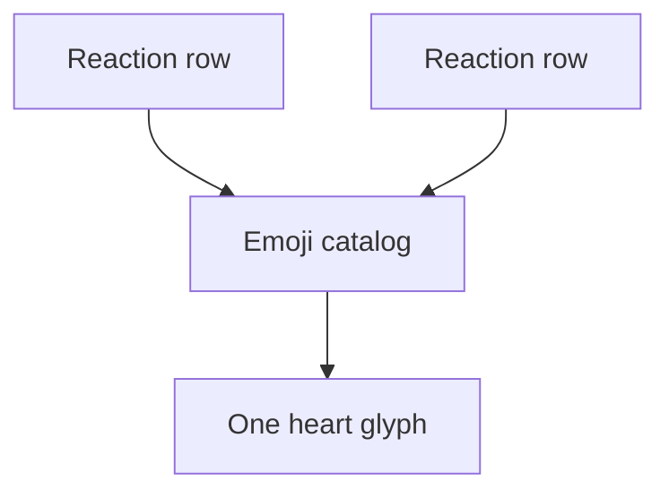

# Flyweight pattern

## What it is

Shares **common immutable state** (intrinsic) across many objects so memory stays low, while each object keeps its own extrinsic state (position, owner, count).

## توضیح فارسی

**Flyweight** دادهٔ مشترک و تغییرناپذیر را بین اشیاء زیاد **اشتراک** می‌گذارد تا حافظه کم شود. بخش مشترک (intrinsic) مثل تصویر ایموجی یا تعریف واکنش است؛ بخش بیرونی (extrinsic) مثل اینکه کدام کاربر در کدام پیام چه واکنشی گذاشته. در چت سازمانی با هزاران واکنش تکراری، نباید برای هر واکنش یک کپی از دارایی سنگین نگه دارید.

## 1. Dummy — Mermaid diagram + one sentence why



**Why:** thousands of chat reactions share ~20 emoji definitions—store heavy assets once, keep rows light.

## 2. When / when not · Good · Bad

### When to use

- Huge numbers of similar objects (reactions, map markers, table cells)
- Intrinsic data is immutable and reused heavily

### When not to use

- Few instances — sharing costs more than it saves
- Mutable shared state (race conditions and UI bugs)

### Good practice

- Factory/cache returns the shared flyweight by key
- Keep extrinsic state outside the shared object

### Bad / worst practice

- **Bad:** mutable flyweight mutated by one user visible to others
- **Worst:** “flyweight” that still embeds per-user data

**Trade-offs:** Memory savings vs more complex identity and lifecycle.

## 3. Working — Hono worst/best + React worst/best TypeScript examples

Real example — Chat reactions.

### Backend (Hono) — worst practice

```ts
// ❌ Embed full image metadata on every reaction row in DB JSON
type Reaction = { messageId: string; userId: string; emoji: { id: string; imageUrl: string; shortcode: string } };
```

### Backend (Hono) — best practice

```ts
type EmojiId = "thumbsup" | "heart" | "fire";

class EmojiGlyph {
  constructor(readonly id: EmojiId, readonly imageUrl: string, readonly shortcode: string) {}
}

const emojiCatalog = new Map<EmojiId, EmojiGlyph>();
function getEmoji(id: EmojiId): EmojiGlyph {
  let glyph = emojiCatalog.get(id);
  if (!glyph) {
    glyph = new EmojiGlyph(id, `/static/emoji/${id}.webp`, `:${id}:`);
    emojiCatalog.set(id, glyph);
  }
  return glyph;
}

type Reaction = { messageId: string; userId: string; emojiId: EmojiId };
```

### Frontend (React) — worst practice

```tsx
function ReactionChip({ reaction }: { reaction: { src: string; label: string; count: number } }) {
  return <button>{reaction.count}</button>; // new src strings per row
}
```

### Frontend (React) — best practice

```tsx
const glyphCache = new Map<string, { src: string; label: string }>();

function emojiFlyweight(id: string) {
  let glyph = glyphCache.get(id);
  if (!glyph) {
    glyph = { src: `/emoji/${id}.webp`, label: id };
    glyphCache.set(id, glyph);
  }
  return glyph;
}

function ReactionChip({ emojiId, count }: { emojiId: string; count: number }) {
  const glyph = emojiFlyweight(emojiId);
  return (
    <button type="button">
      
      {count}
    </button>
  );
}
```

## 4. Rich — edge cases · testing seams

**Edge cases**

- **Custom workspace emoji:** catalog key includes workspace id; still flyweight per workspace pack.
- **SSR hydration:** cache is per-request or per-browser tab, not a global mutable singleton with user data.
- **Count aggregation:** extrinsic—compute counts in query or selector, not inside glyph.

**Testing seams**

- Assert `getEmoji("heart")` returns same reference twice.
- Render 100 chips—one network fetch for sprite sheet (if used).

## 5. CTO — overuse signals · monorepo placement

### Overuse signals

- Flyweight applied to business entities (users, orders) to “save memory”
- Catalog never invalidated when asset CDN path changes

### Alternatives

- CDN + browser HTTP cache for static emoji
- DB stores only `emoji_id` foreign key

### Monorepo placement

| Piece | Location |
|-------|----------|
| `getEmoji` catalog | `packages/domain` or shared `packages/chat` |
| Static assets | `apps/web/public/emoji` |
| Reaction rows | persistence adapter in `packages/infrastructure` |

## Related · Where in this repo

**Related:** [Factory](factory.md), [Composite](composite.md)

**Where:** Teaching pattern for high-cardinality UI/domain tokens (emoji, icons, cells).