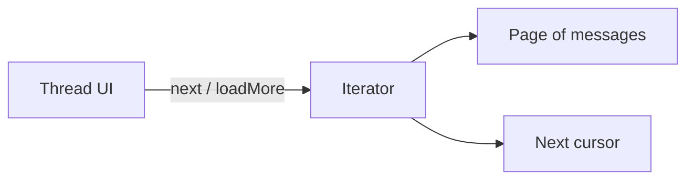

# Iterator pattern

## What it is

Provides a **standard way to traverse** a collection without exposing its internal representation (tree, pages, cursor, network batches).

## توضیح فارسی

**Iterator** یک روش استاندارد برای **پیمایش** مجموعه می‌دهد بدون افشای ساختار داخلی. در چت سازمانی، پیام‌ها صفحه‌به‌صفحه با cursor می‌آیند؛ کلاینت فقط `next()` می‌بیند، نه SQL و نه شکل ایندکس. برای درخت بلاک Notion هم می‌توان DFS iterator نوشت تا export خطی شود.

## 1. Dummy — Mermaid diagram + one sentence why



**Why:** callers consume “the next chunk” without knowing whether storage is SQL offset, keyset, or an in-memory tree.

## 2. When / when not · Good · Bad

### When to use

- Cursor / keyset pagination
- Walking trees or graphs without leaking structure
- Lazy sequences that fetch the next page on demand

### When not to use

- A simple `for...of` over an in-memory array is enough
- You need random access more than traversal

### Good practice

- Stable cursors; never use offset pagination for hot timelines when possible
- Expose `AsyncIterator` for network-backed sequences

### Bad / worst practice

- **Bad:** iterator that mutates the collection while iterating without rules
- **Worst:** exposing SQL cursors or DB connections to the UI layer

**Trade-offs:** Encapsulation and lazy IO vs more plumbing than `array.map`.

## 3. Working — Hono worst/best + React worst/best TypeScript examples

Real example — Cursor pagination over chat messages.

### Backend (Hono) — worst practice

```ts
// ❌ Offset pagination + leak of raw SQL shape to export
app.get("/rooms/:roomId/messages", async (c) => {
  const offset = Number(c.req.query("offset") ?? 0);
  const rows = await db.query(
    `SELECT * FROM messages WHERE room_id = $1 ORDER BY id LIMIT 50 OFFSET $2`,
    [c.req.param("roomId"), offset],
  );
  return c.json(rows.rows); // no cursor; unstable under concurrent inserts
});
```

### Backend (Hono) — best practice

```ts
type Message = { id: string; body: string; createdAt: string };

async function* messagesIterator(
  roomId: string,
  fetchPage: (cursor: string | null) => Promise<{ items: Message[]; nextCursor: string | null }>,
): AsyncGenerator<Message> {
  let cursor: string | null = null;
  do {
    const page = await fetchPage(cursor);
    for (const item of page.items) yield item;
    cursor = page.nextCursor;
  } while (cursor);
}

app.get("/rooms/:roomId/messages", async (c) => {
  const cursor = c.req.query("cursor") ?? null;
  const page = await messages.page(c.req.param("roomId"), cursor, 50);
  return c.json(page); // { items, nextCursor }
});
```

### Frontend (React) — worst practice

```tsx
// ❌ Load entire room into memory on mount
useEffect(() => {
  void api.allMessages(roomId).then(setItems);
}, [roomId]);
```

### Frontend (React) — best practice

```tsx
function useMessageIterator(roomId: string) {
  const [items, setItems] = useState<Message[]>([]);
  const [cursor, setCursor] = useState<string | null>(null);

  async function loadMore() {
    const page = await api.listMessages(roomId, cursor);
    setItems((prev) => [...prev, ...page.items]);
    setCursor(page.nextCursor);
  }

  return { items, loadMore, hasMore: cursor !== null || items.length === 0 };
}
```

Block tree DFS (export):

```ts
function* walkBlocks(node: BlockNode): Generator<BlockNode> {
  yield node;
  if (node.type === "section") {
    for (const child of node.children) yield* walkBlocks(child);
  }
}
```

## 4. Rich — edge cases · testing seams

**Edge cases**

- **Concurrent posts:** keyset on `(createdAt, id)` avoids duplicates/skips vs offset.
- **Empty cursor:** first page uses `null`; document whether `hasMore` is `nextCursor !== null`.
- **Abort in flight:** React `loadMore` should ignore stale responses (cancellation flag).

**Testing seams**

- Fake `fetchPage` returning two fixed pages; async generator yields expected count.
- `walkBlocks` on a small fixture tree without DB.

## 5. CTO — overuse signals · monorepo placement

### Overuse signals

- Custom iterator classes where REST pagination + `for await` of fetch is enough
- Iterator protocol exposed across package boundaries without versioning cursors

### Alternatives

- Repository `list(cursor, limit)` returning a page DTO
- [Composite](composite.md) + local `walk` for in-memory trees only

### Monorepo placement

| Piece | Location |
|-------|----------|
| Keyset query + cursor encoding | `packages/infrastructure` adapter |
| `messagesIterator` | `packages/application` export jobs |
| `useMessageIterator` | `apps/web` chat features |

## Related · Where in this repo

**Related:** [Composite](composite.md), [Repository](repository.md), [Proxy](proxy.md) (lazy)

**Where:** Teaching pattern for timelines and tree walks; chat examples in knowledge course.