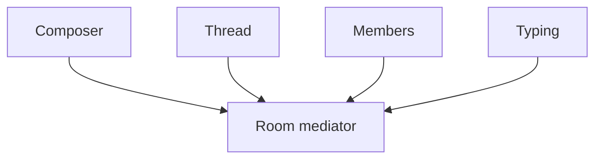

# Mediator pattern

## What it is

Coordinates communication between objects so they **do not refer to each other directly**. Colleagues talk to the mediator; the mediator routes.

## توضیح فارسی

**Mediator** ارتباط بین اشیاء را هماهنگ می‌کند تا به هم **وابسته مستقیم** نباشند. در چت، composer و لیست اعضا و typing indicator نباید همدیگر را import کنند؛ یک هماهنگ‌کنندهٔ اتاق رویدادها را پخش می‌کند. با Observer فرق ظریف دارد: اینجا تمرکز روی **کاهش وابستگی متقابل** بین چند همکار است، نه فقط اطلاع از تغییر یک subject.

## 1. Dummy — Mermaid diagram + one sentence why



**Why:** many chat widgets stay decoupled—they only speak to one coordinator, not to each other.

## 2. When / when not · Good · Bad

### When to use

- Many UI widgets or domain colleagues with tangled pairwise links
- Room/session coordinators

### When not to use

- Two objects with a simple direct call
- Mediator becomes a god object that owns all logic

### Good practice

- Mediator routes; business rules stay in colleagues or use cases
- Keep a clear event/command vocabulary

### Bad / worst practice

- **Bad:** mediator that imports every feature module’s internals
- **Worst:** replacing all structure with one global event bus of strings

**Trade-offs:** Decoupled colleagues vs a busy coordinator.

## 3. Working — Hono worst/best + React worst/best TypeScript examples

Real example — Chat room coordinator.

### Backend (Hono) — worst practice

```ts
// ❌ Composer handler imports thread cache directly
import { bumpThreadVersion } from "./thread-module";
app.post("/rooms/:id/messages", async (c) => {
  await saveMessage(/* ... */);
  bumpThreadVersion(c.req.param("id"));
  notifyTypingOff(c.get("userId"));
});
```

### Backend (Hono) — best practice

```ts
type RoomEvent =
  | { type: "message.posted"; messageId: string; body: string; authorId: string }
  | { type: "typing"; userId: string }
  | { type: "member.joined"; userId: string };

class RoomMediator {
  private members = new Set<(event: RoomEvent) => void>();

  join(listener: (event: RoomEvent) => void) {
    this.members.add(listener);
    return () => this.members.delete(listener);
  }

  publish(event: RoomEvent) {
    for (const listener of this.members) listener(event);
  }

  async postMessage(authorId: string, body: string, save: (msg: { id: string; body: string }) => Promise<void>) {
    const id = crypto.randomUUID();
    await save({ id, body });
    this.publish({ type: "message.posted", messageId: id, body, authorId });
  }
}
```

### Frontend (React) — worst practice

```tsx
// ❌ Composer imports Thread to optimistically prepend
import { prependMessage } from "./Thread";
function Composer() {
  return <textarea onBlur={() => prependMessage(draft)} />;
}
```

### Frontend (React) — best practice

```tsx
type RoomBus = {
  publish(event: RoomEvent): void;
  subscribe(listener: (event: RoomEvent) => void): () => void;
};

function ChatRoom({ bus }: { bus: RoomBus }) {
  return (
    <>
      <MemberList bus={bus} />
      <Thread bus={bus} />
      <Composer bus={bus} />
      <TypingIndicator bus={bus} />
    </>
  );
}
```

## 4. Rich — edge cases · testing seams

**Edge cases**

- **In-memory mediator per process:** scale-out needs Redis pub/sub mediator adapter.
- **Event ordering:** typing events can arrive after message—UI should tolerate.
- **Leak:** unsubscribe on unmount or listeners accumulate.

**Testing seams**

- Publish synthetic `RoomEvent`s; assert thread and typing subscribers react without importing each other.
- Fake `RoomBus` in component tests.

## 5. CTO — overuse signals · monorepo placement

### Overuse signals

- Mediator contains SQL, validation, and React state setters
- Stringly-typed global bus with no schema

### Alternatives

- [Observer](observer.md) for one-to-many change notification
- [Facade](facade.md) for single entry orchestration, not many-to-many chat

### Monorepo placement

| Piece | Location |
|-------|----------|
| `RoomEvent` types | `packages/domain` or `packages/chat` |
| In-process mediator | `apps/api` websocket layer |
| `RoomBus` React context | `apps/web/src/chat` |

## Related · Where in this repo

**Related:** [Observer](observer.md), [Facade](facade.md), [Dependency Injection](dependency-injection.md)

**Where:** Related to chat observer examples; mediator emphasizes multi-colleague coordination.