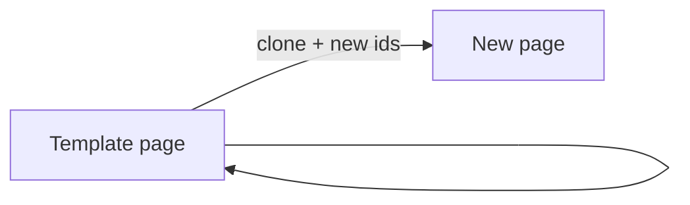

# Prototype pattern

## What it is

Creates a new object by **cloning** an existing instance (the prototype), instead of building from scratch through constructors every time.

## توضیح فارسی

**Prototype** به‌جای ساخت از صفر، یک نمونهٔ موجود را کلون می‌کند. وقتی ساخت گران است یا شیء پیکربندی پیچیده‌ای دارد (مثل صفحهٔ Notion با ده‌ها بلاک)، «Duplicate» یا «Create from template» دقیقاً همین الگوست: کپی ساختاریافته با شناسه‌های تازه، نه ارجاع به همان ردیف.

## 1. Dummy — Mermaid diagram + one sentence why



**Why:** “Duplicate” reuses structure you already paid to load—without aliasing the original row or block ids.

## 2. When / when not · Good · Bad

### When to use

- Duplicate / “save as template” flows
- Expensive setup copied many times with small variations

### When not to use

- A cheap `createEmpty()` factory is clearer
- Deep clone of graphs with shared identity (users, files) without a clear ownership rule

### Good practice

- Clone returns **new ids**; never alias the source row
- Document shallow vs deep clone behavior

### Bad / worst practice

- **Bad:** `structuredClone` of an object that still points at live DB connections
- **Worst:** “clone” that returns the same reference

**Trade-offs:** Fast duplication vs careful handling of nested identity and secrets.

## 3. Working — Hono worst/best + React worst/best TypeScript examples

Real example — Duplicate Notion page (title + blocks, revision `1`). Teaching snippets.

### Backend (Hono) — worst practice

```ts
// ❌ Shallow copy — blocks still share ids with the source
app.post("/pages/:id/duplicate", async (c) => {
  const source = await pages.find(c.req.param("id"));
  if (!source) return c.json({ code: "NOT_FOUND" }, 404);
  await pages.add({ ...source, title: `${source.title} (copy)` });
  return c.json(source, 201); // same ids as source
});
```

### Backend (Hono) — best practice

```ts
type Block = { id: string; type: string; text?: string };
type Page = { id: string; workspaceId: string; title: string; blocks: Block[]; revision: number };

function clonePage(source: Page, newIds: () => string): Page {
  return {
    id: newIds(),
    workspaceId: source.workspaceId,
    title: `${source.title} (copy)`,
    revision: 1,
    blocks: source.blocks.map((block) => ({ ...block, id: newIds() })),
  };
}

app.post("/pages/:id/duplicate", async (c) => {
  const source = await pages.find(c.req.param("id"));
  if (!source) return c.json({ code: "NOT_FOUND" }, 404);
  const copy = clonePage(source, () => crypto.randomUUID());
  await pages.add(copy);
  return c.json(copy, 201);
});
```

### Frontend (React) — worst practice

```tsx
// ❌ Optimistic row aliases server ids — reconcile breaks
function onDuplicate(page: Page) {
  setPages((list) => [...list, page]);
}
```

### Frontend (React) — best practice

```tsx
function duplicateLocal(page: Page): Page {
  return {
    ...page,
    id: crypto.randomUUID(),
    title: `${page.title} (copy)`,
    revision: 1,
    blocks: page.blocks.map((b) => ({ ...b, id: crypto.randomUUID() })),
  };
}
```

## 4. Rich — edge cases · testing seams

**Edge cases**

- **File embeds:** clone block ids but re-point attachment ownership or signed URLs expire.
- **Template gallery:** prototypes are read-only; clone must not mutate the template aggregate.
- **Marketplace listings:** duplicating an order is not prototype—use explicit “reorder” use case.

**Testing seams**

- Unit-test `clonePage` with a fixed `newIds` sequence; assert all block ids differ from source.
- Integration test: duplicate then edit copy—source title unchanged.

## 5. CTO — overuse signals · monorepo placement

### Overuse signals

- `structuredClone` on huge page trees on every keystroke
- No id-remap table—collisions in collaborative editors

### Alternatives

- [Builder](builder.md) when assembly has many validated steps
- [Factory](factory.md) for empty pages with defaults

### Monorepo placement

| Piece | Location |
|-------|----------|
| `clonePage` / domain rules | `packages/domain` or `packages/application` |
| HTTP duplicate route | `apps/api` routes |
| Optimistic clone | `apps/web` editor hooks |

## Related · Where in this repo

**Related:** [Factory](factory.md), [Memento](memento.md)

**Where:** Teaching pattern for page/template duplication; aligns with Notion block examples in [composite.md](composite.md).