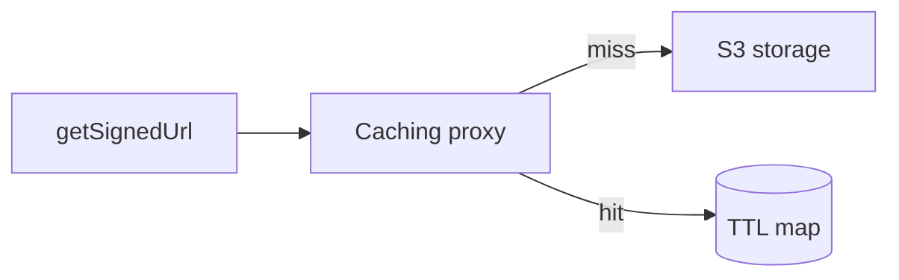

# Proxy pattern

## What it is

A **stand-in** for another object that controls access — authentication, caching, lazy loading, logging, or remote calls — while presenting the same interface.

## توضیح فارسی

**Proxy** به‌جای شیء واقعی می‌نشیند و دسترسی را کنترل می‌کند: کش، بارگذاری تنبل، یا بررسی مجوز. کلاینت همان متدها را صدا می‌زند؛ proxy تصمیم می‌گیرد آیا به شیء واقعی برود، از کش جواب بدهد، یا رد کند. با Decorator شباهت دارد؛ تمرکز Proxy بیشتر روی **کنترل دسترسی/هزینه** است تا افزودن مسئولیت کسب‌وکاری جدید.

## 1. Dummy — Mermaid diagram + one sentence why



**Why:** same port as the real subject—add caching, auth, or lazy load without changing callers.

## 2. When / when not · Good · Bad

### When to use

- Lazy load heavy resources (signed file URLs, large page trees)
- Cache or rate-limit an expensive dependency behind the same port
- Remote proxy over HTTP with the same interface as an in-process API

### When not to use

- You only need to add unrelated behavior ([Decorator](decorator.md) may be clearer)
- Caching rules belong in the repository implementation already

### Good practice

- Same interface as the real subject
- Explicit cache keys and TTL; never cache unauthorized data

### Bad / worst practice

- **Bad:** proxy that silently returns stale private data to the wrong user
- **Worst:** infinite proxy chains that obscure failures

**Trade-offs:** Control and performance vs extra indirection and cache invalidation bugs.

## 3. Working — Hono worst/best + React worst/best TypeScript examples

Real example — Signed attachment URLs + lazy Notion page.

### Backend (Hono) — worst practice

```ts
// ❌ Call S3 every time; cache key ignores user
export async function getSignedUrl(fileId: string) {
  return s3.getSignedUrl(fileId, { expiresIn: 60 });
}
```

### Backend (Hono) — best practice

```ts
interface FileStorage {
  getSignedUrl(fileId: string, userId: string): Promise<string>;
}

class S3FileStorage implements FileStorage {
  async getSignedUrl(fileId: string, userId: string) {
    await assertCanRead(fileId, userId);
    return s3.getSignedUrl(fileId, { expiresIn: 60 });
  }
}

class CachingFileStorage implements FileStorage {
  constructor(
    private readonly inner: FileStorage,
    private readonly cache: Map<string, { url: string; expiresAt: number }>,
  ) {}

  async getSignedUrl(fileId: string, userId: string) {
    const key = `${userId}:${fileId}`;
    const hit = this.cache.get(key);
    if (hit && hit.expiresAt > Date.now()) return hit.url;
    const url = await this.inner.getSignedUrl(fileId, userId);
    this.cache.set(key, { url, expiresAt: Date.now() + 30_000 });
    return url;
  }
}
```

### Frontend (React) — worst practice

```tsx
function Workspace({ pages }: { pages: Page[] }) {
  return pages.map((p) => <PageEditor key={p.id} pageId={p.id} />); // fetches all
}
```

### Frontend (React) — best practice

```tsx
function useLazyPage(pageId: string, enabled: boolean) {
  return useQuery({
    queryKey: ["page", pageId],
    queryFn: () => pagesApi.get(pageId),
    enabled,
  });
}

function PageTab({ pageId, active }: { pageId: string; active: boolean }) {
  const { data } = useLazyPage(pageId, active);
  if (!active) return <span>Page</span>;
  return <PageEditor page={data} />;
}
```

## 4. Rich — edge cases · testing seams

**Edge cases**

- **Cache invalidation on ACL change:** evict keys when sharing rules update.
- **Shorter TTL than signature expiry:** avoid serving URLs about to 403.
- **React Query `enabled`:** tab switch should not refetch if data is fresh (`staleTime`).

**Testing seams**

- Inject `FileStorage` fake; assert proxy calls inner once for two identical requests.
- Test lazy hook with `enabled: false`—`queryFn` never runs (mock fetch).

## 5. CTO — overuse signals · monorepo placement

### Overuse signals

- Hand-rolled caches without metrics or eviction policy
- Proxies wrapping proxies with no composition root diagram

### Alternatives

- HTTP cache headers at CDN for public assets
- Repository-level read-through cache for hot aggregates

### Monorepo placement

| Piece | Location |
|-------|----------|
| `FileStorage` port | `packages/application` |
| `CachingFileStorage` | `packages/infrastructure` or `apps/api` wiring |
| `useLazyPage` | `apps/web` |

## Related · Where in this repo

**Related:** [Decorator](decorator.md), [Repository](repository.md), [Facade](facade.md)

**Where:** Teaching pattern for caching and lazy boundaries at the edges.