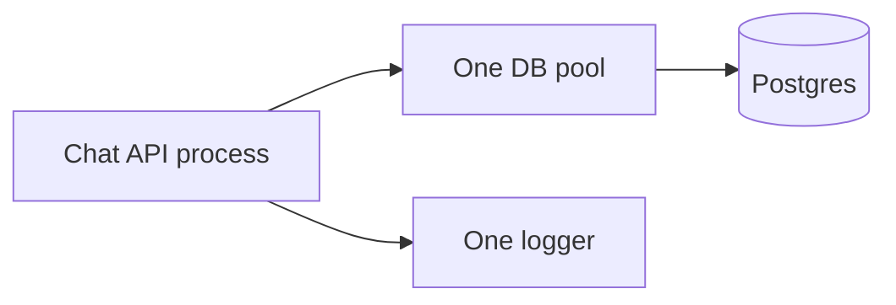
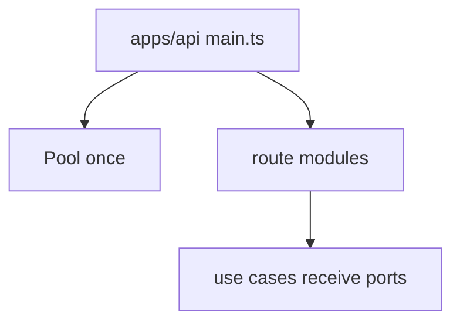

# Singleton pattern

## What it is

Ensures a class has **one shared instance** and provides a global access point to it.

## توضیح فارسی

**Singleton** تضمین می‌کند فقط **یک نمونهٔ مشترک** وجود داشته باشد (مثلاً pool اتصال دیتابیس یا logger فرآیند). استفاده را با احتیاط انجام دهید: دسترسی سراسری تست را سخت می‌کند، وابستگی‌ها را پنهان می‌کند، و در serverless/چند isolate ممکن است «یکی» معنایش عوض شود. اغلب بهتر است همان منبع را یک‌بار در composition root بسازید و با DI تزریق کنید.

## 1. Dummy — Mermaid diagram + one sentence why



**Why:** expensive, process-wide resources should be created once at boot—not per HTTP request or per React subtree.

## 2. When / when not · Good · Bad

### When to use

- Truly process-wide resources (DB pool, metrics registry) constructed once at boot
- You accept the testing cost and document the lifetime

### When not to use

- “I’ll make services singletons so import is easy”
- Per-request state (user, tenant) — that is not a singleton

### Good practice

- Prefer **composition-root singleton**: create once in `main.ts`, inject everywhere
- If you use a module-level instance, export a factory for tests to replace it

### Bad / worst practice

- **Bad:** `getInstance()` called deep inside domain code
- **Worst:** mutable singleton that accumulates request data across users

**Trade-offs:** Convenient shared resource vs hidden coupling and harder tests.

## 3. Working — Hono worst/best + React worst/best TypeScript examples

Real example — One DB pool / one logger for a Hono chat API and React shell. Teaching snippets, not a runnable app.

### Backend (Hono) — worst practice

```ts
// ❌ Classic singleton inside a use case — hidden global
class Db {
  private static instance: Pool;
  static getInstance() {
    if (!Db.instance) Db.instance = new Pool({ connectionString: process.env.DATABASE_URL });
    return Db.instance;
  }
}

export async function listMessages(roomId: string) {
  return Db.getInstance().query("SELECT * FROM messages WHERE room_id = $1", [roomId]);
}
```

### Backend (Hono) — best practice

```ts
// ✅ Composition-root “one instance” — not a service locator
import { Pool } from "pg";
import pino from "pino";

const pool = new Pool({ connectionString: process.env.DATABASE_URL });
const logger = pino();

const app = createApp({
  messages: new PostgresMessageRepository(pool),
  logger,
});
```

### Frontend (React) — worst practice

```tsx
// ❌ new QueryClient() inside every page — no shared cache
export function ChatPage() {
  const client = new QueryClient();
  return (
    <QueryClientProvider client={client}>
      <Thread />
    </QueryClientProvider>
  );
}
```

### Frontend (React) — best practice

```tsx
// ✅ One QueryClient for the app shell
const queryClient = new QueryClient();

createRoot(document.getElementById("root")!).render(
  <QueryClientProvider client={queryClient}>
    <App />
  </QueryClientProvider>,
);
```

| Need | Classic Singleton | Composition-root single instance |
|------|-------------------|----------------------------------|
| Share pool | `Db.getInstance()` anywhere | Pass `pool` from `main.ts` |
| Test | Hard to replace | Inject a fake repository |
| Serverless | Surprising cold-start duplicates | Explicit lifecycle per isolate |

## 4. Rich — edge cases · testing seams

**Edge cases**

- **Serverless / edge workers:** each isolate may construct its own pool—document max connections × concurrency.
- **Hot reload in dev:** module singletons survive reload; pools can leak until process restart.
- **Multi-tenant chat:** never store `currentUserId` on a singleton service.

**Testing seams**

- Pass `MessageRepository` into route factories; tests use `createMemoryMessageRepository()` with no pool.
- For React Query, wrap tests in one shared `QueryClient` with `retry: false` in test setup.



## 5. CTO — overuse signals · monorepo placement

### Overuse signals

- More than three `getInstance()` call sites in `packages/`
- Domain imports from a “global config” module that also opens sockets
- Flaky integration tests because globals leak between cases

### Alternatives

- [dependency-injection.md](dependency-injection.md) at the composition root
- Module-level `const pool` in `apps/api/src/main.ts` only—not in `packages/domain`

### Monorepo placement

| Piece | Location |
|-------|----------|
| Pool, logger, SDK clients | `apps/api/src/main.ts` (or `apps/worker`) |
| Ports & use cases | `packages/application`, `packages/domain` |
| React Query client | `apps/web/src/main.tsx` |

**ADR trigger:** adopting classic Singleton classes in shared packages instead of explicit lifetime at app entry.

## Related · Where in this repo

**Related:** [Dependency Injection](dependency-injection.md), [Factory](factory.md)

**Where:** Prefer DI composition roots; treat classic Singleton as a cautionary pattern. See [COURSE.md](../COURSE.md) track A7 (DI).