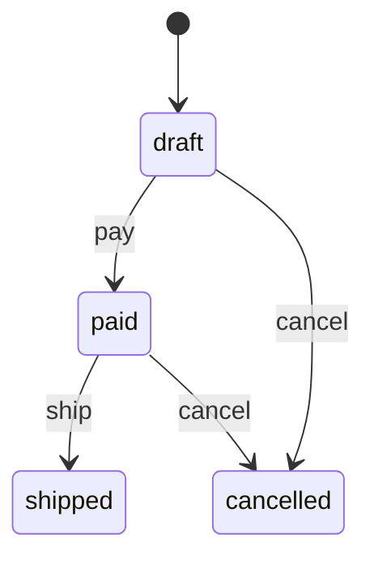

# State pattern

## What it is

Lets an object **alter its behavior when its internal state changes**. It appears to change class; each state object implements the transitions that are legal from there.

## توضیح فارسی

**State** رفتار شیء را بر اساس **وضعیت فعلی** عوض می‌کند. سفارش مارکت‌پلیس از `draft` به `paid` و `shipped` و `cancelled` می‌رود؛ هر وضعیت می‌گوید کدام انتقال مجاز است. به‌جای `if (status === …)` پراکنده، قوانین انتقال داخل اشیاء وضعیت (یا جدول انتقال صریح) می‌مانند.

## 1. Dummy — Mermaid diagram + one sentence why



**Why:** illegal transitions are rejected in one place—marketplace orders don’t ship from `draft` by accident.

## 2. When / when not · Good · Bad

### When to use

- Lifecycles with restricted transitions (orders, tickets, subscriptions)
- Behavior differs strongly per status

### When not to use

- Two statuses with identical behavior
- A boolean flag is enough

### Good practice

- Illegal transitions throw a domain error mapped to `409`
- Persist status as data; recover the state object on load

### Bad / worst practice

- **Bad:** allowing every transition from a god `switch`
- **Worst:** UI and API with different illegal-transition rules

**Trade-offs:** Clear lifecycle vs more types for each status.

## 3. Working — Hono worst/best + React worst/best TypeScript examples

### Real example — Marketplace order lifecycle

### Backend (Hono)

```ts
type OrderStatus = "draft" | "paid" | "shipped" | "cancelled";

type Order = { id: string; status: OrderStatus };

interface OrderState {
  pay(order: Order): Order;
  ship(order: Order): Order;
  cancel(order: Order): Order;
}

class DraftState implements OrderState {
  pay(order: Order) {
    return { ...order, status: "paid" as const };
  }
  ship() {
    throw new Error("ILLEGAL_TRANSITION");
  }
  cancel(order: Order) {
    return { ...order, status: "cancelled" as const };
  }
}

class PaidState implements OrderState {
  pay() {
    throw new Error("ILLEGAL_TRANSITION");
  }
  ship(order: Order) {
    return { ...order, status: "shipped" as const };
  }
  cancel(order: Order) {
    return { ...order, status: "cancelled" as const };
  }
}

class ShippedState implements OrderState {
  pay() {
    throw new Error("ILLEGAL_TRANSITION");
  }
  ship() {
    throw new Error("ILLEGAL_TRANSITION");
  }
  cancel() {
    throw new Error("ILLEGAL_TRANSITION");
  }
}

const states: Record<OrderStatus, OrderState> = {
  draft: new DraftState(),
  paid: new PaidState(),
  shipped: new ShippedState(),
  cancelled: new ShippedState(), // no-op illegal ops — or dedicated CancelledState
};

function transition(order: Order, action: "pay" | "ship" | "cancel") {
  const state = states[order.status];
  return state[action](order);
}

app.post("/orders/:id/ship", async (c) => {
  const order = await orders.get(c.req.param("id"));
  try {
    const next = transition(order, "ship");
    await orders.save(next);
    return c.json(next);
  } catch {
    return c.json({ code: "ILLEGAL_TRANSITION" }, 409);
  }
});
```

### Frontend (React)

```tsx
const actionsByStatus = {
  draft: ["pay", "cancel"],
  paid: ["ship", "cancel"],
  shipped: [],
  cancelled: [],
} as const;

function OrderActions({ status, onAction }: { status: keyof typeof actionsByStatus; onAction: (a: string) => void }) {
  return (
    <div>
      {actionsByStatus[status].map((action) => (
        <button key={action} type="button" onClick={() => onAction(action)}>
          {action}
        </button>
      ))}
    </div>
  );
}
```

### Side-by-side

| Change | Scattered `if (status)` | State |
|--------|-------------------------|-------|
| Forbid ship while draft | Easy to miss a call site | `DraftState.ship` throws |
| UI buttons | Duplicate rules in JSX | Mirror allowed actions from status |

## 4. Rich — edge cases · testing seams

**Edge cases**

- **Hydration:** load status from DB, attach state object—don’t trust client-only status.
- **409 mapping:** illegal transition → domain error → HTTP 409 consistently.
- **UI parity:** `actionsByStatus` must match server transitions.

**Testing seams**

- Transition table tests: `draft.pay()` ok; `draft.ship()` throws.
- API test expects 409 on double-ship.

## 5. CTO — overuse signals · monorepo placement

### Overuse signals

- State class per status when a transition table would fit
- Client allows actions server rejects

### Alternatives

- Explicit `transition(from, action)` table in domain module
- [Strategy](strategy.md) when behavior varies but lifecycle is flat

### Monorepo placement

| Piece | Location |
|-------|----------|
| Order aggregate + transitions | `packages/domain/orders` |
| Routes | `apps/api` |
| `OrderActions` UI | `apps/web` checkout/account |

## Related · Where in this repo

**Related:** [Strategy](strategy.md), [Command](command.md)

**Where:** Teaching pattern for order/ticket lifecycles.
