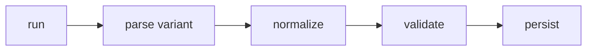

# Template Method pattern

## What it is

Defines the **skeleton of an algorithm** in a base type, deferring some steps to implementations. The outline stays fixed; selected steps vary.

## توضیح فارسی

**Template Method** اسکلت الگوریتم را ثابت می‌گذارد و اجازه می‌دهد بعضی گام‌ها عوض شوند. پایپ‌لاین ایمپورت (خواندن → نرمال‌سازی → اعتبارسنجی → ذخیره) برای CSV و خروجی Notion یکی است؛ فقط گام «خواندن» فرق می‌کند. برخلاف Strategy که کل الگوریتم عوض می‌شود، اینجا ترتیب گام‌ها در پایه قفل است.

## 1. Dummy — Mermaid diagram + one sentence why



**Why:** lock the import pipeline order—swap only how bytes become rows.

## 2. When / when not · Good · Bad

### When to use

- Shared pipelines with a few variant steps (import, ETL, notification deliver)
- You want to forbid reordering steps by subclasses

### When not to use

- Every step varies — Strategy or composition fits better
- Deep inheritance only to override one line

### Good practice

- Mark the template method final / non-overridable in spirit
- Keep hooks small and intentional

### Bad / worst practice

- **Bad:** template that subclasses override end-to-end anyway
- **Worst:** brittle base class that breaks all importers on small changes

**Trade-offs:** Consistent pipelines vs inheritance coupling.

## 3. Working — Hono worst/best + React worst/best TypeScript examples

Real example — Import pages from CSV or Notion export.

### Backend (Hono) — worst practice

```ts
async function importCsv(bytes: Uint8Array) {
  const rows = parseCsv(new TextDecoder().decode(bytes));
  for (const row of rows) {
    if (!row.title) throw new Error("TITLE_REQUIRED");
    await db.insertPage(row);
  }
}

async function importNotion(bytes: Uint8Array) {
  const rows = parseNotionExportZip(bytes);
  for (const row of rows) {
    if (!row.title) throw new Error("TITLE_REQUIRED"); // duplicated validate
    await db.insertPage(row);
  }
}
```

### Backend (Hono) — best practice

```ts
abstract class PageImporter {
  async run(source: Uint8Array) {
    const rows = await this.parse(source);
    const normalized = rows.map((row) => this.normalize(row));
    for (const page of normalized) this.validate(page);
    await this.persist(normalized);
    return { imported: normalized.length };
  }

  protected abstract parse(source: Uint8Array): Promise<Array<Record<string, string>>>;

  protected normalize(row: Record<string, string>) {
    return { title: (row.title ?? "").trim(), body: row.body ?? "" };
  }

  protected validate(page: { title: string }) {
    if (!page.title) throw new Error("TITLE_REQUIRED");
  }

  protected async persist(pages: { title: string; body: string }[]) {
    await db.insertPages(pages);
  }
}

class CsvPageImporter extends PageImporter {
  protected async parse(source: Uint8Array) {
    return parseCsv(new TextDecoder().decode(source));
  }
}
```

### Frontend (React) — worst practice

```tsx
async function onUpload(file: File, kind: string) {
  const data = kind === "csv" ? await readCsv(file) : await readZip(file);
  setPreview(data);
  await fetch("/imports", { method: "POST", body: JSON.stringify(data) });
}
```

### Frontend (React) — best practice

```tsx
abstract class ImportWizard {
  async submit(file: File) {
    const parsed = await this.parse(file);
    this.preview(parsed);
    await this.upload(parsed);
  }
  protected abstract parse(file: File): Promise<unknown>;
  protected preview(_data: unknown) { /* set state */ }
  protected async upload(data: unknown) {
    await fetch("/imports", { method: "POST", body: JSON.stringify(data) });
  }
}
```

## 4. Rich — edge cases · testing seams

**Edge cases**

- **Hooks vs composition:** prefer `run(parseFn)` function pipeline if inheritance feels heavy.
- **Partial persist:** template should define transaction boundary in `persist`.
- **Large files:** streaming parse may require async generator hook—not blocking `run`.

**Testing seams**

- `CsvPageImporter` with in-memory bytes; fake `persist` counting inserts.
- Subclass with deliberate `validate` failure—assert earlier steps ran.

## 5. CTO — overuse signals · monorepo placement

### Overuse signals

- Base class changed weekly—every importer breaks
- Single importer left but abstract class remains

### Alternatives

- Pipeline of functions (`parse | normalize | validate`)
- [Strategy](strategy.md) when entire flow differs

### Monorepo placement

| Piece | Location |
|-------|----------|
| `PageImporter` base | `packages/application/imports` |
| Format subclasses | same package |
| `POST /imports` route | `apps/api` |

## Related · Where in this repo

**Related:** [Factory Method](factory-method.md), [Strategy](strategy.md)

**Where:** Teaching pattern for import/export pipelines.