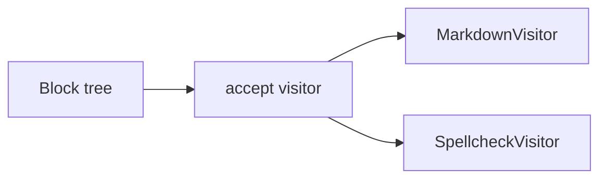

# Visitor pattern

## What it is

Adds **new operations** to object structures without changing the classes of the elements. Each element accepts a visitor; the visitor implements `visitX` per type.

## توضیح فارسی

**Visitor** عملیات جدید را به ساختار اشیاء اضافه می‌کند **بدون تغییر کلاس‌های عناصر**. هر بلاک `accept(visitor)` دارد؛ visitorهایی مثل `MarkdownExportVisitor` یا `SpellcheckVisitor` جدا اضافه می‌شوند. وقتی انواع عنصر پایدارند ولی عملیات‌ها زیاد می‌شوند (export، آمار، لینت)، Visitor می‌درخشد؛ وقتی انواع عنصر مدام زیاد می‌شوند، هزینهٔ به‌روز کردن همهٔ visitorها بالا می‌رود.

## 1. Dummy — Mermaid diagram + one sentence why



**Why:** add export or spellcheck without editing every block class—add a visitor instead.

## 2. When / when not · Good · Bad

### When to use

- Stable element hierarchy; growing operations (export, lint, analytics)
- You want operations closed against element classes (OCP on behaviors)

### When not to use

- Element types change often — each new type edits every visitor
- A simple method on the element is clearer

### Good practice

- Double dispatch via `accept` / `visitConcrete`
- Keep visitors pure when possible (return values, don’t mutate silently)

### Bad / worst practice

- **Bad:** visitor that needs to know private mutable fields of every node
- **Worst:** using Visitor where a single `switch (type)` in one module would do and types churn weekly

**Trade-offs:** Easy new operations vs hard new element types.

## 3. Working — Hono worst/best + React worst/best TypeScript examples

### Real example — Operations over Notion block tree

### Backend (Hono)

```ts
interface BlockVisitor {
  visitParagraph(block: ParagraphBlock): void;
  visitSection(block: SectionBlock): void;
  visitEmbed(block: EmbedBlock): void;
}

interface Block {
  accept(visitor: BlockVisitor): void;
}

class ParagraphBlock implements Block {
  constructor(
    public id: string,
    public text: string,
  ) {}
  accept(visitor: BlockVisitor) {
    visitor.visitParagraph(this);
  }
}

class SectionBlock implements Block {
  constructor(
    public id: string,
    public title: string,
    public children: Block[],
  ) {}
  accept(visitor: BlockVisitor) {
    visitor.visitSection(this);
    for (const child of this.children) child.accept(visitor);
  }
}

class EmbedBlock implements Block {
  constructor(
    public id: string,
    public url: string,
  ) {}
  accept(visitor: BlockVisitor) {
    visitor.visitEmbed(this);
  }
}

class MarkdownExportVisitor implements BlockVisitor {
  parts: string[] = [];
  visitParagraph(block: ParagraphBlock) {
    this.parts.push(block.text);
  }
  visitSection(block: SectionBlock) {
    this.parts.push(`## ${block.title}`);
  }
  visitEmbed(block: EmbedBlock) {
    this.parts.push(`[embed](${block.url})`);
  }
  result() {
    return this.parts.join("\n\n");
  }
}

class SpellcheckVisitor implements BlockVisitor {
  issues: Array<{ id: string; message: string }> = [];
  visitParagraph(block: ParagraphBlock) {
    if (block.text.includes("teh ")) this.issues.push({ id: block.id, message: "Possible typo: teh" });
  }
  visitSection() {}
  visitEmbed() {}
}

app.get("/pages/:id/export.md", async (c) => {
  const root = await loadTree(c.req.param("id"));
  const visitor = new MarkdownExportVisitor();
  root.accept(visitor);
  return c.text(visitor.result());
});
```

### Frontend (React)

```tsx
type Visitor = {
  paragraph(text: string): React.ReactNode;
  embed(url: string): React.ReactNode;
};

function renderBlock(block: BlockNode, visitor: Visitor): React.ReactNode {
  if (block.type === "paragraph") return visitor.paragraph(block.text);
  if (block.type === "embed") return visitor.embed(block.url);
  return block.children.map((child) => renderBlock(child, visitor));
}

const previewVisitor: Visitor = {
  paragraph: (text) => <p>{text}</p>,
  embed: (url) => <a href={url}>{url}</a>,
};
```

### Side-by-side

| Change | Methods on each block class | Visitor |
|--------|-----------------------------|---------|
| Add spellcheck | Edit Paragraph/Section/Embed | New `SpellcheckVisitor` |
| Add new block type | One class | Update every visitor |

## 4. Rich — edge cases · testing seams

**Edge cases**

- **New block type:** every visitor gets a new `visitX`—budget that cost.
- **Pure visitors:** return strings or diagnostics; avoid silent tree mutation.
- **React preview:** visitor can be a render map (`paragraph`, `embed`) without class-based accept.

**Testing seams**

- Golden export: fixture tree + `MarkdownExportVisitor` output.
- Missing `visitEmbed` should fail compile (exhaustive visitor typing).

## 5. CTO — overuse signals · monorepo placement

### Overuse signals

- Weekly new block types with five visitors each to update
- Visitor used where one `switch (type)` module would be clearer

### Alternatives

- [Composite](composite.md) methods when only one operation exists
- [Builder](builder.md) for single export path

### Monorepo placement

| Piece | Location |
|-------|----------|
| Visitors (export, spellcheck) | `packages/application/blocks` |
| `accept` on nodes | `packages/domain/blocks` |
| Preview visitor | `apps/web/src/editor` |

## Related · Where in this repo

**Related:** [Composite](composite.md), [Iterator](iterator.md), OCP

**Where:** Pairs with Composite block trees and export/builder flows.
