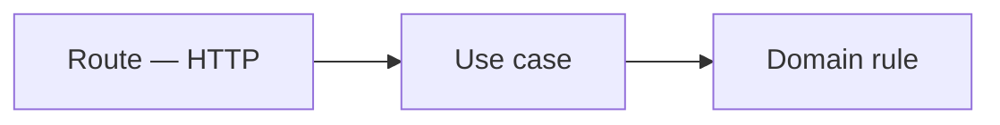

# Single Responsibility Principle (SRP)

## What it is

A module should have **one reason to change** — one cohesive responsibility, not “one function” literally.

Examples of separate reasons to change:

| Module | Reason to change |
|--------|------------------|
| Hono route | HTTP shape, status codes, headers |
| Use case | Workflow / orchestration steps |
| Domain rule | Business invariant |
| React form UI | Layout, a11y, field widgets |
| API client hook | How we call the backend |

---

## 1. Dummy — 30-second picture

One module, one reason to change. HTTP status edits stay in the route; tax rules stay in domain.



**Why it exists:** so a pricing change does not reopen every Hono handler.

---

## When to use

### Backend (Hono)

- Route handler mixes validation, SQL, email, and response mapping
- One `*Service` class gains a new method for every feature
- Changing the DB forces edits in HTTP handlers

### Frontend (React)

- A page component fetches, validates, maps domain rules, and renders a large tree
- “God component” re-renders for unrelated state (form + websocket + analytics)
- You need to reuse the same mutation logic in web and mobile

## When not to use

- Splitting a five-line helper into three files “for SRP”
- Extracting a component that is only used once and has no independent change reason
- Micro-modules that increase navigation cost without isolating change

**Rule of thumb:** split when two concerns change for **different reasons** or are tested differently—not because a file hit an arbitrary line count.

---

## Backend (Hono) — worst practice

One handler owns HTTP, validation, persistence, and business rules. Any change (schema, SQL, status codes) touches the same function.

```ts
// ❌ Worst: route does everything
import { Hono } from "hono";
import { db } from "./db"; // concrete driver leaked into HTTP layer

const app = new Hono();

app.post("/todos", async (c) => {
  const body = await c.req.json();

  // validation + HTTP + domain + SQL in one place
  if (!body.title || typeof body.title !== "string") {
    return c.json({ error: "title required" }, 400);
  }
  const title = body.title.trim();
  if (title.length === 0) {
    return c.json({ error: "title empty" }, 400);
  }

  const id = crypto.randomUUID();
  await db.execute("INSERT INTO todos (id, title, done) VALUES (?, ?, 0)", [
    id,
    title,
  ]);

  // more unrelated work often lands here later: email, metrics, PDF…
  return c.json({ id, title, done: false }, 201);
});
```

**Why this fails SRP:** HTTP transport, input rules, persistence, and (soon) side effects share one reason-to-change surface. Hard to unit-test the “title must be non-empty” rule without standing up Hono + DB.

---

## Backend (Hono) — best practice

Each layer has one job. The route adapts HTTP ↔ application; the use case orchestrates; domain owns the invariant; the repository port owns persistence.

```ts
// ✅ Domain: one reason to change — business rules
export type Todo = { id: string; title: string; done: boolean };

export function createTodoTitle(raw: string): string {
  const title = raw.trim();
  if (!title) throw new Error("TITLE_REQUIRED");
  return title;
}
```

```ts
// ✅ Application port + use case
export interface TodoRepository {
  add(todo: Todo): Promise<void>;
}

export async function createTodo(
  input: { title: string },
  deps: { todos: TodoRepository; id: () => string },
): Promise<Todo> {
  const todo: Todo = {
    id: deps.id(),
    title: createTodoTitle(input.title),
    done: false,
  };
  await deps.todos.add(todo);
  return todo;
}
```

```ts
// ✅ Hono route: HTTP only — validate contract, call use case, map errors
import { Hono } from "hono";
import { z } from "zod";
import { createTodo } from "@fsab/application";

const CreateTodoBody = z.object({ title: z.string() });

export function todoRoutes(deps: {
  createTodo: typeof createTodo;
  todos: { add(todo: unknown): Promise<void> };
}) {
  const app = new Hono();

  app.post("/todos", async (c) => {
    const parsed = CreateTodoBody.safeParse(await c.req.json());
    if (!parsed.success) {
      return c.json({ code: "VALIDATION_ERROR" }, 400);
    }

    try {
      const todo = await deps.createTodo(parsed.data, {
        todos: deps.todos,
        id: () => crypto.randomUUID(),
      });
      return c.json(todo, 201);
    } catch (e) {
      if (e instanceof Error && e.message === "TITLE_REQUIRED") {
        return c.json({ code: "TITLE_REQUIRED" }, 400);
      }
      throw e;
    }
  });

  return app;
}
```

**Why this fits SRP:**

| Piece | Changes when… |
|-------|----------------|
| Route | Status codes / JSON envelope change |
| Zod contract | Wire format changes |
| `createTodo` use case | Workflow steps change |
| `createTodoTitle` | Business rule changes |
| `TodoRepository` adapter | SQL / vendor changes |

---

## Frontend (React) — worst practice

One component fetches, owns server rules, mutates global concerns, and renders everything. Editing the button styles risks breaking the API call.

```tsx
// ❌ Worst: page component does networking, rules, and heavy UI
import { useEffect, useState } from "react";

export function TodosPage() {
  const [title, setTitle] = useState("");
  const [todos, setTodos] = useState<{ id: string; title: string }[]>([]);
  const [error, setError] = useState<string | null>(null);

  useEffect(() => {
    fetch("http://localhost:3001/todos")
      .then((r) => r.json())
      .then(setTodos)
      .catch(() => setError("load failed"));
  }, []);

  async function onSubmit(e: React.FormEvent) {
    e.preventDefault();
    // domain rule duplicated (and likely drift from API)
    if (!title.trim()) {
      setError("title empty");
      return;
    }
    const res = await fetch("http://localhost:3001/todos", {
      method: "POST",
      headers: { "Content-Type": "application/json" },
      body: JSON.stringify({ title }),
    });
    if (!res.ok) {
      setError("create failed");
      return;
    }
    const todo = await res.json();
    setTodos((prev) => [...prev, todo]);
    setTitle("");
    // analytics, toast, localStorage… all pile in here
  }

  return (
    <div>
      {error && <p>{error}</p>}
      <form onSubmit={onSubmit}>
        <input value={title} onChange={(e) => setTitle(e.target.value)} />
        <button type="submit">Add</button>
      </form>
      <ul>
        {todos.map((t) => (
          <li key={t.id}>{t.title}</li>
        ))}
      </ul>
    </div>
  );
}
```

**Why this fails SRP:** UI layout, HTTP client details, and duplicated business rules change for different reasons but live in one component.

---

## Frontend (React) — best practice

Split **presentational UI**, **data/API hook**, and leave **authoritative rules on the server** (client checks are UX only, ideally via shared contracts).

```ts
// ✅ API client module: one reason to change — how we talk to the backend
import { z } from "zod";

const TodoSchema = z.object({
  id: z.string(),
  title: z.string(),
  done: z.boolean(),
});

export type TodoDto = z.infer<typeof TodoSchema>;

export async function listTodos(baseUrl: string): Promise<TodoDto[]> {
  const res = await fetch(`${baseUrl}/todos`);
  if (!res.ok) throw new Error("LIST_FAILED");
  return z.array(TodoSchema).parse(await res.json());
}

export async function createTodoApi(
  baseUrl: string,
  title: string,
): Promise<TodoDto> {
  const res = await fetch(`${baseUrl}/todos`, {
    method: "POST",
    headers: { "Content-Type": "application/json" },
    body: JSON.stringify({ title }),
  });
  if (!res.ok) throw new Error("CREATE_FAILED");
  return TodoSchema.parse(await res.json());
}
```

```tsx
// ✅ Hook: one reason to change — client state orchestration for todos
import { useCallback, useEffect, useState } from "react";
import { createTodoApi, listTodos, type TodoDto } from "./todos-api";

export function useTodos(baseUrl: string) {
  const [todos, setTodos] = useState<TodoDto[]>([]);
  const [error, setError] = useState<string | null>(null);
  const [pending, setPending] = useState(false);

  useEffect(() => {
    let cancelled = false;
    listTodos(baseUrl)
      .then((data) => {
        if (!cancelled) setTodos(data);
      })
      .catch(() => {
        if (!cancelled) setError("load failed");
      });
    return () => {
      cancelled = true;
    };
  }, [baseUrl]);

  const addTodo = useCallback(
    async (title: string) => {
      setPending(true);
      setError(null);
      try {
        const todo = await createTodoApi(baseUrl, title);
        setTodos((prev) => [...prev, todo]);
      } catch {
        setError("create failed");
      } finally {
        setPending(false);
      }
    },
    [baseUrl],
  );

  return { todos, error, pending, addTodo };
}
```

```tsx
// ✅ Presentational pieces: one reason to change — UI / a11y
function TodoForm({
  pending,
  onAdd,
}: {
  pending: boolean;
  onAdd: (title: string) => Promise<void>;
}) {
  const [title, setTitle] = useState("");

  return (
    <form
      onSubmit={(e) => {
        e.preventDefault();
        void onAdd(title).then(() => setTitle(""));
      }}
    >
      <label htmlFor="todo-title">Title</label>
      <input
        id="todo-title"
        value={title}
        onChange={(e) => setTitle(e.target.value)}
        disabled={pending}
      />
      <button type="submit" disabled={pending}>
        Add
      </button>
    </form>
  );
}

function TodoList({ todos }: { todos: { id: string; title: string }[] }) {
  return (
    <ul>
      {todos.map((t) => (
        <li key={t.id}>{t.title}</li>
      ))}
    </ul>
  );
}

// ✅ Page: composition only
export function TodosPage({ apiBaseUrl }: { apiBaseUrl: string }) {
  const { todos, error, pending, addTodo } = useTodos(apiBaseUrl);

  return (
    <main>
      {error && <p role="alert">{error}</p>}
      <TodoForm pending={pending} onAdd={addTodo} />
      <TodoList todos={todos} />
    </main>
  );
}
```

**Why this fits SRP:**

| Piece | Changes when… |
|-------|----------------|
| `TodoForm` / `TodoList` | Visual / a11y requirements change |
| `useTodos` | Loading/error/cache behavior changes |
| `todos-api` | URL, headers, or DTO parsing changes |
| Hono + domain | Authoritative business rules change (not the React tree) |

---

## Side-by-side: same feature, SRP vs not

| Concern | Worst (mixed) | Best (separated) |
|---------|---------------|------------------|
| Non-empty title | Duplicated in React + Hono SQL handler | Domain (server); optional UX hint via shared Zod contract |
| Insert row | Inside `app.post` | DB adapter behind `TodoRepository` |
| JSON status codes | Mixed with SQL | Hono route / error mapper |
| Form layout | Same file as `fetch` | `TodoForm` |
| Client state | Same file as markup | `useTodos` |

---

## Trade-offs

| Benefit                 | Cost                                          |
| ----------------------- | --------------------------------------------- |
| Clear change boundaries | More files and wiring                         |
| Easier unit tests       | Need composition at edges                     |
| Reuse across web/mobile | Over-splitting tiny helpers hurts readability |

SRP is not “more files = better.” Prefer cohesion: things that change together can live together.

## Related concepts

- [05-D.md](05-D.md) — Dependency Inversion (ports make SRP splits testable)
- [../design-patterns/repository.md](../design-patterns/repository.md)
- [../../tech-space/backend-architecture.md](../../tech-space/backend-architecture.md)
- [../../tech-space/frontend-architecture.md](../../tech-space/frontend-architecture.md)

## Where in this repo

Vertical slice Todo (planned): separate route / use case / DB adapter / React page + hook — see [../../examples/vertical-slice-todo/README.md](../../examples/vertical-slice-todo/README.md) and walkthrough steps 03–09.
