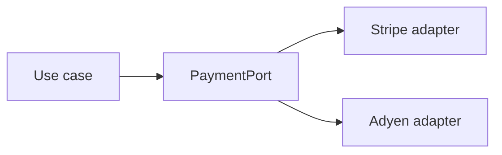

# Open-Closed Principle (OCP)

## What it is

Modules should be **open for extension, closed for modification** — add behavior with **new code** (new adapter, new strategy), not by repeatedly editing a central `switch` / `if` ladder.

| Closed for modification | Open for extension |
|-------------------------|--------------------|
| Stable use case / route flow | New DB vendor, auth mode, export format |
| Callers depend on a port | New class implements the port |

---

## 1. Dummy — 30-second picture

Stable core, new behavior plugs in via a port — not another `switch (vendor)`.



**Why it exists:** so adding Adyen does not edit every call site.

---

## When to use

### Backend (Hono)

- A second (then third) database or auth strategy is real, not hypothetical
- Notification channels keep growing (email → SMS → push) but the “notify user” flow is stable

### Frontend (React)

- Multiple ways to render the same data (table / cards / compact list)
- Multiple submit strategies (API vs offline queue) behind one form action

## When not to use

- Only one variant exists and none is planned — skip the strategy tree
- The core flow is still being discovered (you *should* modify it)
- Inventing interfaces only to “demonstrate OCP”

**Rule of thumb:** introduce an extension point when the **second** real variant arrives (or is firmly scheduled)—not on day one for imaginary vendors.

---

## Backend (Hono) — worst practice

Every new driver means editing the use case (and redeploying risk to the core flow).

```ts
// ❌ Worst: core workflow modified for every vendor
export async function createTodo(
  input: { title: string },
  driver: "libsql" | "postgres" | "mariadb",
) {
  const todo = { id: crypto.randomUUID(), title: input.title.trim(), done: false };

  if (driver === "libsql") {
    await libsql.execute("INSERT INTO todos …", [todo.id, todo.title]);
  } else if (driver === "postgres") {
    await pg.query("INSERT INTO todos …", [todo.id, todo.title]);
  } else if (driver === "mariadb") {
    await mysql.query("INSERT INTO todos …", [todo.id, todo.title]);
  }
  // next vendor → edit this function again
  return todo;
}
```

```ts
// ❌ Same smell at the HTTP edge
app.post("/todos", async (c) => {
  const driver = c.env.DATABASE_DRIVER;
  // giant switch lives in the route forever
});
```

---

## Backend (Hono) — best practice

Stable use case depends on a **port**. New vendor = **new adapter file**. Composition root selects the implementation.

```ts
// ✅ Port — closed for modification when vendors change
export interface TodoRepository {
  add(todo: { id: string; title: string; done: boolean }): Promise<void>;
}

// ✅ Use case — does not change when MariaDB is added
export async function createTodo(
  input: { title: string },
  todos: TodoRepository,
  id: () => string,
) {
  const todo = { id: id(), title: input.title.trim(), done: false };
  if (!todo.title) throw new Error("TITLE_REQUIRED");
  await todos.add(todo);
  return todo;
}
```

```ts
// ✅ Extension: new file, not edits to createTodo
export class PostgresTodoRepository implements TodoRepository {
  constructor(private readonly client: PgClient) {}
  async add(todo: { id: string; title: string; done: boolean }) {
    await this.client.query(
      "INSERT INTO todos (id, title, done) VALUES ($1, $2, $3)",
      [todo.id, todo.title, todo.done],
    );
  }
}
```

```ts
// ✅ Composition root (apps/api) — the only place that switches
function createTodoRepo(config: { driver: string }): TodoRepository {
  switch (config.driver) {
    case "postgres":
      return new PostgresTodoRepository(createPg(config));
    case "libsql":
      return new LibSqlTodoRepository(createLibSql(config));
    default:
      throw new Error(`Unknown driver: ${config.driver}`);
  }
}

const app = createApp({ todos: createTodoRepo(env) });
```

Hono routes stay closed: they always call `createTodo(...)`, never vendor APIs.

---

## Frontend (React) — worst practice

Every new view mode edits the same component’s render path.

```tsx
// ❌ Worst: modify TodosPage for every presentation mode
export function TodosPage({ mode }: { mode: "list" | "cards" | "compact" }) {
  const todos = useTodos();

  if (mode === "list") {
    return <ul>{todos.map((t) => <li key={t.id}>{t.title}</li>)}</ul>;
  }
  if (mode === "cards") {
    return <div className="grid">{/* cards */}</div>;
  }
  if (mode === "compact") {
    return <table>{/* rows */}</table>;
  }
  // mode === "kanban" → edit this file again
  return null;
}
```

---

## Frontend (React) — best practice

Stable container; **extend** with new view components selected by strategy/map.

```tsx
// ✅ View contract — open for new views
type Todo = { id: string; title: string; done: boolean };

type TodoViewProps = { todos: Todo[] };

const todoViews: Record<string, React.FC<TodoViewProps>> = {
  list: TodoListView,
  cards: TodoCardsView,
  compact: TodoCompactView,
  // kanban: TodoKanbanView  ← add mapping, do not rewrite the page
};

export function TodosPage({ mode }: { mode: keyof typeof todoViews }) {
  const { todos } = useTodos();
  const View = todoViews[mode] ?? TodoListView;
  return (
    <main>
      <View todos={todos} />
    </main>
  );
}

function TodoListView({ todos }: TodoViewProps) {
  return (
    <ul>
      {todos.map((t) => (
        <li key={t.id}>{t.title}</li>
      ))}
    </ul>
  );
}
```

Same idea for submit strategies (immediate API vs offline queue): form calls `submit(title)`, implementations vary behind a small interface.

---

## Side-by-side

| Change request | Worst | Best |
|----------------|-------|------|
| Add MariaDB | Edit `createTodo` / route `switch` | New adapter + one factory case |
| Add kanban UI | Edit `TodosPage` conditionals | New view + register in map |
| Add SMS notify | Edit notify service blob | New `Notifier` implementation |

## Trade-offs

| Benefit | Cost |
|---------|------|
| Core flow stays stable | Need a good port early enough |
| Safer extensions | Wrong abstraction is expensive to undo |

OCP without a second variant is often premature. Prefer [01-S.md](01-S.md) clarity first.

## Related concepts

- [05-D.md](05-D.md) — ports enable OCP
- [../design-patterns/strategy.md](../design-patterns/strategy.md)
- [../design-patterns/adapter.md](../design-patterns/adapter.md)

## Where in this repo

DB adapters (walkthrough 07/11/12); auth strategies (walkthrough 14); multi-db notes example.
