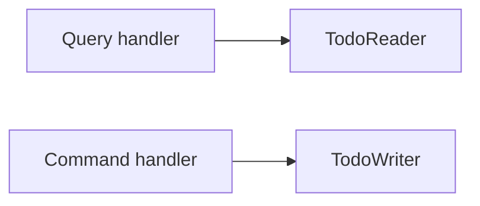

# Interface Segregation Principle (ISP)

## What it is

Prefer **small, focused interfaces** so a client only depends on methods it actually uses. Fat interfaces force unused methods, awkward fakes, and accidental coupling.

| Fat interface smell                            | Segregated alternative                        |
| ---------------------------------------------- | --------------------------------------------- |
| `TodoRepository` with admin + user + analytics | `TodoReader` / `TodoWriter` / `TodoAdmin`     |
| React props bag with 20 callbacks              | Split presentational props vs container props |
| One mock implements 12 unused methods          | Tiny fake for the one port you need           |

---

## 1. Dummy — 30-second picture

Clients depend only on the methods they call — not a 12-method god port.



**Why it exists:** so fakes and mocks stay tiny in tests.

---

## When to use

### Backend (Hono)

- List endpoint only needs `list()` but must inject a repo with `reindex`, `bulkImport`, `purgeAll`
- Admin routes and public routes share one mega-port

### Frontend (React)

- A dumb list component receives an entire `useTodos()` return value it never uses
- Context value exposes mutate + admin + realtime to every consumer

## When not to use

- Exploding into dozens of one-method interfaces with no coherence
- One client truly uses the whole surface — keep one interface
- Splitting before a second client exists (premature)

**Rule of thumb:** segregate when a **second client** would be forced to depend on methods it does not call (or when fakes become painful).

---

## Backend (Hono) — worst practice

Every handler depends on a kitchen-sink port.

```ts
// ❌ Fat port — list route "depends" on purge/reindex
export interface TodoRepository {
  list(): Promise<Todo[]>;
  get(id: string): Promise<Todo | null>;
  add(todo: Todo): Promise<void>;
  complete(id: string): Promise<Todo>;
  purgeAll(): Promise<void>;
  reindexSearch(): Promise<void>;
  exportCsv(): Promise<string>;
}

// Public list still requires the fat type
export function listRoutes(todos: TodoRepository) {
  const app = new Hono();
  app.get("/todos", async (c) => c.json(await todos.list()));
  return app;
}

// ❌ Test fake must stub everything
class FakeTodos implements TodoRepository {
  async list() {
    return [];
  }
  async get() {
    return null;
  }
  async add() {}
  async complete() {
    throw new Error("unused");
  }
  async purgeAll() {
    throw new Error("unused");
  }
  async reindexSearch() {
    throw new Error("unused");
  }
  async exportCsv() {
    return "";
  }
}
```

---

## Backend (Hono) — best practice

Segregate by client need. One class may still implement several interfaces.

```ts
// ✅ Small ports
export interface TodoReader {
  list(): Promise<Todo[]>;
  get(id: string): Promise<Todo | null>;
}

export interface TodoWriter {
  add(todo: Todo): Promise<void>;
  complete(id: string): Promise<Todo>;
}

export interface TodoAdmin {
  purgeAll(): Promise<void>;
  reindexSearch(): Promise<void>;
}

// Adapter can implement all three
export class LibSqlTodoRepository
  implements TodoReader, TodoWriter, TodoAdmin
{
  /* … */
}
```

```ts
// ✅ Routes depend only on what they use
export function publicTodoRoutes(todos: TodoReader & TodoWriter) {
  const app = new Hono();
  app.get("/todos", async (c) => c.json(await todos.list()));
  app.post("/todos", async (c) => {
    /* validate + add */
  });
  return app;
}

export function adminTodoRoutes(admin: TodoAdmin) {
  const app = new Hono();
  app.post("/admin/todos/purge", async (c) => {
    await admin.purgeAll();
    return c.body(null, 204);
  });
  return app;
}

// ✅ Tiny fake for public tests
class FakePublicTodos implements TodoReader, TodoWriter {
  private items: Todo[] = [];
  async list() {
    return this.items;
  }
  async get(id: string) {
    return this.items.find((t) => t.id === id) ?? null;
  }
  async add(todo: Todo) {
    this.items.push(todo);
  }
  async complete(id: string) {
    const t = await this.get(id);
    if (!t) throw new Error("NOT_FOUND");
    t.done = true;
    return t;
  }
}
```

---

## Frontend (React) — worst practice

Presentational child forced to accept a fat props/context API.

```tsx
// ❌ Fat props — TodoList does not need mutate/admin
type TodosApi = {
  todos: Todo[];
  loading: boolean;
  error: string | null;
  add: (title: string) => Promise<void>;
  complete: (id: string) => Promise<void>;
  purgeAll: () => Promise<void>;
  reindex: () => Promise<void>;
  connectRealtime: () => void;
};

export function TodoList({ api }: { api: TodosApi }) {
  return (
    <ul>
      {api.todos.map((t) => (
        <li key={t.id}>{t.title}</li>
      ))}
    </ul>
  );
}
```

Every change to admin APIs can ripple through list consumers and tests.

---

## Frontend (React) — best practice

Pass **only what the view needs**. Containers compose wider hooks.

```tsx
// ✅ Segregated view props
type TodoListProps = {
  todos: { id: string; title: string; done: boolean }[];
};

export function TodoList({ todos }: TodoListProps) {
  return (
    <ul>
      {todos.map((t) => (
        <li key={t.id}>{t.title}</li>
      ))}
    </ul>
  );
}

type TodoListActionsProps = {
  onComplete: (id: string) => void;
  todos: { id: string; title: string; done: boolean }[];
};

export function TodoListWithActions({ todos, onComplete }: TodoListActionsProps) {
  return (
    <ul>
      {todos.map((t) => (
        <li key={t.id}>
          {t.title}
          <button type="button" onClick={() => onComplete(t.id)}>
            Done
          </button>
        </li>
      ))}
    </ul>
  );
}

// ✅ Page/container may use the full hook; children stay narrow
export function TodosPage() {
  const { todos, complete, purgeAll } = useTodos();
  return (
    <main>
      <TodoListWithActions todos={todos} onComplete={complete} />
      {/* admin only where needed */}
      <button type="button" onClick={() => void purgeAll()}>
        Purge
      </button>
    </main>
  );
}
```

Same idea for context: provide `TodosReadContext` vs `TodosAdminContext` instead of one mega-value.

---

## Side-by-side

| Client | Fat dependency | Segregated dependency |
|--------|----------------|------------------------|
| `GET /todos` | Full `TodoRepository` | `TodoReader` |
| Admin purge | Same mega type | `TodoAdmin` |
| `TodoList` UI | Entire `useTodos()` | `{ todos }` |
| Test fake | 7 stub methods | 2–4 real fake methods |

## Trade-offs

| Benefit | Cost |
|---------|------|
| Lean clients and fakes | More type names |
| Clearer authz surfaces | Can over-split into noise |

Start small ([Todo port in walkthrough 04](../../walkthrough/04-application-layer/README.md)); segregate when a second client appears.

## Related concepts

- [03-L.md](03-L.md) — fat interfaces often force LSP violations via empty stubs
- [05-D.md](05-D.md)
- [../design-patterns/repository.md](../design-patterns/repository.md)

## Where in this repo

Keep the first Todo port small; split reader/writer/admin only when routes need it.
