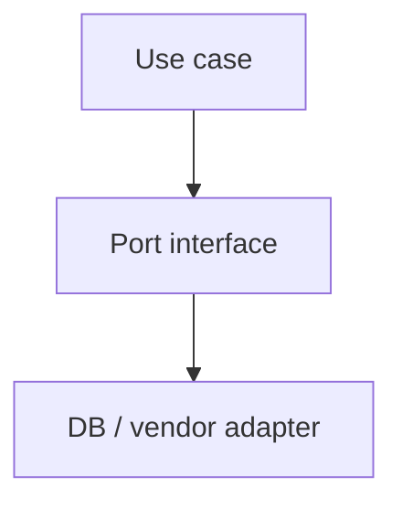

# Dependency Inversion Principle (DIP)

## What it is

**High-level policy** (domain / use cases / UI workflow) must not depend on **low-level details** (Hono, `pg`, React Query internals, Capacitor plugins). Both depend on **abstractions** (ports). Details implement those abstractions.

```text
❌  use case  →  @libsql/client
❌  domain    →  react
❌  page      →  raw SQL

✅  use case  →  TodoRepository (port)
✅  LibSqlTodoRepository implements TodoRepository
✅  apps/api composition root wires the adapter
```

DIP ≠ Dependency Injection. **DI** is a way to *supply* the abstraction; DIP is the *direction* of the dependency.

---

## 1. Dummy — 30-second picture

Use cases point at ports; Postgres and Stripe sit in adapters at the composition root.



**Why it exists:** so `packages/domain` never imports `drizzle-orm`.

---

## When to use

### Backend (Hono)

- Business rules must be testable without HTTP or a real DB
- Multiple drivers (libSQL / Postgres / MariaDB) or future CLI entrypoints

### Frontend (React)

- Screens should not hard-bind to one HTTP client or Capacitor plugin
- Same workflow on web and mobile with different storage/HTTP adapters

## When not to use

- A one-off script with a single IO call
- Abstracting a dependency that will never be replaced and has no test value
- Ports invented only to name a pattern

**Rule of thumb:** invert when you need **tests with fakes**, **multiple adapters**, or **framework independence**. Otherwise keep it direct.

---

## Backend (Hono) — worst practice

High-level flow imports low-level SDKs. Changing DB or HTTP framework rewrites the “brain” of the app.

```ts
// ❌ Use case depends on concrete libSQL + Hono types
import type { Context } from "hono";
import { createClient } from "@libsql/client";

const db = createClient({ url: process.env.DATABASE_URL! });

export async function createTodo(c: Context) {
  const body = await c.req.json();
  await db.execute("INSERT INTO todos (id, title) VALUES (?, ?)", [
    crypto.randomUUID(),
    body.title,
  ]);
  return c.json({ ok: true }, 201);
}
```

```ts
// ❌ Domain imports React "for convenience"
import { useState } from "react";

export function incompleteCount(todos: { done: boolean }[]) {
  const [n] = useState(todos.filter((t) => !t.done).length); // nonsense + coupling
  return n;
}
```

---

## Backend (Hono) — best practice

Policy depends on a port; Hono and libSQL sit at the edges; composition root wires them.

```ts
// ✅ packages/application — high level depends on abstraction
export interface TodoRepository {
  add(todo: Todo): Promise<void>;
}

export async function createTodo(
  input: { title: string },
  deps: { todos: TodoRepository; newId: () => string },
) {
  const title = input.title.trim();
  if (!title) throw new Error("TITLE_REQUIRED");
  const todo = { id: deps.newId(), title, done: false };
  await deps.todos.add(todo);
  return todo;
}
```

```ts
// ✅ packages/db — detail depends on the abstraction
import type { TodoRepository } from "@fsab/application";
import { createClient } from "@libsql/client";

export function createLibSqlTodoRepository(url: string): TodoRepository {
  const client = createClient({ url });
  return {
    async add(todo) {
      await client.execute({
        sql: "INSERT INTO todos (id, title, done) VALUES (?, ?, ?)",
        args: [todo.id, todo.title, todo.done ? 1 : 0],
      });
    },
  };
}
```

```ts
// ✅ apps/api — composition root (wiring only)
import { Hono } from "hono";
import { createTodo } from "@fsab/application";
import { createLibSqlTodoRepository } from "@fsab/db";

export function createApp(config: { databaseUrl: string }) {
  const todos = createLibSqlTodoRepository(config.databaseUrl);
  const app = new Hono();

  app.post("/todos", async (c) => {
    const body = await c.req.json();
    const todo = await createTodo(
      { title: String(body.title ?? "") },
      { todos, newId: () => crypto.randomUUID() },
    );
    return c.json(todo, 201);
  });

  return app;
}
```

```ts
// ✅ Test — swap detail for a fake (DIP pays off)
const fake: TodoRepository = {
  async add() {
    /* record calls */
  },
};
await createTodo({ title: "Ship DIP" }, { todos: fake, newId: () => "1" });
```

---

## Frontend (React) — worst practice

UI policy hard-depends on a concrete transport and native plugin.

```tsx
// ❌ Page knows fetch URLs + Capacitor plugin directly
import { Preferences } from "@capacitor/preferences";

export function TodosPage() {
  async function add(title: string) {
    await fetch("http://192.168.1.10:3001/todos", {
      method: "POST",
      body: JSON.stringify({ title }),
    });
    await Preferences.set({ key: "lastTitle", value: title });
  }
  return <TodoForm onAdd={add} />;
}
```

Changing API host, auth headers, or storage backend means editing every screen.

---

## Frontend (React) — best practice

UI depends on small ports; adapters implement HTTP / storage; page receives them (DI) or a factory.

```ts
// ✅ Ports (abstractions)
export interface TodoApi {
  create(title: string): Promise<Todo>;
  list(): Promise<Todo[]>;
}

export interface KeyValueStore {
  get(key: string): Promise<string | null>;
  set(key: string, value: string): Promise<void>;
}
```

```ts
// ✅ Details implement ports
export function createHttpTodoApi(baseUrl: string): TodoApi {
  return {
    async list() {
      const res = await fetch(`${baseUrl}/todos`);
      if (!res.ok) throw new Error("LIST_FAILED");
      return res.json();
    },
    async create(title) {
      const res = await fetch(`${baseUrl}/todos`, {
        method: "POST",
        headers: { "Content-Type": "application/json" },
        body: JSON.stringify({ title }),
      });
      if (!res.ok) throw new Error("CREATE_FAILED");
      return res.json();
    },
  };
}

export const preferencesStore: KeyValueStore = {
  async get(key) {
    const { value } = await Preferences.get({ key });
    return value;
  },
  async set(key, value) {
    await Preferences.set({ key, value });
  },
};

export const webLocalStore: KeyValueStore = {
  async get(key) {
    return localStorage.getItem(key);
  },
  async set(key, value) {
    localStorage.setItem(key, value);
  },
};
```

```tsx
// ✅ UI policy depends on ports only
export function TodosPage({
  api,
  store,
}: {
  api: TodoApi;
  store: KeyValueStore;
}) {
  const [todos, setTodos] = useState<Todo[]>([]);

  useEffect(() => {
    void api.list().then(setTodos);
  }, [api]);

  async function add(title: string) {
    const todo = await api.create(title);
    await store.set("lastTitle", title);
    setTodos((prev) => [...prev, todo]);
  }

  return <TodoForm onAdd={add} todos={todos} />;
}

// Composition at the app edge (web vs mobile)
const api = createHttpTodoApi(import.meta.env.VITE_API_URL);
const store = isNative ? preferencesStore : webLocalStore;
<TodosPage api={api} store={store} />;
```

---

## Side-by-side

| Layer | Worst dependency | Best dependency |
|-------|------------------|-----------------|
| Use case | `@libsql/client`, `Context` | `TodoRepository` |
| Domain | `react` | pure functions / types |
| React page | hard-coded `fetch` + plugin | `TodoApi` + `KeyValueStore` |
| Tests | must boot DB / browser plugin | in-memory fakes |

## Trade-offs

| Benefit | Cost |
|---------|------|
| Testable policy, swappable details | Composition/wiring code |
| Framework-independent core | Over-abstraction if no second adapter |

Pair with [01-S.md](01-S.md) (split responsibilities) and [02-O.md](02-O.md) (extend via new adapters). Deliver dependencies with [../design-patterns/dependency-injection.md](../design-patterns/dependency-injection.md).

## Related concepts

- [02-O.md](02-O.md), [03-L.md](03-L.md), [04-I.md](04-I.md)
- [../architecture-styles/hexagonal.md](../architecture-styles/hexagonal.md)
- [../../tech-space/backend-architecture.md](../../tech-space/backend-architecture.md)

## Where in this repo

Core teaching goal of the monorepo — walkthrough steps 03–07 (domain → application ports → Hono → libSQL adapter).
