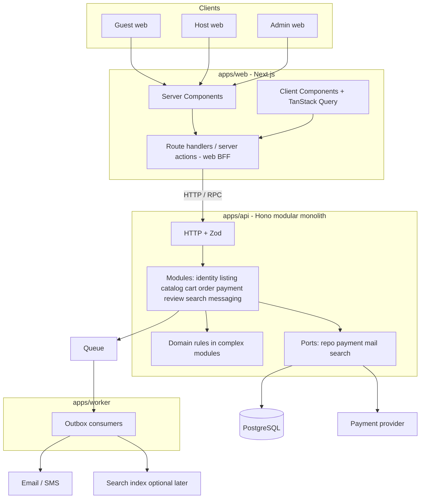

# Marketplace (FA + EN) — React + Hono Monorepo Suggestion

**Goal:** ship an enterprise-grade marketplace while learning, with **fast development**, **clear boundaries**, **polished UX**, and a path that **scales** — without starting as microservices.

**Stance (from this repo):** modular monolith + vertical slices + hexagonal-lite at payment/booking edges + logical CQRS + events for side effects + monorepo packages. See [react-next-hono-recommendations.md](../knowledge/architecture-styles/react-next-hono-recommendations.md) § Marketplace and [project-blueprint.md](../tech-space/project-blueprint.md).

---

## 1. Verdict (what to build)

| Layer | Choice | Why |
|-------|--------|-----|
| Repo | **pnpm + Turborepo monorepo** | Atomic contracts + UI + API changes; matches blueprint |
| Web | **Next.js App Router (React)** | SEO for listings, RSC for read pages, BFF at the edge |
| API | **Hono modular monolith** | Thin HTTP edge; explicit composition root; fast to evolve |
| Worker | **`apps/worker`** | Email, search index, payouts, webhooks follow-up |
| DB | **PostgreSQL** (Drizzle behind ports) | Enterprise default; outbox, JSON, strong constraints |
| Validation | **Zod in `packages/contracts`** | One shape for web + API |
| Client data | **TanStack Query** | Cache/invalidation for guest/host/admin interactivity |
| i18n | **`next-intl` (or equivalent) + `packages/i18n`** | FA + EN, RTL-first layout support |
| Auth | **Session/JWT strategy behind a port** | Keep secrets server-side; never trust client |
| Payments | **Provider adapter behind a port** | Idempotent webhooks; domain owns money invariants |

**Do not start with:** microservices, Event Sourcing for everything, a god `packages/common`, or browser → Stripe/multi-service calls.

---

## 2. System shape



**Learning benefit:** one deployable API teaches module boundaries; Next BFF teaches client-specific shaping without duplicating domain rules ([bff.md](../knowledge/architecture-styles/bff.md)).

---

## 3. Monorepo layout (marketplace-shaped)

Extend the blueprint; optimize for **consistency** and **speed**, not package count for its own sake.

```text
.
├── apps/
│   ├── web/                      # Next.js — locale-aware App Router (fa | en)
│   ├── api/                      # Hono — composition root + module mount
│   └── worker/                   # Queue consumers (notifications, index, payouts)
├── packages/
│   ├── ui/                       # Design system: primitives, tokens, RTL-aware layout
│   ├── i18n/                     # Message catalogs, locale types, format helpers
│   ├── contracts/                # Zod DTOs + shared error codes (API ↔ web)
│   ├── domain/                   # Pure rules (booking/order/payment invariants)
│   ├── application/              # Use cases + ports (no Hono/React/SQL)
│   ├── db/                       # DB port + Postgres adapter (Drizzle)
│   ├── config/                   # Typed env, feature flags
│   ├── api-client/               # Typed fetch client generated from contracts
│   ├── eslint-config/
│   ├── tsconfig/
│   └── test-kit/                 # Fixtures, MSW handlers, fake ports
├── Docs/
│   └── thinking/                 # This suggestion space
├── pnpm-workspace.yaml
└── turbo.json
```

### Package responsibilities (keep sharp)

| Package | Owns | Must not own |
|---------|------|--------------|
| `packages/ui` | Buttons, forms shells, typography, spacing, RTL direction, a11y | Fetching, prices, permissions, Next routing |
| `packages/i18n` | `fa`/`en` message maps, plural/date/currency helpers | Business invariants |
| `packages/contracts` | Request/response Zod, shared `ErrorCode` | SQL, React components |
| `packages/domain` | Money, availability, order state machine | Hono, React, Drizzle |
| `packages/application` | Use cases + ports | HTTP status mapping, JSX |
| `packages/db` | Persistence adapters | HTTP routes, UI |
| `packages/api-client` | Typed HTTP for web/mobile later | Domain rules |
| `apps/web` | Routes, shells (guest/host/admin), BFF | SQL, Stripe secrets |
| `apps/api` | Middleware, route mount, DI wiring | Giant god modules |
| `apps/worker` | Async side effects | Browser concerns |

**Dependency rule (enforce with ESLint boundaries):**  
`apps/* → packages/*` only; packages never import apps; modules talk via `public.ts`; `ui` never imports `domain` business modules.

Aligned with [monorepo.md](../knowledge/architecture-styles/monorepo.md) and [architecture-rules.md](../knowledge/architecture-styles/architecture-rules.md).

---

## 4. What to suggest for React (Next.js)

### 4.1 Architecture style

| Concern | Recommendation |
|---------|----------------|
| App organization | **Modular frontend**: `guest` / `host` / `admin` areas ([modular-frontend.md](../knowledge/architecture-styles/modular-frontend.md)) |
| Inside large areas | **Light FSD** or feature folders — not full FSD day one ([feature-sliced-design.md](../knowledge/architecture-styles/feature-sliced-design.md)) |
| Rendering | RSC for listing/search/SEO pages; Client Components for cart, chat, dashboards |
| Data | RSC + BFF for first paint; TanStack Query for interactive mutations |
| Domain | No booking/payment invariants in React — call API / shared domain only on server |
| Consistency | All interactive UI from `packages/ui` |

### 4.2 Suggested `apps/web` shape

```text
apps/web/
  app/
    [locale]/                    # fa | en — next-intl middleware
      (marketing)/
      (guest)/
        listings/
        checkout/
      (host)/
        dashboard/
        listings/manage/
      (admin)/
        moderation/
        payouts/
      layout.tsx                 # dir={rtl|ltr}, fonts, providers
  src/
    modules/
      guest/
      host/
      admin/
      shared/                    # auth gate, nav shell composition only
    bff/                         # server-only aggregation → Hono
    i18n/                        # next-intl wiring; catalogs from @repo/i18n
```

### 4.3 Multilingual (FA + EN) — treat as a first-class product concern

| Concern | Do this |
|---------|---------|
| Routing | Locale prefix: `/fa/...`, `/en/...` |
| Direction | `dir="rtl"` for `fa`, `ltr` for `en` on `<html>` from locale |
| Design system | `packages/ui` tokens that work in both directions (logical CSS: `margin-inline`, `ps`/`pe`) |
| Copy | Messages in `packages/i18n` — never hardcode user-facing strings in components |
| Dates / money | Locale-aware formatters in `packages/i18n`; **amounts stored as integer minor units + currency code** in DB |
| Content | Listing title/description as **localized fields** (`title.fa`, `title.en`) or a `listing_translations` table |
| SEO | Per-locale metadata, hreflang, canonical |
| Forms / validation | Zod messages mapped through i18n keys; same schema in contracts |
| Fonts | Explicit FA + EN font pairing in the web layout (not system defaults) |

**Polished UX rule:** one composition language for guest storefront; host/admin can be denser tools — still same `packages/ui`.

### 4.4 React “fast development” habits

1. Build **3–5 UI primitives** first (Button, Input, Select, Dialog, Toast) in `packages/ui` with Storybook or a local gallery page.
2. Share form schemas from `@repo/contracts` so FA/EN forms and API never drift.
3. Feature modules expose `public.ts` only — screens compose modules, not deep paths.
4. Prefer server actions / BFF routes that call Hono; keep secrets and aggregation off the client.
5. Learn rendering boundaries from [modern-lifecycle.md](../knowledge/react-rendering/modern-lifecycle.md) — Server vs Client is an architecture decision, not a style preference.

### 4.5 React anti-patterns for this marketplace

- Putting availability / fee calculation only in Client Components
- Duplicate fetch + validation per screen
- Mixing guest/host/admin into one undifferentiated `components/` dump
- English-only UI with a late “we’ll add FA later” (RTL will force rewrites)
- Cards-everywhere dashboard aesthetic on the public storefront (hurts polish)

---

## 5. What to suggest for Hono (backend)

### 5.1 Architecture style

| Concern | Recommendation |
|---------|----------------|
| Deployable | **One modular monolith** first |
| Module layout | By **business capability** |
| Inside modules | **Vertical slices** (create-order, cancel-order, get-availability) |
| Hard edges | **Hexagonal-lite** ports for DB, payment, mail, search |
| Complex domains | **DDD-lite** for order/payment/availability; simpler CRUD for reviews/content |
| Reads vs writes | **Logical CQRS** — availability/search queries separate from order commands |
| Side effects | **Transactional outbox → worker** (email, index, webhooks follow-up) |
| HTTP | Thin routes: validate → use case → map errors |

Matches marketplace row in [react-next-hono-recommendations.md](../knowledge/architecture-styles/react-next-hono-recommendations.md) and [backend-architecture.md](../tech-space/backend-architecture.md).

### 5.2 Suggested modules (bounded capabilities)

```text
apps/api/src/
  create-app.ts                   # composition root
  middleware/                     # requestId, logger, cors, security, locale?
  modules/
    identity/                     # users, sessions, roles (buyer/seller/admin)
    catalog/                      # categories, attributes
    listing/                      # publish, draft, media, translations
    search/                       # read model / query API (extract later if needed)
    cart/
    order/                        # place, cancel, state machine
      commands/
      queries/
      domain/
      infrastructure/
    payment/                      # intents, webhooks, payouts port
    review/
    messaging/                    # optional later
    notification/                 # enqueue only; worker sends
  public mounts → /v1/...
```

Each module: `public.ts`, own tables, no casual cross-module joins ([architecture-rules.md](../knowledge/architecture-styles/architecture-rules.md)).

### 5.3 Hono request pipeline (enterprise baseline)

```text
requestId → pino logger → security headers → cors → auth (optional)
  → route: Zod parse (packages/contracts)
  → use case (packages/application or module slice)
  → domain invariants
  → ports (db / payment / outbox)
  → HTTP problem+json mapper (stable `code`, safe message, localized message key optional)
```

**i18n on API errors:** return stable `code` + optional `messageKey`; let Next/i18n render FA/EN text. Do not return only English free-text as the contract.

### 5.4 Money, booking, and scale rules (Hono side)

| Rule | Why |
|------|-----|
| Integer money + currency in domain | Avoid float bugs across FA/EN displays |
| Availability query model ≠ order aggregate | Logical CQRS; prevents calendar contention design mistakes |
| Webhook signature verify + idempotency keys | Enterprise payment hygiene |
| Outbox in same DB transaction as state change | Reliable notifications/index without dual-write lies |
| Module `public.ts` for cross-talk | Keeps monolith modular so you *can* extract later |
| Accept `Accept-Language` or explicit locale only for message keys | Domain decisions stay language-agnostic |

### 5.5 Hono “fast development” habits

1. One `createApp(deps)` — test with fakes, no IoC container until forced.
2. Generate or share OpenAPI later; **Zod contracts first** for speed.
3. Slice template: `schema.ts` + `handler.ts` + `use-case.ts` + `repo.port.ts` + `repo.drizzle.ts`.
4. Add worker only when the second side effect appears (email + something else) — still design outbox early for orders/payments.
5. Postgres from day one for marketplace; skip multi-DB teaching adapters until the product is real (blueprint multi-DB is for learning elsewhere).

### 5.6 When to extract from the monolith

| Signal | Extract |
|--------|---------|
| Search latency / indexing load | `search` service or dedicated indexer |
| Payout compliance / PCI-ish isolation | `payment` worker/service |
| Team release contention on admin vs storefront | Separate Next apps or SCS later |
| Mobile needs different payloads | Mobile BFF (`apps/mobile-bff`) — domain stays in core API |

---

## 6. Cross-cutting enterprise checklist

| Area | Baseline |
|------|----------|
| AuthZ | Role + resource checks in use cases (seller owns listing, admin moderates) |
| Observability | `requestId` end-to-end (web BFF → Hono → worker) |
| Audit | Append-only for payment/order transitions (table or events) — not full Event Sourcing unless disputes demand replay |
| Rate limits | At edge (Next/gateway) + sensitive Hono routes |
| File/media | Object storage adapter; never store blobs in Postgres |
| Feature flags | `packages/config` — gradual rollout of checkout/payment |
| Testing | Domain unit + Hono `app.request` + contract tests + Playwright critical paths (checkout, publish listing) |
| CI | Turborepo affected `lint` / `test` / `build` |
| Security | Secrets only in api/worker/server Next; CSP; webhook allowlists |

---

## 7. Learning path (build while learning)

Order that teaches architecture **and** ships marketplace value:

| Phase | Ship | Learn |
|-------|------|-------|
| **0** | Monorepo skeleton + `ui` tokens + `i18n` fa/en hello | pnpm/turbo boundaries |
| **0b** | Hono structure + Postgres (`infra/`) + Drizzle + listing API | Follow [Docs/clouds/market-place-server](../clouds/market-place-server/README.md) |
| **1** | Listing CRUD + localized fields + public listing page | Next RSC + Hono vertical slice + contracts |
| **2** | Identity (buyer/seller) + host dashboard shell | Auth port, modular frontend |
| **3** | Cart + order place/cancel + outbox email | Domain state machine, worker |
| **4** | Payment port + webhook idempotency | Hexagonal adapter, money rules |
| **5** | Search read model + filters | Logical CQRS |
| **6** | Admin moderation + reviews | Module public APIs |
| **7** | Polish RTL/LTR, a11y, performance, observability | Enterprise quality |

Stay aligned with walkthrough ideas in [Docs/walkthrough](../walkthrough/README.md), but keep marketplace modules instead of todos once the skeleton exists.

---

## 8. Opinionated defaults (lock these to move fast)

1. **One** Next app with route groups — not three frontends until teams need them.
2. **One** Hono API — modules, not services.
3. **`packages/ui` + `packages/i18n` before features** — consistency compounds.
4. **FA + EN from day one** — RTL in the design system, not a retrofit.
5. **Zod contracts** as the shared language of the monorepo.
6. **Postgres + outbox** for anything money-adjacent.
7. **DDD only** in order/payment/availability; keep catalog/reviews thinner.
8. **No microservices** until a measured signal (section 5.6).

---

## 9. Traceability to this repo’s docs

| Decision | Source |
|----------|--------|
| Marketplace module cut + CQRS/events | [react-next-hono-recommendations.md](../knowledge/architecture-styles/react-next-hono-recommendations.md) |
| Monorepo apps/packages | [monorepo.md](../knowledge/architecture-styles/monorepo.md), [project-blueprint.md](../tech-space/project-blueprint.md) |
| Next as BFF | [bff.md](../knowledge/architecture-styles/bff.md), [frontend-architecture.md](../tech-space/frontend-architecture.md) |
| Hono pipeline | [backend-architecture.md](../tech-space/backend-architecture.md) |
| Enforceable import rules | [architecture-rules.md](../knowledge/architecture-styles/architecture-rules.md) |
| Guest/host/admin UI modules | [modular-frontend.md](../knowledge/architecture-styles/modular-frontend.md) |
| Combinations | [architecture-combination-guide.md](../knowledge/architecture-styles/architecture-combination-guide.md) |

---

## 10. One-sentence summary

**Build a pnpm/Turborepo modular monolith: Next.js (FA/EN + RTL, guest/host/admin) as the polished web edge and BFF, Hono as capability modules with Zod contracts and hexagonal ports for DB/payments, plus a worker for async side effects — share `ui`, `i18n`, and `contracts` so speed and enterprise structure reinforce each other instead of fighting.**
